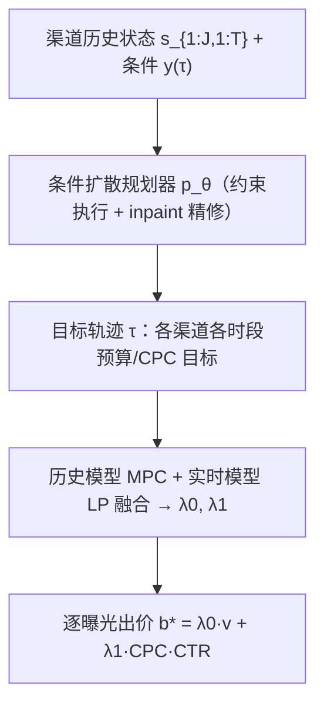
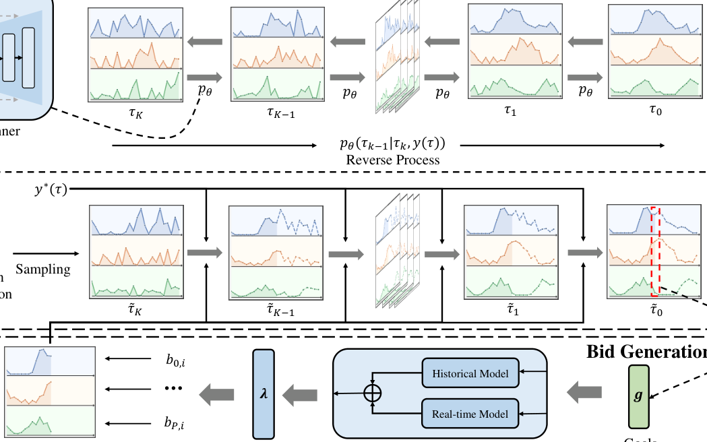

# AHBid: An Adaptable Hierarchical Bidding Framework for Cross-Channel Advertising (面向跨渠道广告的自适应分层出价框架)

- **会议/期刊**: WWW 2026
- **作者与机构**: Xinxin Yang, Yangyang Tang, Yikun Zhou, Yaolei Liu, Yun Li, Bo Yang（OPPO，深圳）
- **推荐链路定位**: 粗排（出价/预算分配层，位于精排与计费之间）
- **研究方向**: 强化学习与动态探索推荐 / 生成式推荐
- **论文原文**: [https://arxiv.org/abs/2602.22650v1](https://arxiv.org/abs/2602.22650v1)
- **开源代码**: [https://github.com/alimama-tech/AuctionNet](https://github.com/alimama-tech/AuctionNet)（AuctionNet 数据集仓库）

## TL;DR (1分钟核心速览)

跨渠道自动出价需在预算与 CPC 约束下把预算分配到 Search/Feeds/Video 等行为模式迥异的渠道，优化法难以适应动态市场，RL 法受 MDP 状态独立性假设所限、丢失历史时序依赖。AHBid 提出分层框架：高层用条件扩散模型生成"渠道×时段"目标轨迹（含约束执行与历史 inpaint 精修），低层用 MPC 历史模型 + 实时 LP 模型融合调节对偶参数出价。在 AuctionNet 与工业 GenB-4c 上 Full-Episode 仿真中 R 分别提升 0.99%/8.42%，线上两周 A/B 收益 +13.57%。

## Background & Motivation (背景与核心矛盾)

- **主流范式**: 跨渠道出价分两派——优化法（预测期望收益 + 数学规划分配预算）与 RL 法（MDP 联合优化分配与出价，如 HiBid）。
- **前人局限**: ① 优化法的分配与出价策略彼此孤立，环境波动即失效；② RL 法依赖 MDP 状态独立性假设，无法刻画历史交互序列中的时序依赖与周期性观测模式，在高波动广告环境中次优。
- **核心洞察 (Key Insight)**: 图 2 显示 Feeds 与 Search 的收益/CPC 均呈强周期性（午间与晚间高峰、凌晨高波动），且 Feeds 性价比更高——说明"何时给哪个渠道多少预算"本身是可学习的时序分布，而非逐次曝光决策。
- **本文切入点**: 把出价问题重构为分层形式：高层以扩散模型对"目标轨迹"整体分布建模（天然捕捉时序依赖），低层只需在阶段目标下调节少量对偶参数。

## Method (核心方法设计)

### 1. 整体框架 (Overall Architecture)

将每个渠道的投放 episode 切为 $M$个时段，规划器输出$J\times M$的目标矩阵$\boldsymbol{\tau}$（每格含预算消耗与目标 CPC），出价器据此调整对偶参数$\lambda_0,\lambda_1$ 并对每次曝光出价。训练时对轨迹加噪并学习去噪重建；推理时每阶段开始重新生成轨迹，并用已发生阶段真实状态做 inpaint 精修，再交由历史模型与实时模型融合出价。

<figure class="paper-figure" markdown="span">
  <figcaption>图3：AHBid的整体流程。训练时，规划器逐步向目标轨迹添加噪声并学习基于去噪的重建。推理时，它利用先前阶段的历史数据对采样轨迹进行迭代去噪和细化。优化后的轨迹随后指导自动出价器调整参数并确定实时最优出价。</figcaption>
</figure>

### 2. 关键设计拆解 (Key Designs)

1. **条件扩散目标规划器（把分配变成轨迹分布建模）**：痛点在于 RL 的逐步决策无法利用整条历史轨迹。作者以 MLE 目标 $\max_\theta \mathbb{E}_{\tau\sim D}[\log p_\theta(\tau|y(\tau))]$学习轨迹分布，条件$y(\tau)$含预算、约束与归一化收益$\bar{R}=(R_\tau-R_{min})/(R_{max}-R_{min})$；生成时置$\bar{R}=1$即"取最优收益条件采样"。用 classifier-free guidance 线性组合条件/无条件噪声估计$\hat{\epsilon}_k=\epsilon_\theta(\tau_k,\varnothing)+\omega(\epsilon_\theta(\tau_k,y)-\epsilon_\theta(\tau_k,\varnothing))$，使生成轨迹朝高收益方向偏移——本质是把"分配策略搜索"转为"条件生成"。

2. **约束执行 + 历史 inpaint 精修（保证可行与实时自适应）**：扩散中间步天然带噪、直接算违约无意义，故定义违约强度 $V(\tau_k,y)=\kappa_b V_B+\kappa_c V_C$，并以同噪声水平下真实轨迹的期望违约$V_{GT}$做归一化：$\mathcal{L}_{final}=\mathcal{L}_{diff}+\xi\cdot \mathcal{L}_{vio}/V_{GT}$，使高噪声步的违约惩罚自动衰减。推理时每$T$阶段后用真实状态$s_{1:J,1:T}$替换轨迹前$T$列、仅对$m>T$ 的未来目标去噪（式 14），实现"以史为锚"的滚动重规划。

3. **历史-实时双模型出价与训练开销**：由原始-对偶理论把逐曝光出价压缩为 $b^*=\lambda_0 v+\lambda_1\cdot CPC\cdot CTR$，只需调两个对偶参数。历史模型用线性近似$[\Delta\lambda_0,\Delta\lambda_1]^\top=[\boldsymbol{x}]^{-1}[\Delta Cost,\Delta CPC]^\top$（逆矩阵仅 2 参数$\phi,\varphi$，直接搜索拟合）；实时模型在滑窗$[t-T_0,t]$上做周期 LP。融合$\Lambda(t)=\sigma(t)\Lambda_h+(1-\sigma(t))\Lambda_r$，$\sigma(t)=1-\min(\rho t,p)$前期偏历史模型抗冷启、后期偏实时模型。总损失即式 (18)；规划器单 episode 复杂度$O(MKH)$，GPU 加速下生成耗时 0.04s。

## Experimental Setup & Evaluation Protocol (实验设置与评估协议)

- **数据集与预处理**:

| 数据集 | #Trajectories | #Impressions/条 | 渠道数 | 场景说明 |
| :--- | :---: | :---: | :---: | :--- |
| AuctionNet | 40,000 | 500,000 | 单渠道（淘宝） | 公开基准 |
| GenB-4c | 930,000 | 970,000+ | 4（Pop-Up/Feeds/Video/Search） | 2025.3.3–3.30 工业日志 |

- **数据划分与防穿越**: 离线采用**虚拟广告系统 (VAS) 仿真**——广告系统模拟器（召回/出价/排序/计费）+ 用户反馈预测器；episode 按日循环离散为 48 个 30 分钟阶段，每阶段曝光量 3,000–25,000 动态变化，属"仿真回放式"评估而非随机切分。
- **排名评测协议**: 非排序类指标，采用**全 episode 约束满足评估**：$R$（平均转化数）、$CSR$（CPC 约束满足率，超支 10% 内视为满足）、$BCR$（预算消耗率，预算耗尽即停投故恒 <1）。每模型随机初始化 30 次，取 top-5 均值。
- **对比基线与超参**: 基线含 PID、USCB、MCQ(CQL)、ABPlanner、DiffBid、HiBid；规划器用 U-Net，$M=48$，$K=30$，guidance$\omega=0.2$，条件丢弃率$p_u=0.25$，Adam，bs=256，lr=$1e^{-4}$，1000 epochs。

## Key Experimental Results (实验关键数据)

### 1. 主实验对比 (Main Results)

| 数据集 | 指标 | PID | USCB | MCQ | ABPlanner | DiffBid | HiBid | **AHBid** | Improv. |
| :--- | :---: | :---: | :---: | :---: | :---: | :---: | :---: | :---: | :---: |
| AuctionNet | $R$ | 206.37 | 250.30 | 245.68 | 275.33 | 278.16 | 250.59 | **280.94** | +0.99% |
| | $CSR$ | 0.904 | 0.813 | 0.835 | 0.816 | 0.882 | 0.842 | **0.917** | +1.04% |
| | $BCR$ | 0.764 | 0.837 | 0.818 | 0.879 | 0.927 | 0.863 | **0.936** | +0.97% |
| GenB-4c | $R$ | 210.43 | 236.68 | 242.18 | 248.45 | 251.76 | 275.40 | **298.59** | +8.42% |
| | $CSR$ | 0.890 | 0.798 | 0.819 | 0.799 | 0.826 | 0.856 | **0.907** | +1.91% |
| | $BCR$ | 0.787 | 0.802 | 0.813 | 0.852 | 0.852 | 0.869 | **0.936** | +7.71% |

**线上 A/B（2025.8.1–8.14，2360 个 campaign，同预算 3,342,847）**：AHBid vs HiBid，$R$417,268 → 473,892（**+13.57%**），$CSR$0.836 → 0.904（+4.13%），$BCR$ 0.897 → 0.935（+5.06%）。

### 2. 消融实验 (Ablation Study)

原文未设标准逐组件消融表，以超参敏感性与状态对比替代：

| 配置 | $R$|$CSR$|$BCR$ | 说明 |
| :--- | :---: | :---: | :---: | :--- |
| $\xi$ 过小（0.05） | 较高 | 偏低 | 偏低 | 约束执行弱，违约多 |
| $\xi$ 过大（0.45） | 下降 | 最高 | 下降 | 过度保守，牺牲收益 |
| $K=10$ | 偏低 | 偏低 | 偏低 | 去噪不足 |
| $K=30$ | 最优 | 最优 | 最优 | 选定配置 |
| $K>30$ | 边际递减 | — | — | 收益饱和 |

### 3. 关键实验发现 (Key Findings)

1. **跨渠道才是主战场**：AuctionNet（单渠道）上 AHBid 仅领先 DiffBid 0.99%，而 GenB-4c（四渠道）上领先 HiBid 8.42%、领先 DiffBid 18.6%——说明分层规划的价值主要来自渠道间预算再分配，而非单渠道出价微调。
2. **生成式优于 RL 的误差传播**：DiffBid/AHBid 全面压过 USCB/MCQ，作者归因于对整条轨迹-收益联合分布建模避免了 RL 的逐步误差累积；但 DiffBid 在 AuctionNet 胜 HiBid、在 GenB-4c 反被超越，印证"缺自适应分配"在跨渠道下会崩。
3. **预算节奏更平滑且利用率更高**：图 5/6 显示 AHBid 单 episode 内预算消耗曲线更贴近理想节奏，四渠道消耗分布更均衡，$BCR$ 达 0.936（HiBid 0.869），即同等预算下多花出 6.7 个百分点且不破约束。

## Highlights & Limitations (亮点、对比与审稿批判)

- **与代表作对比 (vs. Prior Work)**: 相比 **HiBid**（分层 RL，MDP 逐步决策、无时序全局建模），AHBid 用扩散模型一次性生成整条目标轨迹；相比 **DiffBid**（扩散生成状态轨迹 + 逆动力学出价，纯离线、无跨渠道分配），AHBid 增加渠道维规划、约束执行与历史-实时双模型闭环；相比 **USCB/PID**（单渠道对偶出价），其增量在于把对偶参数的目标由规划器动态给定。
- **可迁移亮点**: ① "以真实已发生状态 inpaint 未来段"的滚动重规划范式，可直接迁移到任何长程预算/配额分配任务；② 用 $V_{GT}$ 归一化违约损失，解决扩散中间步约束不可评估的通用技巧。
- **审稿级局限批判**: ① 离线评估完全依赖自建 VAS 仿真器与用户反馈预测器，仿真偏差可能放大生成式方法的优势，缺乏公开可复现的跨渠道基准；② 历史模型被强假设为线性耦合（式 19–21），在强非线性竞价环境中可能失配；③ 消融以超参曲线替代组件级拆解，约束执行与 inpaint 各自的边际贡献未被定量隔离。

## Rating (四维评分)

- **方法创新性 (Novelty)**: ⭐⭐⭐⭐ （核心机制与方法设计具备明确创新性，理论与实验动机支撑充分）
- **评估协议与实验扎实度 (Protocol & Experiments)**: ⭐⭐⭐⭐ （主流公开数据集评测完整，包含多基线对比与消融实验验证）
- **写作与数学规范度 (Clarity & Rigor)**: ⭐⭐⭐⭐ （问题形式化定义清晰，核心模块数学推导与架构阐述严谨易读）
- **工业落地与复现价值 (Industrial & Practical Value)**: ⭐⭐⭐⭐⭐ （兼顾推荐效果增益与训练/推理效率，具备实际场景迁移参考价值）
