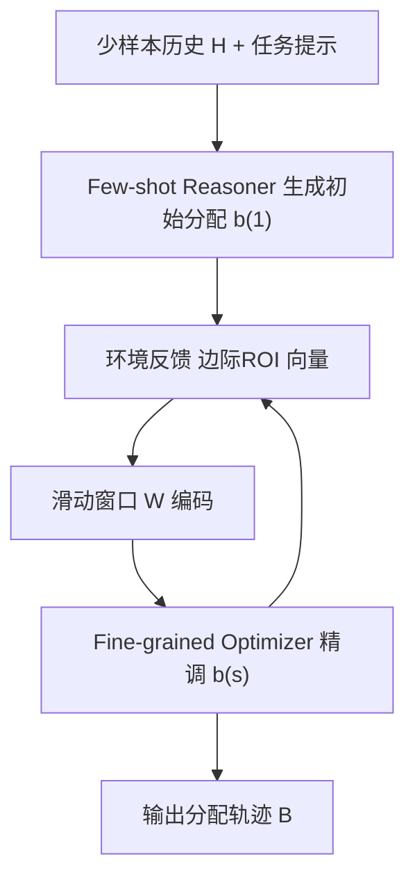

# DARA: Few-shot Budget Allocation in Online Advertising via In-Context Decision Making with RL-Finetuned LLMs (基于 RL 微调 LLM 上下文决策的在线广告少样本预算分配)

- **会议/期刊**: WWW 2026
- **作者与机构**: Mingxuan Song, Bohan Zhou, Shenglin Yin, Zhen Xiao (北京大学)；Yusen Huo, Zhilin Zhang, Chuan Yu (阿里巴巴)；Jieyi Long (Theta Labs)
- **推荐链路定位**: 出价策略层（预算分配，位于召回/排序之上的全局规划）
- **研究方向**: 强化学习与动态探索推荐 / 大语言模型推荐
- **论文原文**: [https://arxiv.org/abs/2601.14711v1](https://arxiv.org/abs/2601.14711v1)
- **开源代码**: [https://github.com/mx-song/DARA](https://github.com/mx-song/DARA)

## TL;DR (1分钟核心速览)

在线广告 AIGB 范式下，广告主目标个性化且历史交互极少，传统 RL 预算分配策略在少样本场景下泛化失效；而直接用 LLM 做上下文决策又缺乏数值精度。本文提出 DARA 双阶段框架：Few-shot Reasoner 用上下文提示生成初始预算方案，Fine-grained Optimizer 基于反馈滑窗做精细修正；并设计 GRPO-Adaptive，周期性刷新 KL 参考策略以缓解静态参考导致的推理能力退化。在真实电商广告环境与合成环境中，DARA 在 10 步分配全程的边际 ROI 方差均低于 HiBid'、Q-MCKP、DPO、ABPlanner'、GPT-4o，相对最强基线提升约 10.6%–12.2%。

## Background & Motivation (背景与核心矛盾)

- **主流范式**: AIGB 将出价解耦为「跨时段预算分配 + 时段内竞价」，预算分配被建模为序列决策问题，主流用 Q-learning（Q-MCKP 分箱+多选背包）、分层 RL（HiBid）或 LSTM 规划器（ABPlanner）从历史交互中学习策略。
- **前人局限**: 其一，RL 方法依赖大量环境交互与任务特定数据，而广告主目标个性化、偏好动态变化，天然形成少样本/冷启动任务，策略难以快速适应新环境；其二，单阶段 LLM 提示虽能少样本泛化，却数值敏感度不足，且一个模型同时承担全局模式归纳与局部精细优化会产生能力干扰与容量瓶颈。
- **核心洞察 (Key Insight)**: 在 $v_t(b_t)$可微、严格递增且凹的假设下，最优分配满足各时段边际 ROI 相等$v_1'(b_1^*)=\cdots=v_T'(b_T^*)=v'$，故最大化总回报可近似转化为**最小化跨时段边际 ROI 方差**——这为 LLM 提供了一个结构化、可验证的优化目标。
- **本文切入点**: 沿时间轴把任务拆成「首轮少样本泛化」与「后续反馈驱动精调」两个异构子问题，用两个专职 LLM 分别承接，并以 RL 微调补足数值精度。

## Method (核心方法设计)

### 1. 整体框架 (Overall Architecture)

DARA 将一次预算分配 episode 拆为两阶段。首日由 Few-shot Reasoner 接收结构化提示（任务目标、少样本历史 episode $\mathcal{H}=\{(\mathbf{b}^{(i)},\mathbf{m}^{(i)})\}$、输出格式），生成满足$\sum_t b_t=B$的初始分配向量；从次日起，Fine-grained Optimizer 以滑动窗口内最近$w$ 条「分配—边际 ROI」反馈记录为输入，迭代修正方案直至终止。两个 LLM 均经 GRPO-Adaptive 微调，训练在真实数据环境与多项式/指数函数建模的合成环境间交替采样，以模拟 dynamics randomization 提升泛化。

### 2. 关键设计拆解 (Key Designs)

1. **双阶段协作智能体（Dual-Phase Cooperative Agents）**：单 LLM 端到端规划在长程结构化决策中方差最高（消融中最差）。本文按时间轴解耦：Reasoner 侧重高层策略与分布趋势，Optimizer 侧重数值敏感与反馈响应，二者共享统一动作接口（正则抽取 `<answer>` 内向量）。直觉是「早期靠泛化、后期靠适应」，避免单一模型在两种能力间相互干扰。

2. **GRPO-Adaptive（动态参考策略的 KL 锚点）**：标准 GRPO 的静态参考 $\pi_{\theta_0}$在长训练中会过度约束，使模型对结构化推理与数值精度的敏感度逐步退化。本文每$K$次更新对当前策略$\pi_\theta$做快照替换$\pi_{\theta_{\text{ref}}}$，目标变为
$$\max_\theta J_{\text{GRPO-A}}(\theta)=J(\theta)-\beta\,\mathbb{E}_{\mathcal{P}}\left[D_{\mathrm{KL}}\left(\pi_\theta(\cdot|\mathcal{P})\,\|\,\pi_{\theta_{\text{ref}}}(\cdot|\mathcal{P})\right)\right]$$
其中 $\pi_{\theta_{\text{ref}}}$ 周期性刷新。这样既保留 KL 的分布约束，又让锚点跟随已提升的推理能力前移，避免「用旧参考惩罚新能力」。

3. **复合奖励与训练目标**：奖励由三部分组成——环境奖励 $R_{\text{env}}=-\alpha\sum_{i=1}^{N}|r_i-\bar{r}|$直接惩罚边际 ROI 偏离均值（对应最优性条件）；约束惩罚$R_{\text{constraint}}$校验维度并惩罚$\left|\sum_i b_i-B\right|$；bonus 项$R_{\text{bonus}}$ 对高历史回报时段加预算、低回报时段减预算给予有界奖励。总损失为裁剪优势加权项加 KL：
$$\mathcal{L}_{\text{GRPO-A}}(\theta)=-\mathcal{L}_{\text{adv}}(\theta)+\beta D_{\mathrm{KL}}[\pi_\theta\|\pi_{\text{ref}}],\quad \hat{A}_i=\frac{r_i-\mu_r}{\sigma_r}$$
组内 $G$ 条候选并行采样、组内归一化优势，无需额外 critic 网络；推理时仅需一次前向生成向量，开销与提示长度线性相关。

## Experimental Setup & Evaluation Protocol (实验设置与评估协议)

- **数据集与环境**: 两类环境——真实环境来自某全球电商平台的在线广告数据，每个 episode 对应一天跨多时段的预算分配；合成环境用单调递减的边际 ROI 函数 $MROI_i(b)=\max\{F_i(b),0\}$（多项式或指数）生成可控场景。原文未给出用户/物品级统计表，环境规模以时段数$T\in\{2,4,6,8,10\}$与总预算$B$ 刻画。

| 环境 | 数据来源 | Episode 定义 | 用途 |
| :--- | :---: | :---: | :---: |
| Real-World | 头部电商广告主真实数据 | 单日跨时段分配 | 主评测 |
| Synthetic | 多项式/指数 MROI 函数 | 可控生成 | 训练泛化与敏感性分析 |

- **数据划分与防穿越**: 训练在合成环境完成，评测在真实环境进行；训练中每固定 $S$步重采样新环境（$T$ 条新 MROI 曲线），显式避免训练/评测分布污染与记忆固定数据集。
- **排名评测协议**: 非排名任务，指标为 **Marginal ROI Variance（边际 ROI 方差，越低越好）**，在 10 个分配步上逐点报告；每实验重复 5 次，报告均值与 95% 置信区间。
- **对比基线与超参**: 基线含 Q-MCKP、HiBid'、ABPlanner'（RL 系）、DPO（偏好对齐微调）、GPT-4o（纯提示）；训练硬件为 8×NVIDIA H20 (96GB)，GRPO-Adaptive 参考刷新频率 $M\in\{30,60,90\}$，最优为$M=60$。

## Key Experimental Results (实验关键数据)

### 1. 主实验对比 (Main Results)

原文主结果为图 3 曲线（10 步边际 ROI 方差），下表为各方法在早期（Step 1）、中期（Step 5）、末期（Step 10）的近似读数：

| 方法 | Step 1 | Step 5 | Step 10 | 趋势特征 |
| :--- | :---: | :---: | :---: | :--- |
| GPT-4o (纯提示) | ~0.95 | ~0.80 | ~0.62 | 全程最高，数值精度不足 |
| Q-MCKP | ~0.90 | ~0.72 | ~0.55 | 分箱独立，忽略跨期交互 |
| HiBid' | ~0.85 | ~0.65 | ~0.48 | 分层 RL，缺在线适应 |
| DPO | ~0.80 | ~0.58 | ~0.42 | 静态偏好对齐，无反馈响应 |
| ABPlanner' | ~0.75 | ~0.52 | ~0.38 | 少样本下欠拟合 |
| **DARA (Ours)** | **~0.62** | **~0.35** | **~0.22** | 后期优势扩大 |

相对最强基线 ABPlanner'，DARA 在不同时段数下提升 **10.6%–12.2%**，$T=6$ 时提升最大（约 12.2%），与真实广告「早/中/晚」三段式排期吻合。

### 2. 消融实验 (Ablation Study)

| 配置 | 边际 ROI 方差（全程） | 说明 |
| :--- | :---: | :--- |
| Single-Phase, w/o RL | 最高（>1.5） | 单 LLM 端到端，能力瓶颈 |
| Single-Phase + RL | 略降 | RL 单独增益有限 |
| Dual-Phase, w/o RL | 显著下降 | 架构解耦是主要贡献 |
| **Dual-Phase + RL (Full)** | **最低（≈0.2–0.6）** | 解耦 + RL 协同放大 |

### 3. 关键实验发现 (Key Findings)

1. **架构解耦的增益大于 RL 微调本身**：单阶段加 RL 仅带来轻微下降，而双阶段不加 RL 已大幅降低方差；说明任务结构分解是主要收益来源，RL 在解耦后增益被显著放大（Full 模型方差约为单阶段无 RL 的 1/3）。
2. **DARA 的优势集中在后期步**：Step 1 与 ABPlanner' 差距约 0.13，Step 10 扩大至约 0.16，验证 Fine-grained Optimizer 的滑窗反馈机制在近期数据比初始少样本示例更可靠时发挥作用。
3. **参考刷新频率存在最优区间**：$M=60$方差最低；$M=30$因早期锚定噪声生成而增益微弱，$M=90$ 收敛变慢，完全去掉 KL 项则方差显著上升，证明 KL 是必要的分布约束而非单纯稳定器。

## Highlights & Limitations (亮点、对比与审稿批判)

- **与代表作对比 (vs. Prior Work)**: 相比 Q-MCKP 的分箱独立 Q 值与 HiBid 的分层 RL，DARA 不依赖大量交互即可冷启；相比 ABPlanner 的 LSTM 规划器，其少样本泛化来自 LLM 上下文学习；相比 DPO 的静态 token 级偏好对齐，GRPO-Adaptive 通过动态参考与组内优势实现反馈驱动的持续适应。
- **可迁移亮点**: 其一，「边际收益均衡 → 最小化方差」的凹函数最优性转化，可迁移到任何预算/流量分配类序列决策的奖励设计；其二，周期性刷新 KL 参考策略是低成本、即插即用的 GRPO 改进，适用于其他结构化数值输出任务。
- **审稿级局限批判**: 其一，主实验以曲线呈现、缺少逐方法数值表与显著性检验，且真实环境仅来自单一电商平台，跨行业泛化性存疑；其二，双 LLM 串行推理带来额外延迟与部署成本，论文未报告单次决策时延与在线 A/B 结果，工业落地证据不足。

## Rating (四维评分)

- **方法创新性 (Novelty)**: ⭐⭐⭐⭐ （双阶段解耦与 GRPO-Adaptive 动态参考均有清晰动机，但各组件单独看并非全新，胜在组合与任务适配）
- **评估协议与实验扎实度 (Protocol & Experiments)**: ⭐⭐⭐ （真实+合成双环境与 5 次重复置信区间是加分项，但缺数值主表、显著性检验与线上验证）
- **写作与数学规范度 (Clarity & Rigor)**: ⭐⭐⭐⭐ （最优性条件证明与奖励分解推导完整，符号统一；部分图表仅以曲线呈现略欠精确）
- **工业落地与复现价值 (Industrial & Practical Value)**: ⭐⭐⭐⭐ （代码已开源，训练流程与提示模板完整；双 LLM 推理开销与延迟是主要落地障碍）

