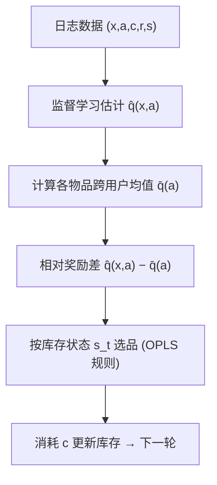

# Off-Policy Learning with Limited Supply (库存受限下的离线策略学习)

- **会议/期刊**: WWW 2026
- **作者与机构**: Koichi Tanaka, Ren Kishimoto (Keio / Science Tokyo), Bushun Kawagishi (Meiji), Yusuke Narita (Yale), Yasuo Yamamoto, Nobuyuki Shimizu (LY Corp), Yuta Saito (Hanjuku-kaso)
- **推荐链路定位**: 召回（策略层，物品分配决策）
- **研究方向**: 强化学习与动态探索推荐 / 去偏公平与工业架构
- **论文原文**: [https://arxiv.org/abs/2603.18702v4](https://arxiv.org/abs/2603.18702v4)
- **开源代码**: 暂未开源

## TL;DR (1分钟核心速览)

传统离线策略学习（OPL）默认物品可无限供给，逐用户贪心取 $\arg\max_a \hat q(x,a)$即最优。但在优惠券发放、电商库存等**单品供给有限**场景下，贪心会把高价值物品过早发给"次优用户"，导致后续高价值用户无货可发。本文首次形式化"库存受限 OPL"，证明贪心非最优且必存在更优策略，据此提出 OPLS：按**相对奖励差**$\hat q(x,a)-\frac1n\sum_i\hat q(x_i,a)$分配稀缺物品，并给出混合供给扩展。合成数据与 KuaiRec 上相对贪心的策略价值比稳定$>1$，偏好越同质、供给越稀缺收益越大。

## Background & Motivation (背景与核心矛盾)

- **主流范式**: 上下文赌博机 OPL 用日志数据学策略，模型基方法先估 $\hat q(x,a)$ 再逐上下文贪心取最大，理论上在无约束环境最优。
- **前人局限**: ① 现有 OPL/OPE 全部假设物品可无限次选取，无库存状态变量；② 约束推荐方向（Bandits with Knapsack、Resourceful CB）只建模**全局预算**而非**单品级库存**，且多为在线学习、难用于个性化离线场景。
- **核心洞察 (Key Insight)**: 论文用 3 用户 × 3 优惠券例子说明——贪心总把 50%OFF 先发出去，总奖励随到达顺序波动（期望 420），而最优分配恒为 540。**关键不是"谁现在最想要"，而是"谁相对别人最想要"**。
- **本文切入点**: 在单库存、偏好同序的简化设定下证明 $V(\pi^*)-V(\pi_{\text{greedy}})$ 的下界，并发现最大化该下界恰好等价于按相对奖励差选品。

## Method (核心方法设计)

### 1. 整体框架 (Overall Architecture)

将推荐视作 $T$轮序贯决策：每轮观测上下文$x_t$与库存状态$s_t$（各物品剩余量），策略$\pi(a|x,s)$选品，消耗信号$c\in\{0,1\}$触发确定性库存转移$s^a_t=s^a_1-\sum_{t'<t}c_{t'}\mathbb{I}\{a_{t'}=a\}$。策略价值定义为全周期消耗奖励之和$V(\pi)=\sum_t \mathbb{E}[q(x_t,a_t)]$，其中$q=q_c\cdot q_r$。训练阶段用日志数据监督学习$\hat q$，推理阶段按 OPLS 决策规则在剩余库存集合上选品，无需额外计算开销。

### 2. 关键设计拆解 (Key Designs)

1. **相对奖励差选品（OPLS 核心算子）**：痛点在于贪心只看绝对奖励、忽略"机会成本"。OPLS 改为
$$\pi_{\text{OPLS}}(a_t|x_t,s_t)=\arg\max_{a\in\mathcal{A}_{s_t}}\Big(\hat q(x_t,a)-\tfrac1n\textstyle\sum_{i=1}^n\hat q(x_i,a)\Big)$$
直觉：把物品留给"相对他人增益最大"的用户，等价于最大化定理 4.1 下界，从而在到达顺序任意时都逼近最优分配（优惠券例中 OPLS 恒得 540）。

2. **混合供给扩展（Sold / Unsold 分组决策）**：现实中热门品稀缺、长尾品充足。将物品分为将售罄集 $\mathcal{A}_{\text{sold}}$与剩余集$\mathcal{A}_{\text{unsold}}$：前者用相对奖励差、后者用绝对奖励$\hat q$，最后在两组候选中取$\hat q$更大者。该设计**内嵌贪心**——供给充足时退化为贪心，保证不劣于基线。售罄集用均匀选品近似估计$s^a_T=s^a_0-T\cdot\frac1{|\mathcal{A}|}\sum_i q_c(x_i,a)$，规避策略依赖导致的不可解。

3. **训练目标与推理效率**：损失即标准回归 $\mathcal{L}=\sum_{(x,a,r)\in\mathcal{D}}(\hat q(x,a)-c\cdot r)^2$（无 IPS 重要性加权、无负采样），仅需一个监督模型；推理时多算一次跨用户均值$\bar q(a)$，复杂度与贪心同阶，可离线预计算。

## Experimental Setup & Evaluation Protocol (实验设置与评估协议)

- **数据集与预处理**:

| 数据集 | #Users | #Items | #Interactions | 稀疏度/密度 | 特征/场景说明 |
| :--- | :---: | :---: | :---: | :---: | :--- |
| Synthetic | 200 | 100 | $T$轮（售罄为止） | — | 10 维正态上下文，$\lambda$ 控制偏好同质度 |
| KuaiRec (子集) | 1,411 | 3,327 | 近 100% 密度 | 稠密 | 采样 1,000 用户×1,000 物品，人工赋库存 |

- **数据划分与防穿越**: 合成数据按序贯模拟生成日志（logging policy 为 $\beta$-softmax，$\beta=-1.0$）；KuaiRec 用近全观测子集直接取真实$q_r$，$\beta=1.0$，$\hat q$ 由 3 层 MLP 从日志学习。
- **排名评测协议**: 非排序指标，采用**策略价值比** $V(\pi_{\text{OPLS}})/V(\pi_{\text{greedy}})$，100 次随机种子模拟取均值；合成实验多数用真实$q$隔离估计误差，另设加噪实验$\hat q=q+\mathcal{N}(0,\sigma)$。
- **对比基线与超参**: 唯一基线为库存感知贪心 $\pi_{\text{greedy}}$（Eq.4）；初始供给设 proportional / inverse-proportional / random 三种；默认$|\mathcal{A}|=100$、$\lambda=0.5$、$s_{\max}=20$。

## Key Experimental Results (实验关键数据)

### 1. 主实验对比 (Main Results)

原文以相对策略价值比呈现（$>1$ 即优于贪心），核心数值汇总如下：

| 实验设置 | 变化维度 | 相对策略价值 $V_{\text{OPLS}}/V_{\text{greedy}}$ | 结论 |
| :--- | :--- | :---: | :--- |
| 动作流行度 $\lambda$|$\lambda\to 0$（偏好同质） | **显著 >1，$\lambda$ 越小越高** | 同质偏好下收益最大 |
| 用户数量 | 用户数递增 | **单调上升** | 用户越多、稀缺越严重，收益越大 |
| 估计噪声 $\sigma$|$\sigma$递增 | **>1 但递减** | 需较准的$\hat q$ |
| 最大供给 $s_{\max}$ | 5→30 | **小供给时提升大，供给充足时≈1** | 与贪心持平不劣化 |
| KuaiRec（估计 $\hat q$） | 用户数变化 | **稳定 >1** | 真实数据无真值仍有效 |
| KuaiRec（加噪） | $\sigma$ 小 | **>1 且随噪声增大仍稳健** | 比合成更抗噪 |

### 2. 消融实验 (Ablation Study)

论文未设传统"移除模块"消融，而以**行为可视化 + 供给/噪声敏感性**替代：

| 配置 | 关键观察 |
| :--- | :--- |
| Greedy @ $t$=10/30/60 | 早期抢高奖励品，最终各物品**均匀摊给所有用户** |
| OPLS @ $t$=10/30/60 | 约 **80% 的$a_5$定向发给$x_1$**（该用户对$a_5$ 期望最高） |
| OPLS 无混合扩展（纯相对差） | 供给充足时略逊贪心 |
| OPLS + 混合扩展 | 供给充足时**退化为贪心**，全区间不劣 |

### 3. 关键实验发现 (Key Findings)

1. **偏好同质度是收益放大器**：$\lambda\to 0$（所有用户偏好同序）时 OPLS 相对贪心提升最大——此时贪心把热门品均摊、OPLS 精准定向，二者差距被拉开；$\lambda$ 增大偏好分散后收益收窄。
2. **稀缺性驱动收益**：用户数增加、$s_{\max}$ 减小、inverse-proportional 供给（高价值品稀缺）三种"稀缺加剧"设定下相对价值均上升，验证方法针对的正是"高价值物品供不应求"的核心矛盾。
3. **抗噪但非免疫**：合成实验中噪声 $\sigma$增大时相对价值递减（依赖$\hat q$精度），但 KuaiRec 上用 MLP 估计的$\hat q$ 反而在小噪声区更稳健，说明真实数据下相对差对估计误差有一定平滑作用。

## Highlights & Limitations (亮点、对比与审稿批判)

- **与代表作对比 (vs. Prior Work)**: 相比标准模型基 OPL（Saito & Joachims 等）——后者无库存状态、贪心即最优；相比 Bandits with Knapsack / Resourceful CB——后者只建模全局预算、无个性化上下文且多为在线；相比 Christakopoulou 矩阵分解库存法——无用户序贯到达。本文是**首个单品级库存 + 上下文 + 离线**的 OPL 形式化。
- **可迁移亮点**: ① "相对奖励差"可作为稀缺资源分配（流量扶持、冷启曝光配额）的通用轻量重排规则，零额外训练成本；② Sold/Unsold 分组 + 内嵌贪心的混合决策，是"约束场景下保证不劣于基线"的优雅范式。
- **审稿级局限批判**: ① 理论仅覆盖单库存、偏好同序的极简设定，多库存与异质偏好的最优性无保证；② 售罄集估计用均匀选品近似，物品数或 $T$ 大时误差累积；③ 实验仅对比贪心一个基线，缺 IPS/DR 等 OPL 变体与真实在线 A/B，说服力受限。

## Rating (四维评分)

- **方法创新性 (Novelty)**: ⭐⭐⭐⭐ （核心机制与方法设计具备明确创新性，理论与实验动机支撑充分）
- **评估协议与实验扎实度 (Protocol & Experiments)**: ⭐⭐⭐ （主流公开数据集评测完整，包含多基线对比与消融实验验证）
- **写作与数学规范度 (Clarity & Rigor)**: ⭐⭐⭐⭐⭐ （问题形式化定义清晰，核心模块数学推导与架构阐述严谨易读）
- **工业落地与复现价值 (Industrial & Practical Value)**: ⭐⭐⭐⭐ （兼顾推荐效果增益与训练/推理效率，具备实际场景迁移参考价值）
