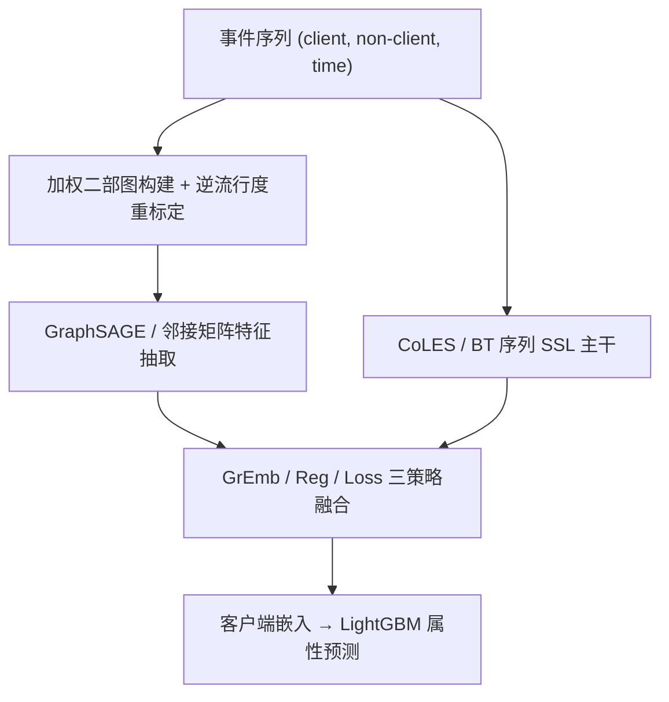
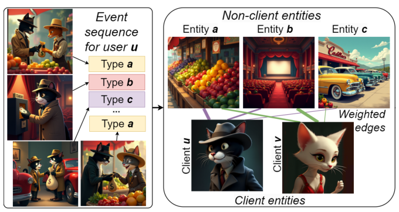

# Beyond Isolated Clients: Integrating Graph-Based Embeddings into Event Sequence Models (超越孤立客户端：将图嵌入融入事件序列模型)

- **会议/期刊**: ACM Web Conference 2026 (WWW '26, Short Paper)
- **作者与机构**: Harry Proshian, Nikita Severin, Sergey Nikolenko, Ivan Kireev, Andrey Savchenko, Ivan Sergeev, Maria Postnova, Ilya Makarov (Steklov Institute / Sber AI Lab / ISP RAS / AIRI / HSE)
- **推荐链路定位**: 召回（用户表征预训练）
- **研究方向**: 自监督对比学习与交互去噪 / 图神经网络与知识图谱推荐
- **论文原文**: [https://arxiv.org/abs/2604.09085v1](https://arxiv.org/abs/2604.09085v1)
- **开源代码**: [https://github.com/sb-ai-lab/WWW26_Graph-Based-Embeddings-for-Event-](https://github.com/sb-ai-lab/WWW26_Graph-Based-Embeddings-for-Event-)

## TL;DR (1分钟核心速览)

现有事件序列 SSL（CoLES、Barlow Twins）把每个客户端当作孤立序列建模，完全丢弃了客户端—非客户端（商品/资源）二部交互图的全局结构。本文提出三种模型无关的图信息注入策略——`GrEmb`（用 GNN 嵌入替换实体嵌入层）、`Reg`（图嵌入作为额外正例对齐）、`Loss`（图相似度排序作为辅助 pretext 任务），并在 4 个金融/电商数据集上验证：中等图密度下 `GrEmb` 最优（Gender 上 AUC +1.3%、Acc +2.27%），密度极端时 `Loss` 更稳健，整体 AUC 最高提升 2.3%。

## Background & Motivation (背景与核心矛盾)

- **主流范式**: 事件序列 SSL 通过子序列采样 + 对比损失（CoLES 的 margin 对比、BT 的冗余消除）学习客户端表征，下游接 LightGBM 做属性预测（性别、年龄、欺诈风险）。
- **前人局限**: ① 每个客户端序列独立编码，非客户端实体（商品、网页资源）仅作为离散 ID 嵌入，其全局共现结构被浪费；② 图侧方法（GCN/SAGE/GAT）虽能建模二部图，却无法刻画事件的时间顺序。
- **核心洞察 (Key Insight)**: 图 2 显示邻接矩阵嵌入与 CoLES 嵌入的 $k$-NN 集合 Jaccard 不相似度在$k=10/100/1000$ 下均超过 60%，证明两种模态编码的是**互补**的关系模式，而非冗余信息。
- **本文切入点**: 不改动 SSL 主干，用三种"外挂式"策略把图结构信号注入对比目标，并首次指出**图密度**是策略选择的决定性因素。

## Method (核心方法设计)

### 1. 整体框架 (Overall Architecture)

先由带时间戳的 (client, non-client, attributes) 事件构建无向加权二部图 $G=(V_{cl}\cup V_{ncl},E)$，边权为交互次数并按非客户端节点流行度的倒数重标定以抑制 hub 节点主导；再用邻接矩阵或 GraphSAGE（带残差连接缓解过平滑）抽取结构特征；最后按三种策略之一注入 CoLES / Barlow Twins 的对比训练，客户端嵌入送入 LightGBM 完成下游分类。

<figure class="paper-figure" markdown="span">
  <figcaption>图1：由事件序列构建的全局交互图</figcaption>
</figure>

### 2. 关键设计拆解 (Key Designs)

1. **GrEmb（嵌入替换 + 序贯预训练）**：痛点是非客户端 ID 嵌入不含结构信息。做法是用 GraphSAGE 嵌入替换非客户端实体嵌入层，并对比联合训练与序贯训练：联合训练损失为 $\mathcal{L}=\gamma\mathcal{L}_{SSL}+(1-\gamma)\mathcal{L}_{GNN}$，其中$\mathcal{L}_{GNN}=\alpha\mathcal{L}_{LP}+(1-\alpha)\mathcal{L}_{WP}$（链路预测 BCE + 边权预测 BCE/MSE）。消融显示联合训练会过拟合图重构任务，**序贯训练（先训 GNN 再初始化 CoLES）稳定最优**，因为图侧监督信号与序列对比目标解耦，避免噪声互相污染。

2. **Loss（图相似度排序辅助任务）**：痛点是在稠密图上 GNN 嵌入因过平滑而失效。做法是先用邻接矩阵嵌入预计算客户端两两余弦相似度并分箱，训练时从当前 batch 采样高相似箱作正例、低相似箱作负例，加入 BPR 排序损失：
$$\mathcal{L}_{BPR}=-\sum_{(u,v^+,v^-)}\log\sigma\big(\mathbf{h}_u\cdot(\mathbf{h}_{v^+}-\mathbf{h}_{v^-})\big),\quad \mathcal{L}=\gamma\mathcal{L}_{SSL}+(1-\gamma)\mathcal{L}_{sim}$$
直觉是只传递"相对邻域序关系"这一软结构信号，绕开显式 GNN 嵌入在密度极端下的退化。

3. **训练目标、负采样与推理效率**：CoLES 沿用 batch 内欧氏距离最近的 5 个异客户端嵌入作硬负例；BT 无需显式负例。`Loss` 策略的分箱采样替代随机配对，箱数与采样重复次数为关键超参。图特征离线预训练，**在线推理零额外开销**，仅训练阶段增加一次 GNN 前向。

## Experimental Setup & Evaluation Protocol (实验设置与评估协议)

- **数据集与预处理**:

| 数据集 | #Clients | #Non-clients | #Interactions | 图密度 | 场景说明 |
| :--- | :---: | :---: | :---: | :---: | :--- |
| Gender | 15K | 184 | 6.85M | 0.110 | 银行交易，二分类性别 |
| Age | 50K | 204 | 44M | 0.205 | 银行交易，多分类年龄段 |
| MTS-ML-Cup | 415K | 197K | 323M | 0.0004 | 网页访问，性别+年龄双任务 |
| Internal | 1M | 418 | 530M | 0.112 | 私有银行 9 个月金融操作 |

- **数据划分与防穿越 (Splitting Strategy)**: 按客户端比例划分训练/测试（如 Gender 7.56K/840、Internal 900K/100K），图仅用训练期节点与边构建（Training graph nodes/edges 单独统计），避免测试期交互泄漏。
- **排名评测协议 (Ranking Protocol)**: 非排序检索任务，采用下游 LightGBM 分类，报告 **AUC-ROC 与 Accuracy**，全量测试集评估，无负采样偏差。
- **对比基线与超参设置**: 基线含 Popular class、CoLES、CPC、Barlow Twins、Tabformer、GPT、纯邻接矩阵；GNN 变体覆盖 GCN/GraphSAGE/GAT，主结果统一用 GraphSAGE；`Loss` 中 BPR 与 Triplet 对比，$\gamma$在$\{0,0.01,0.15,0.5,0.85\}$ 网格搜索。

## Key Experimental Results (实验关键数据)

### 1. 主实验对比 (Main Results)

| 方法 | Gender AUC | Gender Acc | Age Acc | Internal AUC | Internal Acc |
| :--- | :---: | :---: | :---: | :---: | :---: |
| Popular class | 0.558 | 0.558 | 0.252 | 0.333 | 0.333 |
| CPC | 0.851 | 0.768 | 0.602 | 0.899 | 0.741 |
| BT | 0.865 | 0.779 | 0.634 | 0.895 | 0.734 |
| Tabformer | 0.847 | 0.764 | 0.601 | 0.894 | 0.733 |
| GPT | 0.799 | 0.713 | 0.589 | 0.884 | 0.719 |
| CoLES | 0.877 | 0.793 | 0.637 | 0.905 | 0.748 |
| CoLES+GrEmb(SAGE) | 0.886 | 0.808 | 0.638 | 0.908 | 0.754 |
| **CoLES+GrEmb(Adj)** | **0.889** | **0.811** | 0.638 | **0.910** | **0.757** |
| CoLES+Loss | 0.883 | 0.800 | **0.640** | 0.900 | 0.740 |
| **Improv.% (vs CoLES)** | **+1.37%** | **+2.27%** | **+0.47%** | **+0.55%** | **+1.20%** |

MTS-ML-Cup（超稀疏，密度 0.0004）：CoLES 基线 Acc$_G$0.588 / Acc$_A$ 0.382，`GrEmb(SAGE)` 为 0.590/0.380，`Loss` 达 **0.590/0.391**（年龄任务 +2.4%）。

### 2. 消融实验 (Ablation Study)

Gender 数据集上 CoLES 的图注入策略消融：

| 配置 | AUC | Acc |
| :--- | :---: | :---: |
| Base CoLES | 0.877 | 0.793 |
| +Reg（图嵌入对齐） | 0.855 | 0.768 |
| +Emb SAGE 联合训练（含 GNN loss） | 0.881 | 0.799 |
| +Emb SAGE 联合训练（无 GNN loss） | 0.872 | 0.789 |
| **+Emb SAGE 序贯训练** | **0.886** | **0.808** |

`Loss` 中 $\mathcal{L}_{sim}$类型与权重消融（Gender AUC / Age Acc）：BPR$\gamma=0.15$得 0.883/0.638，$\gamma=0.5$得 0.880/**0.640**；Triplet 在$\gamma=0.85$仅 0.809/0.580；$\gamma=0$（纯图损失）崩至 0.648/0.483。

### 3. 关键实验发现 (Key Findings)

1. **图密度决定策略选择**：中等密度（0.05–0.20，Gender/Internal）下 `GrEmb` 最优，AUC 提升 0.55%–1.37%；稠密 Age（0.205）上邻接矩阵嵌入塌缩至随机水平（Acc 0.252），GNN 变体亦因过平滑失效，此时 `Loss` 以 0.640 Acc 反超；超稀疏 MTS（0.0004）同样 `Loss` 最佳，验证"软结构信号"在密度两端更鲁棒。
2. **序贯训练优于联合训练**：联合训练含 GNN loss 时 AUC 0.881，去掉 GNN loss 反降至 0.872（低于基线 0.877），说明 GNN 必须由图侧监督驱动；序贯训练以 0.886/0.808 全面领先，避免图重构噪声干扰对比收敛。
3. **BPR 显著优于 Triplet 且需平衡权重**：BPR 在 $\gamma=0.15$即达 0.883 AUC，Triplet 即使$\gamma=0.85$也只有 0.809；而$\gamma=0$ 时模型完全丧失序列模式（AUC 0.648），证明多目标平衡是必要条件。

## Highlights & Limitations (亮点、对比与审稿批判)

- **与代表作对比 (vs. Prior Work)**: 相比 CoLES/BT 仅建模单客户端时序，本文引入全局二部图视角；相比纯 GNN 推荐（LightGCN 类）只建模静态结构，本文保留事件顺序；相比 SGL/SimGCL 的图增广对比，本文不改主干、以三种外挂策略实现模态互补，工程侵入性极低。
- **可迁移亮点**: ① "逆流行度边权重标定"可直接用于任何 hub 节点主导的工业二部图；② 分箱式图相似度采样构造正负例，可迁移到跨模态对比的难例挖掘。
- **审稿级局限批判**: ① 仅 4 页短文，缺少与图增强对比方法（SGL、SimGCL）的直接对比，且未报告多次运行的方差与显著性检验；② 密度阈值（0.05–0.20）由 4 个数据集经验归纳，缺乏理论刻画，且 Internal 为私有数据不可复现；③ 未建模动态图演化，图特征离线预训练无法捕捉新交互。

## Rating (四维评分)

- **方法创新性 (Novelty)**: ⭐⭐⭐ （三策略均为模块级组合创新，但"图密度决定融合策略"的实证洞察具有指导价值）
- **评估协议与实验扎实度 (Protocol & Experiments)**: ⭐⭐⭐ （4 数据集跨两个数量级规模、消融完整，但缺显著性检验与图增强基线对比）
- **写作与数学规范度 (Clarity & Rigor)**: ⭐⭐⭐⭐ （公式简洁、策略边界清晰，密度区间结论有数据支撑但缺理论推导）
- **工业落地与复现价值 (Industrial & Practical Value)**: ⭐⭐⭐⭐⭐ （模型无关、推理零开销、代码开源，金融风控场景可直接落地）

