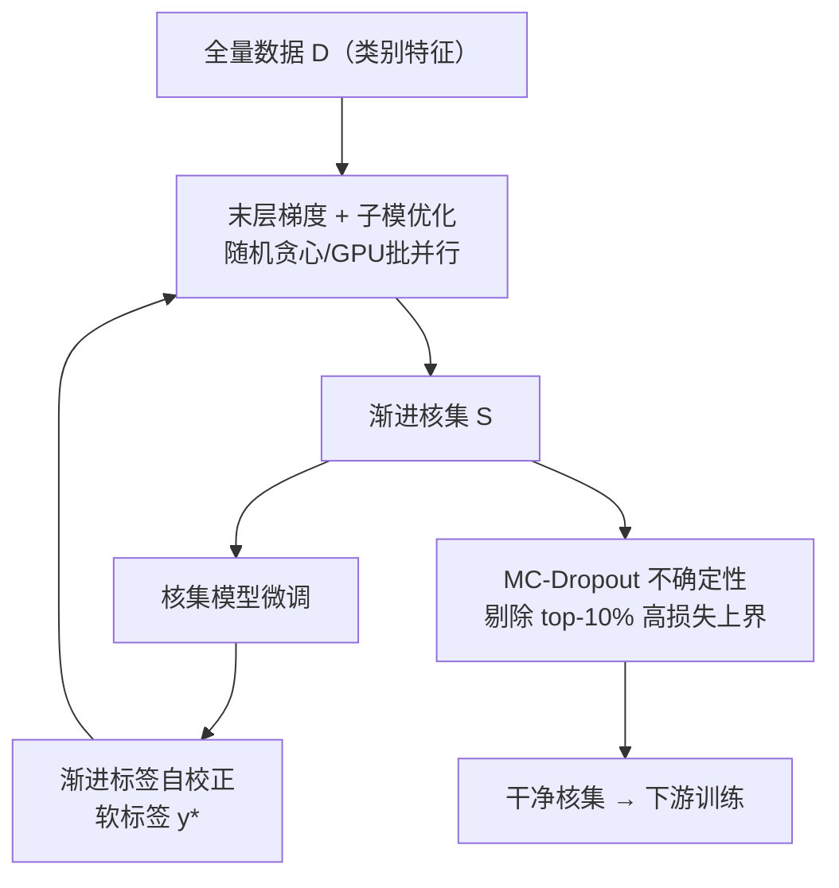
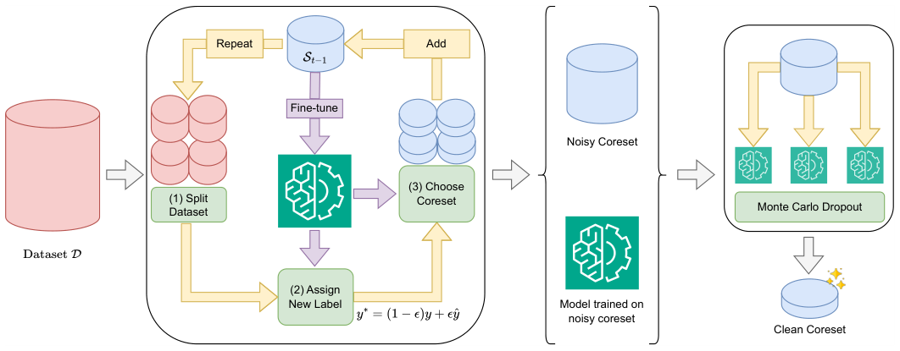

# Efficient Content-based Recommendation Model Training via Noise-aware Coreset Selection (基于噪声感知核集选择的内容推荐高效训练)

- **会议/期刊**: WWW 2026 (WebConf)
- **作者与机构**: Hung Vinh Tran, Tong Chen, Hechuan Wen, Quoc Viet Hung Nguyen, Bin Cui, Hongzhi Yin — 昆士兰大学、格里菲斯大学、北京大学
- **推荐链路定位**: 精排（CTR 预估模型的数据侧训练加速）
- **研究方向**: 自监督对比学习与交互去噪 / CTR 预估与特征交叉
- **论文原文**: [https://arxiv.org/abs/2601.10067v1](https://arxiv.org/abs/2601.10067v1)
- **开源代码**: [https://github.com/chenxing1999/nacs](https://github.com/chenxing1999/nacs)

## TL;DR (1分钟核心速览)

内容推荐（CRS/CTR）模型需反复全量训练，算力开销巨大；而现有核集选择（coreset）方法假设标签无噪，在隐式反馈的假阳性噪声下极易选入错误监督信号，且 CGM 等需稠密特征、违背类别特征稀疏本质。本文提出 NaCS：以**末层梯度子模优化**（随机贪心 + GPU 批并行）渐进构建核集，同步用**渐进标签自校正**软化噪声标签，最后用 **MC-Dropout 不确定性**剔除高方差样本。在 Criteo/Avazu/KDD 上仅用 1% 数据即恢复全量 93–95% AUC，且选择+训练总耗时显著低于全量训练。

## Background & Motivation (背景与核心矛盾)

- **主流范式**: 数据侧加速分两支——数据集蒸馏（CGM 用梯度匹配合成稠密样本）与核集选择（按梯度/特征覆盖挑真实子集）。CRS 以类别特征 + Embedding + 交互头为主干，CTR 为典型任务。
- **前人局限**: ① CGM 为可微梯度匹配被迫把稀疏类别特征稠密化，既失真又抵消了减样本的收益；D2K 只加速推理、训练仍需全量。② 通用核集方法（DeepCore/Submodlib 等）假设标签干净，而点击/购买是行为而非偏好，噪声在极小核集上被放大，直接扭曲训练。
- **核心洞察 (Key Insight)**: 末层梯度足以刻画梯度范数变化（作者附录实证），因此无需全模型反传即可做梯度匹配；同时噪声样本在损失分布上呈明显长尾（图 3），可用损失上置信界识别。
- **本文切入点**: 把"选样本"与"修标签/剔噪声"耦合进同一个渐进训练循环，让核集随模型变强而自我净化。

## Method (核心方法设计)

### 1. 整体框架 (Overall Architecture)

NaCS 分两阶段闭环：**阶段一（选+修）** 从随机初始化模型出发，迭代 $N_{choose}$ 轮，每轮在当前模型下用末层梯度解子模优化、从各 batch 选出 $k/N_{choose}$ 个样本并入核集，同时用当前核集模型对全量数据做渐进标签自校正（软标签），再在更新后的核集上微调；**阶段二（去噪）** 对核集样本开启 dropout 做 $N_{denoise}=10$ 次前向，按损失上界剔除最不确定的 10%，得到最终干净核集用于下游训练。全流程仅需前向 + 末层反传，避免全模型双层优化。

<figure class="paper-figure" markdown="span">
  <figcaption>图1：NaCS 概览。首先，我们在精炼标签的同时逐步构建核心集。接着，我们应用 Monte Carlo Dropout 估计不确定性并移除高不确定性样本，得到最终干净的核心集。</figcaption>
</figure>

### 2. 关键设计拆解 (Key Designs)

1. **Adam 感知的末层梯度子模目标**：痛点是要匹配全量梯度却不想全模型反传。作者把子模目标建立在 Adam 偏差校正后的末层梯度 $\hat g^L_{i,t}=\hat m_{i,t}/(\sqrt{\hat v_{i,t}}+\varepsilon)$ 上，目标为
$$\mathcal{S}^*=\arg\max_{|\mathcal{S}|\le k}\Big(C-\sum_{i\in\mathcal{D}}\min_{j\in\mathcal{S}}\|\hat g^L_{i,t}-\hat g^L_{j,t}\|\Big),$$
即最小化"每个样本到最近核集样本的梯度距离"之和。该函数单调子模，贪心有 $1-1/e$ 保证；再按 batch 分解为式 (10) 的多个子问题并在 GPU 上并行求解随机贪心，把 $O(|\mathcal{D}|\times k)$ 降到近线性。直觉：核集只需在梯度空间"覆盖"全量样本的更新方向。

2. **渐进标签自校正（软标签）**：隐式反馈的 $y\in\{0,1\}$ 本身有噪。用 $y^*=(1-\epsilon)y+\epsilon\hat y$ 把硬标签软化为模型预测与观测的凸组合，其中 $\epsilon=g(t)\times p(\hat y)$，全局信任 $g(t)=\sigma(\beta(t/T-0.5))$ 随训练推进单调上升，局部信任由预测熵 $l(\hat y)=1-H(\hat y)/H(u)$ 调制。直觉：训练早期不信模型、保留原标签；后期模型可靠则更多采信预测，从而在核集增长过程中同步"洗掉"错误监督。损失改为对 $y^*$ 的 BCE $\mathcal{L}_{lc}$。

3. **MC-Dropout 核集去噪与推理开销**：即便修了标签，极小核集仍残留离群点。对每样本做 10 次 dropout 前向，取损失 95% 上置信界 $L_{upper}=m_{loss}+1.96\sqrt{v_{loss}/N_{denoise}}$，剔除 top-10%。上界同时惩罚"高均值"与"高方差"，精准锁定既难学又不稳的样本。训练侧负样本即原始曝光未点击（CTR 天然负例），无需额外负采样；推理阶段与普通 CTR 模型完全一致，零额外在线开销。

## Experimental Setup & Evaluation Protocol (实验设置与评估协议)

- **数据集与预处理**: 三个大规模公开 CTR 数据集，类别特征经分桶/One-Hot 后 Embedding：

| 数据集 | #Users | #Items | #Interactions | 稀疏度/密度 | 特征/场景说明 |
| :--- | :---: | :---: | :---: | :---: | :--- |
| Criteo | 大规模 | 大规模 | 千万~亿级 | 极稀疏 | 数值分桶为类别，展示/点击 |
| Avazu | 大规模 | 大规模 | 千万级 | 极稀疏 | 移动广告点击 |
| KDD | 大规模 | 大规模 | 百万级 | 极稀疏 | KDD Cup 2012 CTR |

- **数据划分与防穿越 (Splitting Strategy)**: 随机 **8:1:1** 划分为 train/valid/test（非时间切分，属随机比例划分）。
- **排名评测协议 (Ranking Protocol)**: CTR 场景采用 **AUC↑ 与 LogLoss↓** 两项指标（非全库 ranking，属二分类判别评估）；AUC 差异 0.1% 即视为显著。
- **对比基线与超参设置**: 基线为 Random、SVP-CF、K-Center、CGM；主干 DeepFM 与 DCNv2；预算 0.5%/1%/5%；早停防过拟合；另在 MIND 文本推荐（Legommenders，1:4 负采样）验证 LLM 兼容性。

## Key Experimental Results (实验关键数据)

### 1. 主实验对比 (Main Results)

1% 预算、DeepFM 主干（AUC↑ / LogLoss↓，加粗为最优）：

| 数据集 | Random | SVP-CF | K-Center | CGM | **NaCS** | Whole | AUC 恢复率 |
| :--- | :---: | :---: | :---: | :---: | :---: | :---: | :---: |
| Criteo | 0.7667 | 0.7673 | 0.7620 | 0.7316 | **0.7706** | 0.8082 | ~95% |
| Avazu | 0.7145 | 0.7117 | 0.6776 | 0.6980 | **0.7383** | 0.7852 | ~93% |
| KDD | 0.7242 | 0.7238 | 0.7108 | 0.7042 | **0.7443** | 0.7976 | ~93% |

DCNv2 上同趋势（Criteo 1%：NaCS 0.7707 vs Random 0.7673；Avazu 1%：0.7365 vs 0.6953；KDD 1%：0.7441 vs 0.7242），且 0.5% 极小预算下优势更大（Avazu 0.5%：0.7071 vs SVP-CF 0.6894）。

### 2. 消融实验 (Ablation Study)

1% 预算、DCNv2 主干（AUC）：

| 配置 | Criteo | Avazu | KDD | 说明 |
| :--- | :---: | :---: | :---: | :--- |
| **NaCS 完整** | **0.7707** | **0.7365** | **0.7441** | 全组件 |
| w/o 子模目标（Random+去噪） | 0.7673 | 0.6953 | 0.7242 | 换随机选样 |
| w/o 子模目标（SetCover+去噪） | 略低 | 略低 | 略低 | 特征覆盖选样 |
| 损失：BCE（硬标签） | 较低 | 较低 | 较低 | 无自校正 |
| 损失：R-CE | 中 | 中 | 中 | 部分去噪 |
| 损失：T-CE | 差 | 差 | 差 | 过度丢正例 |
| 去噪用全量模型 | 更高 | 更高 | 更高 | 上界参考 |

### 3. 关键实验发现 (Key Findings)

1. **子模目标贡献最大且随预算收紧放大**：Avazu 1% 上 NaCS 比 Random+去噪高约 4.1 个 AUC 点（0.7365 vs 0.6953），而 5% 时差距收窄，说明小预算下"梯度覆盖式选样"才是关键，随机选样在极小核集上迅速失效。
2. **标签软化优于硬 BCE 与 T-CE**：渐进自校正的软标签在三数据集全面领先；T-CE 因过度丢弃正例反而最差，印证隐式反馈中"正例稀缺、误删代价高"的物理直觉。
3. **效率与架构可迁移性双赢**：Criteo/Avazu 上 3–4 分钟即可选出 1% 核集，而全量训练需 12.5/11 分钟；自研 GPU 批并行随机贪心较 Submodlib 最高加速 138.65×（朴素贪心 180.74×）；核集在 DeepFM/DCNv2/FinalMLP 间可迁移，MIND 文本推荐上亦稳定优于随机选择。

## Highlights, Limitations & Rating (亮点、对比与审稿评价)

- **与代表作对比 (vs. Prior Work)**: 相比 CGM 的稠密合成样本，NaCS 直接选真实稀疏样本、无失真且更省存储；相比 DeepCore/Submodlib 的通用无噪假设核集，NaCS 首次把"标签自校正 + 不确定性去噪"嵌入选择循环，专治隐式反馈噪声；相比 D2K 只加速推理，NaCS 真正削减训练数据量。
- **可迁移亮点**: ① 末层梯度 + Adam 校正做子模选样，可低成本移植到任何 Embedding+MLP 推荐主干；② MC-Dropout 损失上置信界剔除，是通用的小样本集清洗技巧。
- **审稿级局限批判**: ① 随机 8:1:1 划分而非时间切分，未验证概念漂移下的核集时效性；② 去噪比例 10%、$\beta=16$、$N_{denoise}=10$ 等超参敏感度仅在附录，且核集选择本身仍需全量前向，数据规模极大时前向成本不可忽略。
- **四维评分**: 创新性 ⭐⭐⭐⭐ | 实验扎实度 ⭐⭐⭐⭐ | 方法清晰度 ⭐⭐⭐⭐⭐ | 落地价值 ⭐⭐⭐⭐

