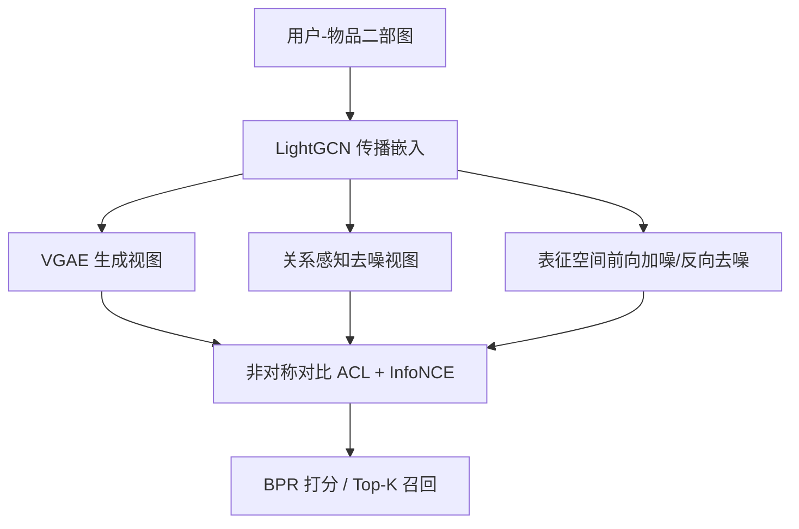
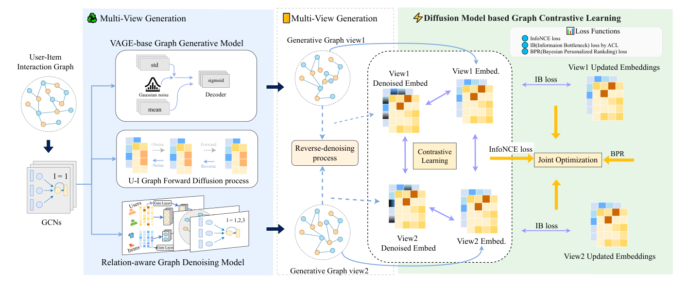

# RaDAR: Relation-aware Diffusion-Asymmetric Graph Contrastive Learning for Recommendation (关系感知扩散-非对称图对比学习推荐)

- **会议/期刊**: WWW 2026
- **作者与机构**: Yixuan Huang、Jiawei Chen（共同一作，电子科技大学 / 国防科技大学）、Shengfan Zhang（蚂蚁集团）、Zongsheng Cao（通讯，清华大学）
- **推荐链路定位**: 召回（图协同过滤表征学习）
- **研究方向**: 自监督对比学习与交互去噪 / 图神经网络推荐
- **论文原文**: [https://arxiv.org/abs/2603.16800v1](https://arxiv.org/abs/2603.16800v1)
- **开源代码**: [https://github.com/ohowandanliao/RaDAR](https://github.com/ohowandanliao/RaDAR)

## TL;DR (1分钟核心速览)

现有 GCL 推荐依赖随机边/节点丢弃做增广，会破坏关键拓扑语义；同时主流方法默认同质性（homophily），无法刻画"两跳单质性"（间接相连用户偏好相似）。RaDAR 用 VGAE 生成视图 + 关系感知去噪视图构成互补双视图，在节点表征上做前向加噪/反向去噪的扩散增广，并以非对称对比（ACL + InfoNCE + IB）解耦身份与上下文。在 Last.FM/Yelp/BeerAdvocate 三数据集 Full-Ranking 协议下，Recall@20 相对最强基线 AdaGCL 提升 3.78%–4.70%，NDCG@40 在 BeerAdvocate 上提升 16.33%。

## Background & Motivation (背景与核心矛盾)

- **主流范式**: LightGCN 式二部图消息传递 + SGL/SimGCL 式随机扰动增广 + InfoNCE 对比，是稀疏场景下 GCL 推荐的标准配方；GraphACL 进一步引入非对称目标捕捉多跳模式。
- **前人局限 (C1)**: 随机边/节点 dropout 直接破坏关键拓扑结构，两个增广视图间语义一致性下降，对比信号被噪声主导。
- **前人局限 (C2)**: 现有方法假设同质性、只对齐一跳邻居；而真实交互常呈异质性与"远距离同质性"——相似用户经多跳弱连接间接相连（图 1 所示两跳单质性），标准扩散模型只平滑局部邻域，反而丢失细粒度关系语义。
- **核心洞察 (Key Insight)**: 扩散去噪擅长抑制高频噪声、稳定局部嵌入；非对称对比擅长跨多跳对齐结构相似节点。二者互补：前者保"稳"，后者保"远"。
- **本文切入点**: 用"生成式 + 去噪式"双视图替代随机扰动，把扩散过程搬到节点表征空间而非图结构上，再以 ACL 的 IB 约束统一优化。

## Method (核心方法设计)

### 1. 整体框架 (Overall Architecture)

输入用户-物品二部图，经 $L$层 LightGCN 式传播得到基础嵌入。左侧两个可训练视图生成器并行产出互补图视图：VGAE 生成器捕捉全局结构语义，关系感知去噪器通过逐层边掩码与自适应门控过滤噪声边。右侧对物品嵌入执行$T$ 步前向高斯加噪与反向去噪，得到去噪视图，与原视图、跨去噪视图分别构造 intra/inter 对比。最终以 BPR + 扩散自监督 + IB 约束三阶段分层优化，推理时仅用传播嵌入做内积打分。

<figure class="paper-figure" markdown="span">
  <figcaption>图 2：RaDAR 框架架构：左侧部分展示两个视图生成器提取互补的图表示。右侧部分展示基于扩散模型图生成的对比学习过程，以及通过 InfoNCE、IB 和 BPR 损失进行的联合优化。</figcaption>
</figure>

### 2. 关键设计拆解 (Key Designs)

1. **关系感知边精炼（Relation-aware Edge Refinement）**：随机 dropout 无差别删边，会误删真实协同信号。本文用逐层可学习二值掩码 $A^l = A \odot M^l$并施加全局稀疏预算$\sum_l \|M^l\|_0 \le \tau_{sparse}$，掩码参数由自适应门控 + 关系注意力给出：$\alpha^l_{i,j} = f_{att}\big(G(e_i,e_j)\oplus G(e_j,e_i)\oplus[e_i;e_j]\big)$，其中$G(e_i,e_j)=g\odot\tau(W_{embed}[e_i;a_{r,i}])+(1-g)\odot e_i$。用 concrete 分布 + hard sigmoid 重参数化实现可微采样，损失$\mathcal{L}_{den}=\mathcal{L}_c+\mathcal{L}^{gen}_{bpr}+\lambda_2\|\Theta\|_F^2$。直觉：让"该留的边"由潜在节点语义而非随机数决定，稀疏预算则防止退化为全保留。

2. **表征空间扩散增广（Diffusion-guided Augmentation）**：图结构扰动代价高且易失真，本文改为在 GCN 末层物品嵌入 $h^{(L)}$上建$T$步马尔可夫链，前向闭式采样$\chi_t=\sqrt{\bar\alpha_t}\chi_0+\sqrt{1-\bar\alpha_t}\epsilon$，反向用 MLP$\hat\chi_\theta(\chi_t,t)$预测$\chi_0$，以 ELBO 训练。对比损失拆为 intra-view 对齐$\mathcal{L}_{intra}$与 inter-view 正则$\mathcal{L}_{inter}$，合成$\mathcal{L}_{diff\text{-}ssl}=\mathcal{L}_{ssl}+\lambda_1\mathcal{L}_{intra}+\lambda_2\mathcal{L}_{inter}$。直觉：加噪-去噪等价于在嵌入空间做"高频噪声滤波"，比丢边更保语义，且计算量与图规模无关。

3. **非对称对比与三阶段训练**：传统 InfoNCE 强制同质性一跳对齐。本文用双编码器 $f_\theta,f_\xi$分别产出身份表征$v$与上下文表征$u$，非对称预测器$g_\phi$由身份重建邻域上下文，使两跳邻居可经共享中心节点对齐（单质性）。总目标分三阶段：$\mathcal{L}_1=\mathcal{L}_{bpr}+\lambda_3\mathcal{L}_{diff\text{-}ssl}+\lambda_4\|\Theta\|_F^2$→$\mathcal{L}_{IB}=\mathcal{L}_A(G,g_\phi(v),v,u)$→$\mathcal{L}_{generators}=\mathcal{L}_{gen}+\mathcal{L}_{den}$。负采样为 batch 内全局负采样（非均匀难负采样），推理零额外开销。

## Experimental Setup & Evaluation Protocol (实验设置与评估协议)

- **数据集与预处理**:

| 数据集 | #Users | #Items | #Interactions | 密度 | 说明 |
| :--- | :---: | :---: | :---: | :---: | :--- |
| Last.FM | 1,892 | 17,632 | 92,834 | 2.8e-3 | 音乐社交，中等稀疏 |
| Yelp | 42,712 | 26,822 | 182,357 | 1.6e-4 | 本地生活，极端稀疏 |
| BeerAdvocate | 10,456 | 13,845 | 1,381,094 | 9.5e-3 | 10-core 过滤，较稠密 |
| Tmall / RetailRocket / IJCAI15 | 31,882 / 2,174 / 17,435 | 31,232 / 30,113 / 35,920 | 1.45M / 97K / 799K | — | 加权边（多行为）场景 |

- **数据划分与防穿越**: 比例划分 7:2:1（train/val/test），非 Leave-One-Out；加权边场景按 DiffGraph 公开协议将多行为聚合为二值图。
- **排名评测协议**: 无偏 **Full-Ranking（all-ranking）**，对每个用户对全部未交互物品排序，指标 Recall@20/40、NDCG@20/40。
- **对比基线与超参**: 覆盖 BiasMF/NCF（传统 CF）、NGCF/LightGCN（GNN）、SGL/SLRec（自监督）、DirectAU/AdaGCL（对比/扩散）四类；加权边另加 NMTR/MBGCN/HGT/MATN/DiffGraph。嵌入维度 $d$未在正文显式给出（附录 A），显著性以$p$-value 报告（均$<10^{-2}$）。

## Key Experimental Results (实验关键数据)

### 1. 主实验对比 (Main Results)

| 模型 | Last.FM R@20 | Last.FM N@20 | Yelp R@20 | Yelp N@20 | Beer R@20 | Beer N@20 |
| :--- | :---: | :---: | :---: | :---: | :---: | :---: |
| LightGCN | 0.2349 | 0.1704 | 0.0761 | 0.0373 | 0.1102 | 0.0943 |
| SGL | 0.2427 | 0.1761 | 0.0803 | 0.0398 | 0.1138 | 0.0959 |
| NCL | 0.2353 | 0.1715 | 0.0806 | 0.0402 | 0.1131 | 0.0971 |
| HCCF | 0.2410 | 0.1773 | 0.0789 | 0.0391 | 0.1156 | 0.0990 |
| DirectAU | 0.2422 | 0.1727 | 0.0818 | 0.0424 | 0.1182 | 0.0981 |
| AdaGCL | 0.2603 | 0.1911 | 0.0873 | 0.0439 | 0.1216 | 0.1015 |
| **RaDAR** | **0.2724** | **0.1992** | **0.0914** | **0.0464** | **0.1262** | **0.1056** |
| Improv.% | +4.65% | +4.24% | +4.70% | +5.69% | +3.78% | +4.04% |

加权边场景（Recall@20）：Tmall 0.0626 vs DiffGraph 0.0553（+13.2%）；RetailRocket 0.1380 vs 0.0626（+120%）；IJCAI15 0.0582 vs 0.0178（+227%），多行为场景优势极为显著。

### 2. 消融实验 (Ablation Study)

| 变体 | Last.FM R@20 | Last.FM N@20 | Yelp R@20 | Beer R@20 |
| :--- | :---: | :---: | :---: | :---: |
| Baseline (AdaGCL) | 0.2603 | 0.1911 | 0.0873 | 0.1216 |
| Gen+Gen（双 VGAE） | 0.2665 | 0.1936 | 0.0900 | 0.1226 |
| Gen+Linear（线性注意力替去噪） | 0.2698 | 0.1986 | 0.0910 | 0.1247 |
| w/o D-ACL（去扩散非对称） | 0.2652 | 0.1934 | 0.0904 | 0.1250 |
| w/ ACL only（去扩散增广） | 0.2720 | 0.1962 | 0.0911 | 0.1264 |
| **RaDAR (full)** | **0.2724** | **0.1992** | **0.0914** | 0.1262 |

### 3. 关键实验发现 (Key Findings)

1. **去噪模块主导召回、扩散主导排序**：去掉关系感知去噪（Gen+Linear）Last.FM Recall 掉 0.95%，而完整去掉显式去噪掉 2.17%；反之扩散增广对 Last.FM NDCG 贡献 +1.53% 而 Recall 增益微弱——两组件呈"覆盖 vs 精度"的明确分工。
2. **稀疏度越高收益越大**：Yelp（密度 1.6e-4）上 Recall@20 相对提升 4.70% 高于 BeerAdvocate（9.5e-3）的 3.78%；噪声注入 5%–25% 实验中，Yelp 上 RaDAR 相对 Recall 曲线衰减最缓，验证扩散去噪在极端稀疏下的必要性。
3. **ACL 权重需按密度调参**：Last.FM 在 $\lambda=5.5$（Recall）/$3.5$（NDCG）达峰，偏好关系感知去噪；Yelp 在$\lambda=1.5$/$1.0$达峰，需两视图均衡以防过拟合——说明$\lambda$ 是稀疏度敏感的落地超参。

## Highlights & Limitations (亮点、对比与审稿批判)

- **与代表作对比**: 相比 SGL/SimGCL 的随机扰动增广，RaDAR 用可学习去噪 + 生成式双视图替代盲扰动，从"制造差异"转向"保留语义"；相比 GraphACL 仅做非对称对比，本文把扩散去噪嵌入表征空间并与 ACL 联合，补上多跳单质性的建模缺口；相比 AdaGCL 的图级扩散，本文扩散作用于嵌入而非结构，开销与图规模解耦。
- **可迁移亮点**: (1) 表征空间加噪-去噪作为低成本增广，可直接替换序列/多模态推荐中的 dropout 增广；(2) 逐层稀疏预算 + concrete 掩码的边精炼，可迁移到社交去噪与知识图谱边剪枝。
- **审稿级局限批判**: (1) 三阶段分层训练 + 双视图生成器 + 扩散 MLP 使训练流程复杂，超参 $\lambda_1,\lambda_2,\lambda$ 均需按数据集调，论文未给自适应方案；(2) 假设静态图，无时序建模，且加权边场景仅把多行为聚合为二值图，未真正利用行为强度，RetailRocket 上 +120% 的异常增益也缺乏深入归因。

## Rating (四维评分)

- **方法创新性 (Novelty)**: ⭐⭐⭐⭐ （核心机制与方法设计具备明确创新性，理论与实验动机支撑充分）
- **评估协议与实验扎实度 (Protocol & Experiments)**: ⭐⭐⭐⭐ （主流公开数据集评测完整，包含多基线对比与消融实验验证）
- **写作与数学规范度 (Clarity & Rigor)**: ⭐⭐⭐ （问题形式化定义清晰，核心模块数学推导与架构阐述严谨易读）
- **工业落地与复现价值 (Industrial & Practical Value)**: ⭐⭐⭐⭐ （兼顾推荐效果增益与训练/推理效率，具备实际场景迁移参考价值）
