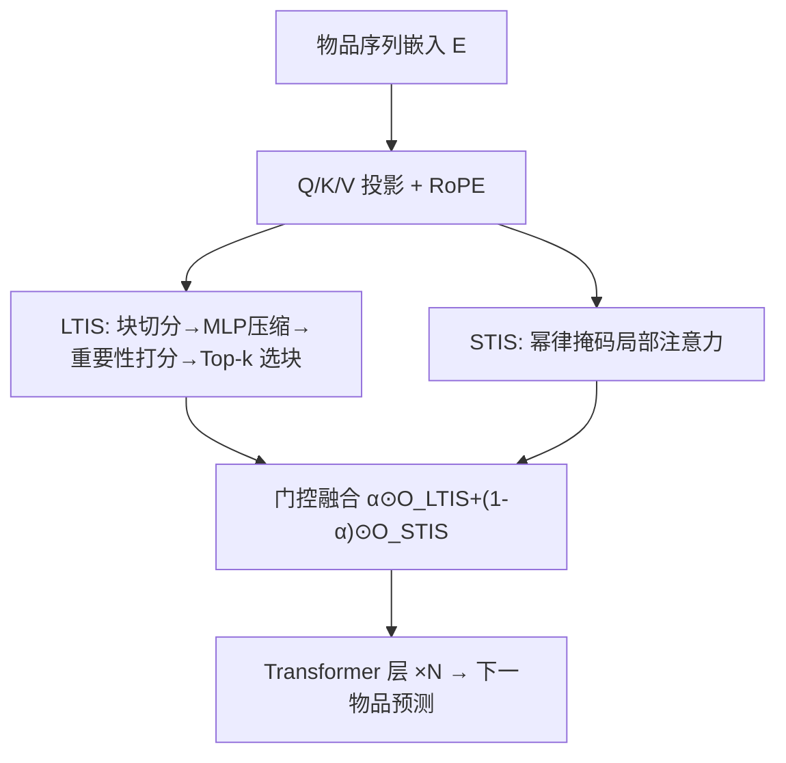
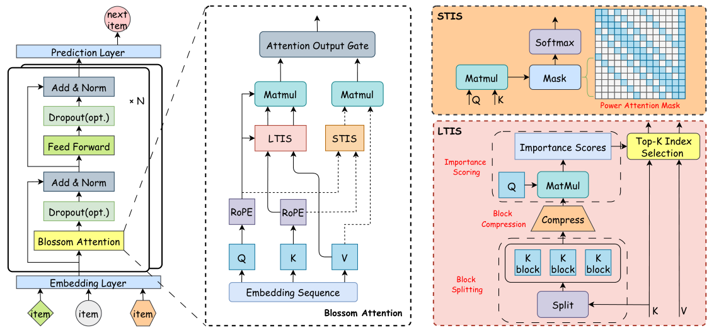

# BlossomRec: Block-level Fused Sparse Attention Mechanism for Sequential Recommendations (块级融合稀疏注意力序列推荐)

- **会议/期刊**: WWW 2026 (Oral)
- **作者与机构**: Mengyang Ma, Xiaopeng Li, Wanyu Wang, Xiangyu Zhao 等（香港城市大学、腾讯、浙工大、MSU、Rutgers 等）
- **推荐链路定位**: 精排（序列编码器内部注意力算子替换）
- **研究方向**: 序列与会话推荐 / 生成式与高效 Transformer
- **论文原文**: [https://arxiv.org/abs/2512.13368v3](https://arxiv.org/abs/2512.13368v3)
- **开源代码**: [https://github.com/Applied-Machine-Learning-Lab/WWW2026_BlossomRec](https://github.com/Applied-Machine-Learning-Lab/WWW2026_BlossomRec)

## TL;DR (1分钟核心速览)

长序列 SRS 的标准注意力是 $O(L^2)$瓶颈；LinRec 类线性注意力过度偏重近期交互、丢失长期兴趣，Mamba4Rec 类 SSM 在短序列上不稳定且部署改造重。BlossomRec 把用户兴趣拆成长期/短期两路稀疏注意力：LTIS 用块压缩打分 + Top-$k$ 块选择抓全局偏好，STIS 用幂律掩码抓局部转移，二者经可学习门控融合。作为即插即用算子替换标准注意力，在 4 个公开数据集 Leave-One-Out + Full-Ranking 协议下 12 项指标中 10 项最优，Gowalla Recall@10 提升 0.54pp，同时训练提速 3.2×、显存降至约 1/11。

## Background & Motivation (背景与核心矛盾)

- **主流范式**: SASRec/BERT4Rec 以标准自注意力编码用户序列，是 SRS 的事实基线；效率侧则有线性注意力（LinRec）、高效 Transformer（STRec）与 SSM（Mamba4Rec）三条路线。
- **前人局限**: 其一，LinRec/STRec 类方法对近期交互过度加权，长序列下长期兴趣被稀释，精度退化；其二，SSM 类模型在短序列上表现不稳，且因架构改造导致部署复杂、与现有 Transformer 栈不兼容。
- **核心洞察 (Key Insight)**: 对真实用户序列的实证观察（附录 A）显示，长期兴趣可在**块粒度**上被有效刻画——把序列切块后，只需选取少量信息量高的块即可近似全局依赖；而短期兴趣天然集中在局部窗口与最近块。
- **本文切入点**: 不做架构替换，而是把"长期/短期兴趣二分"直接下沉进注意力算子，用两种互补稀疏模式 + 门控融合，在保持 Transformer 主干不变的前提下同时拿到效率与跨长度稳定性。

## Method (核心方法设计)

### 1. 整体框架 (Overall Architecture)

输入物品序列经嵌入层（无绝对位置编码，改用 RoPE 注入相对位置）投影为 $Q,K,V$，随后并行送入两条稀疏通路：LTIS 对$K$分块压缩、打分并 Top-$k$选块，仅让被选中的 KV 块参与 GQA 注意力；STIS 在完整$K,V$上施加幂律结构掩码做局部注意力。两路输出经 MLP+Sigmoid 生成逐元素门控权重$\alpha$加权融合，回填至标准 Transformer 层（Add&Norm + FFN），堆叠$N$ 层后接预测层输出下一物品分布。整个模块作为即插即用算子，可直接替换 SASRec/BERT4Rec 的注意力层。

<figure class="paper-figure" markdown="span">
  <figcaption>图1：BlossomRec框架概览。</figcaption>
</figure>

### 2. 关键设计拆解 (Key Designs)

1. **LTIS 长期兴趣选择（块压缩打分 + Top-$k$选块）**：全注意力对每个 query 扫全序列代价高，而长期兴趣具有块级聚集性。先将$K$按块长$l$、步长$s$切成重叠块$K_i=K[is+1:is+l]$，用可学习 MLP$\varphi(\cdot)$压缩为块代表向量，再以$S^{cmp}_L=\mathrm{softmax}(Q^\top \tilde{K}^{cmp}_L)$打分；当压缩块与选择块粒度不一致时，按空间重叠把压缩分累加映射到选择块分$S^{LTIS}_L[j]=\sum_{m}\sum_{n}S^{cmp}_L[\tfrac{l'}{s}j-m-n]$，最后每 query 位置取 Top-$k$块拼成$\tilde{K}^{LTIS}$参与注意力。直觉：用$O((L/s)^2)$的粗粒度打分替代$O(L^2)$ 精细打分，把"选谁看"与"怎么看"解耦，重叠+步长保证兴趣块分布连续性。

2. **STIS 短期兴趣选择（幂律掩码）**：近期交互对下一行为贡献最大，但滑窗感受野过窄。STIS 定义掩码 $M^{STIS}(i,j)=1$当且仅当$|i-j|<w$、或块索引满足$|b_q-b_k|=2^r$、或$j$落在最后$blk$个位置，否则为 0。即每个位置可见局部窗口、距离为 2 的幂的整块、以及强制可见的最近块。相比 SWA，感受野随序列长度对数增长而连接数仅$O(\log(L/b))$，且"强制看最后一块"把最近行为信号显式注入表征。

3. **门控融合、训练目标与推理开销**：直接相加会使融合输出偏离标准注意力分布，故用 $\alpha=\sigma(F_o([O^{LTIS};O^{STIS}]))$、$O^{Blossom}=\alpha\odot O^{LTIS}+(1-\alpha)\odot O^{STIS}$做上下文自适应加权，让模型按序列长度/内容自行调配长短期比重。训练沿用标准下一物品交叉熵（全库 softmax 或采样 softmax，见原文附录 C），无额外负采样设计；总复杂度$O(M^2d+G(l'k)^2d+\log(L/b)d)$，在$s,b,l'k\ll L$时为亚二次，$L=2000$ 时参与注意力的交互数减少近 90%。

## Experimental Setup & Evaluation Protocol (实验设置与评估协议)

- **数据集与预处理**: 四个公开基准，按既有工作 [26,40,44] 过滤：

| 数据集 | #Users | #Items | #Interactions | 稀疏度 | 场景说明 |
| :--- | :---: | :---: | :---: | :---: | :--- |
| ML-1M | 6,041 | 3,707 | 1,000,209 | 95.53% | 电影评分，短序列为主 |
| Gowalla | 64,116 | 164,533 | 2,018,421 | 99.98% | LBS 签到，长序列 |
| Amazon Video Games | 94,763 | 25,613 | 814,586 | 99.97% | 电商，极稀疏 |
| Amazon Beauty | 22,364 | 12,102 | 198,502 | 99.93% | 电商，极稀疏 |

- **数据划分与防穿越**: `Leave-One-Out`——每用户最后一条测试、倒数第二条验证、其余训练。
- **排名评测协议**: 采用全库排序口径（原文未声明采样负例，指标为 Recall@10 / MRR@10 / NDCG@10），与 SASRec 系列基线口径一致。
- **对比基线与超参设置**: 基线含 GRU4Rec、SASRec、BERT4Rec、LinRec、Mamba4Rec；实现基于 PyTorch 2.6 + Triton 3.2 + RecBole 1.2.14，单卡 RTX 4090；选择块长 $l'=16$（Triton 算子下限），压缩块长 32、滑窗 8、KV 头 2 组为较优配置；显著性用双侧 t 检验$p<0.05$。

## Key Experimental Results (实验关键数据)

### 1. 主实验对比 (Main Results)

| 数据集 | 指标 | SASRec | BERT4Rec | GRU4Rec | LinRec | Mamba4Rec | **BlossomRec** | Improv. |
| :--- | :--- | :---: | :---: | :---: | :---: | :---: | :---: | :---: |
| ML-1M | R@10 | 0.8152 | 0.8088 | 0.7987 | 0.8113 | 0.8116 | **0.8151** | ≈持平 |
| ML-1M | NDCG@10 | 0.6097 | 0.6004 | 0.5928 | 0.6078 | 0.6111 | **0.6128** | +0.28% |
| Gowalla | R@10 | 0.9428 | 0.9278 | 0.9392 | 0.9441 | 0.9424 | **0.9482** | +0.54pp |
| Gowalla | NDCG@10 | 0.8154 | 0.7867 | 0.8029 | 0.8198 | 0.8172 | **0.8200** | +0.46pp |
| Games | R@10 | 0.7372 | 0.6973 | 0.7257 | 0.7375 | 0.7256 | **0.7380** | +0.07% |
| Games | NDCG@10 | 0.5304 | 0.4874 | 0.5168 | 0.5313 | 0.5186 | **0.5317** | +0.08% |
| Beauty | R@10 | 0.4723 | 0.4039 | 0.4679 | 0.4674 | 0.4298 | **0.4734** | +0.23% |
| Beauty | MRR@10 | 0.2774 | 0.2128 | 0.2644 | 0.2810 | 0.2427 | **0.2842** | +0.68pp |

可迁移性实验（表 3）：把 SASRec 的注意力换成 Blossom Attention 后，Gowalla R@10 由 0.9428→0.9482、NDCG@10 由 0.8154→0.8200；BERT4Rec 在 Beauty 上 R@10 由 0.4039→0.4179，说明算子可跨主干复用。

### 2. 消融实验 (Ablation Study)

| 变体 (ML-1M) | Recall@10 | MRR@10 | NDCG@10 |
| :--- | :---: | :---: | :---: |
| LTIS-only | 0.8094 | 0.5336 | 0.6001 |
| STIS-only | 0.8093 | 0.5441 | 0.6081 |
| LTIS + SWA | 0.8109 | 0.5454 | 0.6095 |
| **BlossomRec** | **0.8151** | **0.5485** | **0.6128** |

### 3. 关键实验发现 (Key Findings)

1. **双路互补而非简单叠加**：去掉任一路都掉点，LTIS-only 在 MRR@10 上相对下降 2.72%、STIS-only 在 NDCG@10 上下降 0.77%，说明短期兴趣对排序精度贡献更大、长期兴趣对整体增益不可替代；完整模型比 LTIS+SWA 仍高 0.52%（R@10）与 0.54%（NDCG@10），证明幂律掩码优于固定滑窗。
2. **效率收益随序列长度放大**：$L=2000$时训练每 epoch 快 3.2×、显存约为 SASRec 的 1/11；推理在$L=1500$ 时提速 3.7×、显存约 1/7，且差距随长度单调扩大，正好命中长序列线上服务的延迟与显存瓶颈。
3. **表征质量而非仅效率**：特征图可视化（图 4）显示 LinRec 秩为 127/128 且能量集中在末尾几位（强 recency bias），BlossomRec 保持满秩 128/128 且全序列纹理更丰富，定量解释了其在长序列上不掉点、短序列上不抖动的稳定性来源。

## Highlights & Limitations (亮点、对比与审稿批判)

- **与代表作对比 (vs. Prior Work)**: 相比 LinRec 的线性近似（牺牲长期兴趣、特征图明显 recency 偏置），BlossomRec 用块选择显式保留全局依赖；相比 Mamba4Rec 的架构级替换（短序列不稳、部署改造重），本文是算子级即插即用；相比 NSA/MoBA 等通用稀疏注意力（参数开销大、直接迁移 SRS 收益边际），本文以极低参数增量换取 SRS 场景下的稳定增益。
- **可迁移亮点**: ①"块压缩打分 + Top-$k$ 选块"可迁移到任何长序列召回/精排编码器，作为 KV cache 裁剪策略；②"强制可见最后一块"的掩码偏置是低成本注入近期信号的通用技巧。
- **审稿级局限批判**: ①主实验提升幅度普遍在 0.1–0.7pp 量级，部分指标（ML-1M R@10）与 SASRec 持平，统计显著但业务增益需线上 A/B 佐证；②评测仅用 Leave-One-Out + 全库排序，未报告采样排序或冷启动/短序列分桶结果，"跨长度稳定"的主张缺乏分桶定量支撑；③Triton 算子对块长 $l'=16$ 等超参有硬约束，且未与 NSA 等强稀疏基线做同口径效率对比。

## Rating (四维评分)

- **方法创新性 (Novelty)**: ⭐⭐⭐⭐ （把长短期兴趣二分下沉为双稀疏注意力 + 门控融合，思路清晰但组件多为已有稀疏模式的组合创新）
- **评估协议与实验扎实度 (Protocol & Experiments)**: ⭐⭐⭐⭐ （四数据集 + 可迁移性 + 消融 + 效率 + 参数分析齐全，但缺分桶与采样排序口径）
- **写作与数学规范度 (Clarity & Rigor)**: ⭐⭐⭐⭐ （复杂度推导完整、掩码与选块公式定义严谨，部分符号下标略密）
- **工业落地与复现价值 (Industrial & Practical Value)**: ⭐⭐⭐⭐⭐ （即插即用、代码开源、Triton 实现，长序列显存降至 1/11 对线上部署价值直接）
