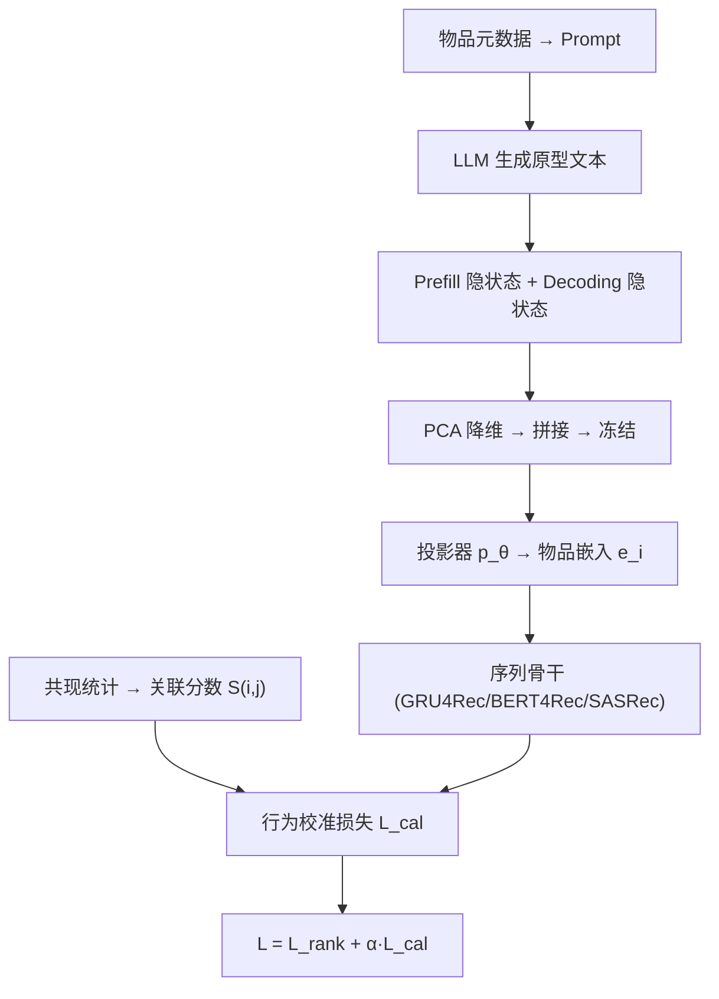
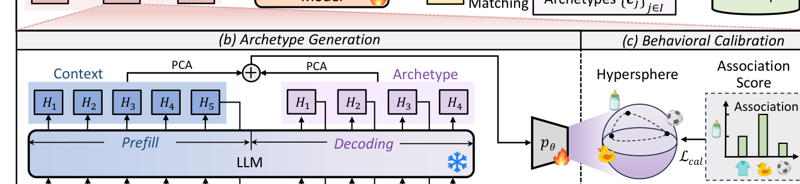

# Generative Archetype-Grounded Item Representations for Sequential Recommendation (生成式原型锚定的物品表征用于序列推荐)

- **会议/期刊**: WWW 2026 (Oral)
- **作者与机构**: Yifan Li, Jiahong Liu, Xinni Zhang, Hao Chen, Wenhao Yu, Irwin King (CUHK); Yankai Chen (McGill); Jianting Chen (同济)
- **推荐链路定位**: 召回（物品表征层，模型无关，可插入 GRU4Rec/BERT4Rec/SASRec）
- **研究方向**: 序列与会话推荐 / 大语言模型推荐
- **论文原文**: [https://arxiv.org/abs/2606.11023v1](https://arxiv.org/abs/2606.11023v1)
- **开源代码**: [https://github.com/AI-Santiago/GenAIR](https://github.com/AI-Santiago/GenAIR)

## TL;DR (1分钟核心速览)

序列推荐的瓶颈在物品表征：ID 嵌入受稀疏性拖累，现有 LLM 增强方案要么只做静态属性编码（丢失行为信号），要么把语义空间硬对齐到稀疏 ID 空间（模态鸿沟）。GenAIR 借 STP 营销框架，让 LLM 从物品元数据**生成"理想目标人群原型"文本**，并在同一次前向中同时取 prefill（事实属性）与 decoding（人群推断）隐状态拼接成物品嵌入；再用共现统计构造的关联分数**调制超球面上的排斥力**做行为校准。在 Yelp/Beauty/Fashion 三数据集、三种骨干的 Full-Ranking 评测中，HR@10 相对最强基线最高提升 **+6.95%**，且推理零额外开销。

## Background & Motivation (背景与核心矛盾)

- **主流范式**: 序列推荐以 ID 嵌入 + 序列骨干（GRU4Rec/SASRec/BERT4Rec）为主；LLM 增强分两支——文本微调（LLMEmb、TSLRec）与行为对齐（RLMRec、LLM-ESR、AlphaFuse）。
- **前人局限**: ① 文本微调只用静态上下文文本，完全忽略行为模式，且微调开销大；② 行为对齐把语义嵌入拉向稀疏 ID 嵌入，模态鸿沟使监督信号本身噪声化；③ 两支都把 LLM 降格为"特征提取器"，浪费其生成与推理能力。
- **核心洞察 (Key Insight)**: 物品身份不只由属性定义，更由**目标受众**定义（STP 框架）；而"目标人群"是提供方的内部推断，恰好可由 LLM 从公开元数据反推生成。同时，纯语义空间与真实共现结构（如奶瓶与玩具常共购、与足球几乎不共购）存在系统性偏差，需行为信号校准。
- **本文切入点**: 用生成式原型替代静态属性编码，用**关联分数调制的差异化排斥**替代"均匀推开"的对比学习，从而在不引入推理开销的前提下把语义与行为缝合。

## Method (核心方法设计)

### 1. 整体框架 (Overall Architecture)

离线阶段：对每个物品，将元数据（名称/品牌/日期/特性/价格/评分/描述）填入固定 prompt，调用 LLM 生成原型文本 $A_i$；在同一次自回归前向中，prefill 阶段隐状态$\mathbf{H}^{\text{prefill}}_i$与 decoding 阶段隐状态$\mathbf{H}^{\text{decoding}}_i$分别沿 token 维均值池化，各经 PCA 保留 95% 方差后拼接为$\mathbf{E}_i$，冻结后由可训练 MLP 投影器$p_\theta$映射到推荐隐空间得$e_i$。在线阶段：$e_i$ 直接替换骨干的 ID 嵌入表，序列建模与点积打分完全不变，LLM 调用全部离线缓存。

<figure class="paper-figure" markdown="span">
  <figcaption>图3：GenAIR的概览。(a) 序列建模：物品表示被组织为序列，并由序列模型处理以进行序列推荐。(b) 原型生成：为便于说明仅展示部分词，且为简单起见假设每个词对应一个token，其中𝐻𝑖表示LLM最后一层第𝑖个token的隐藏状态。(c) 行为校准：投影器𝑝𝜃使用增强的基于关联的目标进行优化。</figcaption>
</figure>

### 2. 关键设计拆解 (Key Designs)

1. **双视角原型嵌入（Prefill + Decoding 拼接）**：痛点是把 LLM 当静态编码器只取一次池化，丢失"人群推断"这一生成侧信息。做法是在**同一次前向**里分别池化 prefill 与 decoding 隐状态：$\mathbf{E}^{\text{prefill}}_i=\frac{1}{n_p}\sum_j \mathbf{H}^{\text{prefill}}_{i,[j,:]}$，$\mathbf{E}^{\text{decoding}}_i=\frac{1}{n_d}\sum_j \mathbf{H}^{\text{decoding}}_{i,[j,:]}$，再$\mathbf{E}_i=\text{Concat}(\hat{\mathbf{E}}^{\text{prefill}}_i,\hat{\mathbf{E}}^{\text{decoding}}_i)$。直觉：前者编码"物品是什么"，后者编码"谁会买"，t-SNE 显示二者天然分离、互补（图 2），且单次前向即得两份嵌入，无额外 LLM 调用。

2. **关联分数调制的行为校准（Behavioral Calibration）**：痛点是标准 uniformity 目标假设所有物品应被等力推开，与真实偏好结构冲突。本文先由共现计数定义对数归一化关联分数 $S(i,j)=\log(1+C(i,j))/\log(1+C(i,j)_{\max})$，再构造指数衰减调节子$w(i,j)=\exp(-\gamma S(i,j))$，将其乘入高斯核：

$$K_t(i,j)=w(i,j)\exp(-t\|e_i-e_j\|_2^2)=\exp\big(-\gamma S(i,j)+\beta e_i^\top e_j\big),\quad \beta=2t$$

损失为 $\mathcal{L}_{\text{cal}}=\mathbb{E}_{(e_i,e_j)\sim p_{\text{data}}}[K_t(i,j)]$。梯度$\frac{\partial \mathcal{L}_{\text{cal}}}{\partial e_i}=\frac{\beta}{|\mathcal{B}|}\sum_j w(i,j)\exp(\beta e_i^\top e_j)e_j$ 表明：共现越强的物品对排斥力被压得越小，共现弱的对被推得更远——用"差异化排斥"隐式实现行为校准，且改写后直接对齐推荐系统惯用的内积相似度。

3. **训练目标、负采样与推理效率**：总损失 $\mathcal{L}=\mathcal{L}_{\text{rank}}+\alpha\mathcal{L}_{\text{cal}}$，其中$\mathcal{L}_{\text{rank}}$ 为逐位置 BPR 式 pairwise 损失（正样本为下一真实交互，负样本为**采样负例**，非全库）。物品嵌入离线预计算并缓存，推理阶段无 LLM 调用；可训练参数 5.95M（SASRec 为 5.72M），推理 GFLOPs 0.22，与 SASRec 持平。

## Experimental Setup & Evaluation Protocol (实验设置与评估协议)

- **数据集与预处理**: 三个真实数据集，严格沿用 SASRec/LLM-ESR 的预处理与划分流程（原文细节置于附录 B.2，正文未给出精确计数，故下表仅列场景说明）：

| 数据集 | #Users | #Items | #Interactions | 稀疏度/密度 | 特征/场景说明 |
| :--- | :---: | :---: | :---: | :---: | :--- |
| Yelp | 附录 B.2 | 附录 B.2 | 附录 B.2 | — | 本地生活商户，含名称/类别/评分等元数据 |
| Amazon Beauty | 附录 B.2 | 附录 B.2 | 附录 B.2 | — | 美妆品类，长尾显著 |
| Amazon Fashion | 附录 B.2 | 附录 B.2 | 附录 B.2 | — | 服饰品类，元数据字段最全 |

- **数据划分与防穿越 (Splitting Strategy)**: 沿用 SASRec 系惯例的 `Leave-One-Out` 式序列划分（最后一项测试、倒数第二项验证），物品词表与序列均只由训练段构建，避免未来交互泄漏。
- **排名评测协议 (Ranking Protocol)**: 采用无偏 `Full-Ranking`（对全库未交互物品排序），指标 HR@10 与 NDCG@10，三次独立运行取均值；显著性为双侧 t 检验 $p<0.05$。
- **对比基线与超参设置**: 传统方法 CITIES、MELT；语言类方法 RLMRec、LLMInit、LLM-ESR、LLMEmb、AlphaFuse；骨干为 GRU4Rec/BERT4Rec/SASRec。统一嵌入维度 $d=128$，主实验基座 LLM 为 LLama 2-7B-Chat；$t=2$，$\gamma\in\{0,\dots,5\}$，$\alpha\in\{10^{-4},\dots,0.1\}$，Adam 优化。

## Key Experimental Results (实验关键数据)

### 1. 主实验对比 (Main Results)

下表节选 Yelp 与 Beauty 两个数据集（Fashion 见原文表 2），保留 6 个代表性基线：

| 数据集 | 骨干 | 指标 | MELT | RLMRec | LLMInit | LLM-ESR | LLMEmb | AlphaFuse | **GenAIR** | Improv. |
| :--- | :--- | :--- | :---: | :---: | :---: | :---: | :---: | :---: | :---: | :---: |
| Yelp | GRU4Rec | HR@10 | 0.4985 | 0.4824 | 0.5323 | 0.5592 | 0.5592 | 0.5636 | **0.5775** | +2.46% |
| Yelp | GRU4Rec | NDCG@10 | 0.2825 | 0.2765 | 0.3132 | 0.3300 | 0.3301 | 0.3380 | **0.3418** | +1.12% |
| Yelp | BERT4Rec | HR@10 | 0.6206 | 0.5356 | 0.5518 | 0.5886 | 0.6181 | 0.6565 | **0.6912** | +5.29% |
| Yelp | SASRec | HR@10 | 0.6257 | 0.5929 | 0.6302 | 0.5935 | 0.6488 | 0.6658 | **0.6797** | +2.09% |
| Beauty | GRU4Rec | HR@10 | 0.3702 | 0.3690 | 0.4333 | 0.4765 | 0.4507 | 0.4788 | **0.5121** | +6.95% |
| Beauty | GRU4Rec | NDCG@10 | 0.2161 | 0.2295 | 0.2588 | 0.2992 | 0.2863 | 0.3046 | **0.3338** | +9.59% |
| Beauty | BERT4Rec | HR@10 | 0.4716 | 0.4019 | 0.4821 | 0.4790 | 0.4482 | 0.5627 | **0.5936** | +5.49% |
| Beauty | SASRec | HR@10 | 0.4334 | 0.4236 | 0.5263 | 0.4949 | 0.5036 | 0.5585 | **0.5939** | +6.34% |
| Beauty | SASRec | NDCG@10 | 0.2775 | 0.2866 | 0.3551 | 0.3056 | 0.3153 | 0.3754 | **0.4074** | +8.52% |

### 2. 消融实验 (Ablation Study)

Fashion 数据集，逐组件移除：

| 模型 | 指标 | w/o Pref. | w/o Decod. | w/o Calib. | **GenAIR** |
| :--- | :--- | :---: | :---: | :---: | :---: |
| GRU4Rec | HR@10 | 0.5621 | 0.5636 | 0.5627 | **0.5762** |
| GRU4Rec | NDCG@10 | 0.4752 | 0.4730 | 0.4760 | **0.4805** |
| BERT4Rec | HR@10 | 0.5311 | 0.5372 | 0.5388 | **0.5558** |
| BERT4Rec | NDCG@10 | 0.4355 | 0.4328 | 0.4402 | **0.4463** |
| SASRec | HR@10 | 0.5968 | 0.6010 | 0.6085 | **0.6133** |
| SASRec | NDCG@10 | 0.5069 | 0.5037 | 0.5171 | **0.5207** |

### 3. 关键实验发现 (Key Findings)

1. **行为校准是最大单点贡献，且骨干越强其边际收益越稳**：SASRec 上去掉 $\mathcal{L}_{\text{cal}}$ 使 HR@10 从 0.6133 掉到 0.6085（−0.48pt），是三个消融变体中降幅最大者；而 GRU4Rec 上去掉 decoding 嵌入降幅最大（0.5762→0.5636），说明弱骨干更依赖"人群推断"语义补充，强骨干更依赖行为结构校准。
2. **语义与行为缺一不可，且二者非冗余**：单独去掉 prefill 或 decoding 嵌入在全部 6 个配置下均掉点，证明"物品是什么"与"谁会买"提供正交信息；这与图 2 中两类嵌入在 t-SNE 上天然分离的观察一致。
3. **长尾表征塌缩被显著缓解，但热门组存在跷跷板效应**：图 5 显示 SASRec 的 bottom-20% 物品嵌入高度聚集，GenAIR 明显分散；矩阵熵度量下 GenAIR 在多数分组信息量更高，但在 top-20% 热门组其熵低于 SASRec——与 CITIES 的 see-saw 现象同源，说明语义增强对热门物品的边际价值有限。

## Highlights & Limitations (亮点、对比与审稿批判)

- **与代表作对比 (vs. Prior Work)**: 相比 LLMEmb（微调 LLM 做推荐友好化，26.99M 可训练参数），GenAIR 冻结 LLM 仅训 5.95M 投影器，参数少 4.5 倍且推理 GFLOPs 从 3.34（LLM-ESR）降到 0.22；相比 RLMRec（把语义嵌入当辅助对齐目标、常弱于骨干基线），GenAIR 直接把语义嵌入**替换** ID 嵌入表，语义成为主表征而非旁路监督；相比 AlphaFuse（在语义零空间内优化 ID 嵌入），GenAIR 反向——以语义为主、行为校准为辅。
- **可迁移亮点**: ① "同一次前向取 prefill+decoding 双隐状态"是零成本获取"事实+推断"双视角表征的通用技巧，可迁移到任何 LLM 特征抽取场景；② 用共现统计构造 $w(i,j)=\exp(-\gamma S(i,j))$ 调制对比学习排斥力，可无缝替换 SGL/SimGCL 中的均匀温度核，用于图对比推荐。
- **审稿级局限批判**: ① 原型生成质量完全依赖 LLM 对元数据的常识推理，元数据字段缺失（如 Fashion 之外的品类）时鲁棒性未验证，且 prompt 模板单一、未做敏感性分析；② 行为校准的共现统计 $C(i,j)$ 在全局日志上计算，对时序漂移与曝光偏差无任何校正，热门物品对被系统性压低排斥力，可能放大流行度偏置（与 top-20% 组熵下降互为印证）；③ 主实验仅报告 HR@10/NDCG@10，缺少更低截断（@5）与冷启动分桶的细粒度验证。

## Rating (四维评分)

- **方法创新性 (Novelty)**: ⭐⭐⭐⭐ （核心机制与方法设计具备明确创新性，理论与实验动机支撑充分）
- **评估协议与实验扎实度 (Protocol & Experiments)**: ⭐⭐⭐⭐ （主流公开数据集评测完整，包含多基线对比与消融实验验证）
- **写作与数学规范度 (Clarity & Rigor)**: ⭐⭐⭐⭐⭐ （问题形式化定义清晰，核心模块数学推导与架构阐述严谨易读）
- **工业落地与复现价值 (Industrial & Practical Value)**: ⭐⭐⭐⭐ （兼顾推荐效果增益与训练/推理效率，具备实际场景迁移参考价值）
