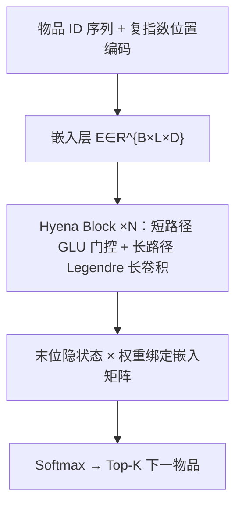
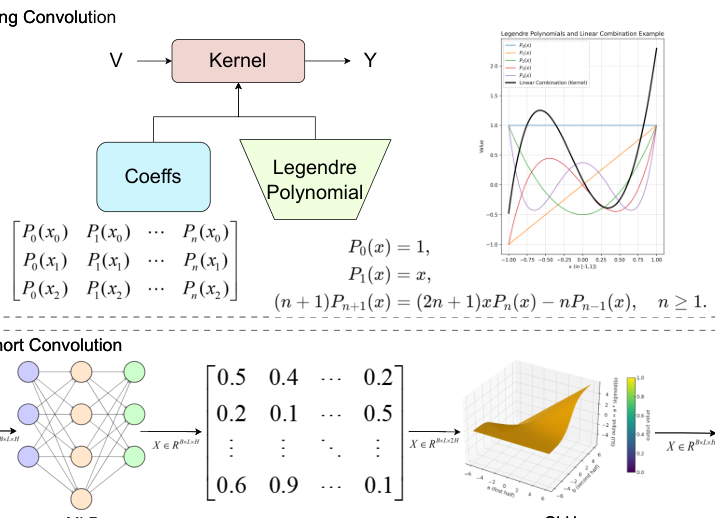

# Hyena Operator for Fast Sequential Recommendation (面向快速序列推荐的 Hyena 算子)

- **会议/期刊**: ACM Web Conference 2026 (WWW '26)
- **作者与机构**: Jiahao Liu, Lin Li, Zhiyuan Li, Kaixi Hu, Kaize Shi, Jingling Yuan（武汉理工大学、武汉纺织大学、南昆士兰大学）
- **推荐链路定位**: 召回（Next-Item 序列建模）
- **研究方向**: 序列与会话推荐
- **论文原文**: [https://arxiv.org/abs/2603.25027v1](https://arxiv.org/abs/2603.25027v1)
- **开源代码**: 暂未开源

## TL;DR (1分钟核心速览)

针对注意力序列推荐 $O(L^2)$ 复杂度难以承载超长用户历史、而原生 Hyena 的隐式核生成器在稀疏推荐序列上易过拟合高频噪声且数值不稳的痛点，本文提出 HyenaRec：用 Legendre 正交多项式显式线性组合参数化 Hyena 的逐通道长卷积核，并配合 GLU 短程门控捕捉行为突发。在 Leave-One-Out + Full-Ranking 协议下，四个数据集全面领先，超长序列 XLong 上 NDCG@10 相对最强基线 LRURec 提升 **17.65%**，训练最高 **6×** 加速。

## Background & Motivation (背景与核心矛盾)

- **主流范式**: 序列推荐已从 Markov/RNN/CNN 演进到 SASRec、BERT4Rec、EulerFormer 等自注意力架构，近期 HSTU、LRURec、Mamba4Rec 尝试用次二次算子替代注意力。
- **前人局限**: 注意力类方法训练与增量推理开销随 $L$ 平方增长，长历史场景不可承受；RNN/线性递归类（LRURec）虽高效，但受"摘要瓶颈"与梯度传播限制，长程信息保留仍不足。
- **核心洞察 (Key Insight)**: 推荐序列是**稀疏、非周期、变长**的，而原生 Hyena 的隐式核生成器（MLP + Fourier 特征）会拟合虚假高频模式，且跨不同 $L$ 重缩放时产生插值伪影与数值不稳；用户兴趣本质是"慢变全局偏好 + 短时突发"的多尺度结构。
- **本文切入点**: 把核生成从"隐式黑盒"换成"Legendre 正交多项式低维子空间上的显式投影"，用正交性与受控边界值天然施加低通平滑先验，再保留 Hyena 的门控短路径补足局部突发。

## Method (核心方法设计)

### 1. 整体框架 (Overall Architecture)

输入为用户交互物品 ID 序列，经嵌入表映射为 $\mathbf{E}\in\mathbb{R}^{B\times L\times D}$；位置信息不直接加到嵌入上，而是以复指数基$z_f(t)=e^{-i2\pi f t/L}$构造的位置编码送入滤波器生成器，保证时序结构与骨干一致。骨干由$N$ 个 Hyena Block 堆叠，每块含 Hyena 算子混合层（短路径轻量卷积 + GLU 门控，长路径 Legendre 参数化深度可分离因果长卷积）、前馈 MLP、残差与 LayerNorm。末端取最后位置隐状态，与输入嵌入矩阵权重绑定后投影到物品词表得 logits，softmax 后取 Top-K。

<figure class="paper-figure" markdown="span">
  <figcaption>图1：HyenaRec的整体架构，包括输入与嵌入层、基于Hyena的序列主干（其中每个Hyena块包含一个使用Legendre Hyena滤波器的Hyena算子以进行长程建模），以及用于下一项推荐的Top-K预测层。</figcaption>
</figure>

### 2. 关键设计拆解 (Key Designs)

1. **LegendreHyenaFilter（平滑正交核参数化）**：原生 Hyena 用位置条件 MLP 隐式生成核 $k^{(o)}=g^{(o)}_\theta(\cdot)$，在稀疏交互下过拟合高频噪声、变长时数值不稳。本文改为在 Legendre 基上显式展开，每个通道核为前$K$个 Legendre 多项式的线性组合并做$\ell_1$ 归一化：
$$k^{(o)}(t)=\sum_{n=0}^{K-1}c_n^{(o)}P_n\big(\mathrm{linspace}(-1,1,L)[t]\big),\qquad \mathbf{K}=\frac{\mathbf{C}\mathbf{P}}{\|\mathbf{C}\mathbf{P}\|_1}$$
其中 $\mathbf{P}\in\mathbb{R}^{K\times L}$为基矩阵、$\mathbf{C}\in\mathbb{R}^{D\times K}$为可学习系数。有效性直觉：Legendre 在均匀测度下严格正交（阶间冗余最小，隐式正则），边界满足$|P_n(\pm1)|=1$（避免边界信号爆炸），且三项递推$(n+1)P_{n+1}=(2n+1)xP_n-nP_{n-1}$使基生成仅$O(KL)$；高阶系数自然衰减形成低通滤波，压制稀疏反馈中的高频抖动。基大小按累积能量$E_K\ge 0.95$的经验准则取$K=64$。

2. **多阶门控长卷积（Hyena 骨架的推荐适配）**：单条长卷积感受野有限，Hyena 通过通道扩张 $\mathbf{U}=\mathbf{X}\mathbf{W}_{in}$（$D_{exp}=D\cdot(O+1)$）分出$O$ 条调制流与初始状态，逐阶执行
$$\mathbf{V}^{(o)}=\mathrm{Conv}_{dw}\big(\mathbf{V}^{(o-1)}\odot\mathbf{X}^{(o)},\,k^{(o)}\big),\qquad \mathbf{Y}=\big(\mathbf{V}^{(O-1)}\odot\mathbf{X}^{(0)}\big)\mathbf{W}_{out}$$
数据相关的逐元素门控让有效感受野随阶数 $O$渐进扩张，实现多时间尺度建模而无需构造$L\times L$ 注意力矩阵；短路径 GLU 则专门捕捉短时行为突发，与长路径的慢变全局偏好形成互补。

3. **训练目标、负采样与推理效率**：采用全库 softmax 交叉熵（式 1），**不做负采样**，直接在全物品词表上归一化；优化器 AdamW，学习率 1e-3，batch 128（XLong 为 32），dropout 0.2、weight decay 1e-4。卷积经 FFT 实现，单层复杂度 $O(BDL(D+\log L))$，训练显存$O(LD)$（注意力为$O(L^2)$）；推理时卷积形式支持每步$O(D)$ 增量计算，适合在线实时服务。

## Experimental Setup & Evaluation Protocol (实验设置与评估协议)

- **数据集与预处理**: 过滤交互数少于 5 的物品与序列长度小于 2 的用户（`5-core` 风格）：

| 数据集 | #Users | #Items | #Interactions | 平均长度 | 稀疏度 | 场景说明 |
| :--- | :---: | :---: | :---: | :---: | :---: | :--- |
| ML-1M | 6,040 | 3,416 | 1M | 165.5 | 95.2% | 电影，中长序列 |
| Steam | 334,730 | 13,047 | 3.7M | 11.0 | 99.96% | 游戏，极稀疏短序列 |
| Video | 31,013 | 23,715 | 287K | 9.3 | 99.9% | 视频，短序列 |
| XLong | 69,691 | 2,122,932 | 66.8M | 958.8 | 99.95% | 超长序列、超大物品库 |

- **数据划分与防穿越 (Splitting Strategy)**: `Leave-One-Out`——每用户最后一条交互作测试、倒数第二条作验证、其余训练。
- **排名评测协议 (Ranking Protocol)**: 无偏 `Full-Ranking`（全库未交互物品排序），指标 NDCG@{10,20} 与 Recall@{10,20}。
- **对比基线与超参设置**: 覆盖 RNN（GRU4Rec、NARM）、注意力（SASRec、BERT4Rec、EulerFormer）、生成式（HSTU）、线性递归（LRURec）四类；附录另比 Mamba4Rec 与 AtrousHyena 变体。超参网格：weight decay $\{0,10^{-8},10^{-6},10^{-4},10^{-2}\}$、dropout$\{0,0.2,0.4,0.6,0.8\}$，早停以 Recall@10 连续 10 次不提升为准。

## Key Experimental Results (实验关键数据)

### 1. 主实验对比 (Main Results)

| 数据集 | 指标 | SASRec | BERT4Rec | EulerFormer | HSTU | LRURec | **HyenaRec** | Improv. |
| :--- | :--- | :---: | :---: | :---: | :---: | :---: | :---: | :---: |
| ML-1M | NDCG@10 | 0.18293 | 0.16377 | 0.16016 | 0.18607 | 0.19065 | **0.20007** | +4.94% |
| ML-1M | Recall@20 | 0.43084 | 0.41738 | 0.40368 | 0.41298 | 0.43118 | **0.44858** | +4.04% |
| Steam | NDCG@10 | 0.06759 | 0.06433 | 0.06825 | 0.07094 | 0.06934 | **0.07238** | +2.02% |
| Steam | Recall@20 | 0.18716 | 0.18245 | 0.18416 | 0.19764 | 0.19082 | **0.20222** | +2.32% |
| Video | NDCG@10 | 0.05829 | 0.05600 | 0.05473 | 0.06320 | 0.06198 | **0.06436** | +1.84% |
| Video | Recall@20 | 0.15989 | 0.16640 | 0.15231 | 0.16470 | 0.16705 | **0.16720** | +0.01% |
| XLong | NDCG@10 | 0.30949 | 0.23429 | 0.27164 | 0.28728 | 0.34867 | **0.41021** | +17.65% |
| XLong | NDCG@20 | 0.33531 | 0.27293 | 0.30561 | 0.31272 | 0.37174 | **0.42314** | +13.83% |
| XLong | Recall@10 | 0.49348 | 0.41536 | 0.43825 | 0.45722 | 0.52688 | **0.54178** | +2.83% |
| XLong | Recall@20 | 0.59527 | 0.56860 | 0.54062 | 0.55766 | **0.61800** | 0.60281 | -2.46% |

训练效率（TTR，HyenaRec 归一为 1×）：ML-1M 上 SASRec 1.77×、BERT4Rec 4.25×、HSTU 1.62×，即本文最高约 6× 加速（对应 BERT4Rec 类最重基线）。

### 2. 消融实验 (Ablation Study)

| 变体 | ML-1M NDCG@10 | Steam Recall@20 | Video NDCG@10 | XLong Recall@20 |
| :--- | :---: | :---: | :---: | :---: |
| **HyenaRec 完整** | **0.20007** | **0.20222** | **0.06436** | **0.60281** |
| w/o PK（去多项式核） | 0.19174 | 0.19748 | 0.06177 | 0.48575 |
| w/o GLU（去门控） | 0.19026 | 0.19474 | 0.06338 | 0.58263 |
| 换 Fourier 基 | 0.19270 | 0.19450 | 0.06306 | 0.57333 |
| 换 Chebyshev 基 | 0.19545 | 0.19541 | 0.06275 | 0.57625 |

### 3. 关键实验发现 (Key Findings)

1. **长序列是主战场**：XLong 上 NDCG@10 相对 LRURec 提升 17.65%，而短序列 Steam/Video 仅 1.8–2.3%，说明 Legendre 长卷积的收益随序列长度放大；但 XLong 的 Recall@20 反被 LRURec 反超 2.46%，提示本文在"极深尾部召回广度"上仍有短板，NDCG 优势主要来自头部排序质量。
2. **多项式核是绝对核心组件**：去掉 PK 后 XLong Recall@20 从 0.60281 暴跌至 0.48575（-19.4%），远超换 Fourier（0.57333）与 Chebyshev（0.57625）的损失，定量印证"正交 + 受控边界 + 低通平滑"三项性质缺一不可，而非任意正交基都行。
3. **门控与正则的边界清晰**：去 GLU 在 ML-1M 掉 4.9%（0.20007→0.19026），说明短程突发建模对稠密中长序列同样关键；超参上 dropout>0.5 一致退化、weight decay 在 $10^{-4}$达峰且超过$10^{-2}$ 在稀疏集（Steam/XLong）急剧下滑，佐证稀疏场景对过正则高度敏感。

## Highlights & Limitations (亮点、对比与审稿批判)

- **与代表作对比 (vs. Prior Work)**: 相比 SASRec/BERT4Rec 的 $O(L^2)$注意力，本文以 FFT 长卷积实现$O(L\log L)$且显存$O(LD)$；相比同为次二次的 LRURec/Mamba4Rec 的递归式状态压缩，本文用"显式多项式核 + 多阶门控"绕开摘要瓶颈，在 XLong 上 NDCG 大幅领先；相比原生 Hyena 的隐式 MLP 核生成器，本文以正交多项式替换，直接针对推荐数据的稀疏非周期特性做归纳偏置改造。
- **可迁移亮点**: ①"正交多项式基 + $\ell_1$核归一化"可作为任意长卷积/SSM 模型在稀疏序列上的通用正则化插件；②按累积能量$E_K\ge0.95$ 选基大小的准则，为核维度选择提供了可复用的定量方法。
- **审稿级局限批判**: ①XLong 的 Recall@20 未胜 LRURec，且 Video 上 Recall@20 仅提升 0.01%，说明收益并不全域稳健，缺少按序列长度分桶的细粒度分析；②基大小 $K=64$与阶数$O$的联合敏感性仅在附录简述，FFT 长卷积在极端$L$ 下的实际显存/延迟未给出线上级 profiling；③未与 Mamba4Rec 在主表中正面比较，次二次算子间的公平效率对比略欠完整。

## Rating (四维评分)

- **方法创新性 (Novelty)**: ⭐⭐⭐⭐ （首次将 Legendre 正交多项式核参数化引入推荐长卷积，正交性与边界受控的归纳偏置论证扎实，但整体仍是 Hyena 骨架的定向改造而非全新算子）
- **评估协议与实验扎实度 (Protocol & Experiments)**: ⭐⭐⭐⭐ （四数据集覆盖短/中/超长序列，Full-Ranking 无偏评测规范，消融含 Fourier/Chebyshev 强对照；扣分在缺长度分桶分析与 Mamba4Rec 主表对比）
- **写作与数学规范度 (Clarity & Rigor)**: ⭐⭐⭐⭐ （核构造、$\ell_1$归一化与三项递推公式完整，复杂度推导清晰；部分符号如$O$阶数与$O(\cdot)$ 复杂度记号混用略易混淆）
- **工业落地与复现价值 (Industrial & Practical Value)**: ⭐⭐⭐⭐ （线性复杂度 + $O(D)$ 增量推理 + 最高 6× 训练加速，工程价值明确；但代码未开源、FFT 长卷积的线上延迟实测缺失，复现门槛偏高）
