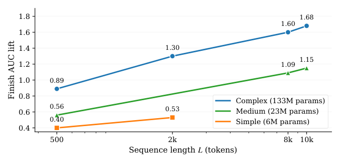
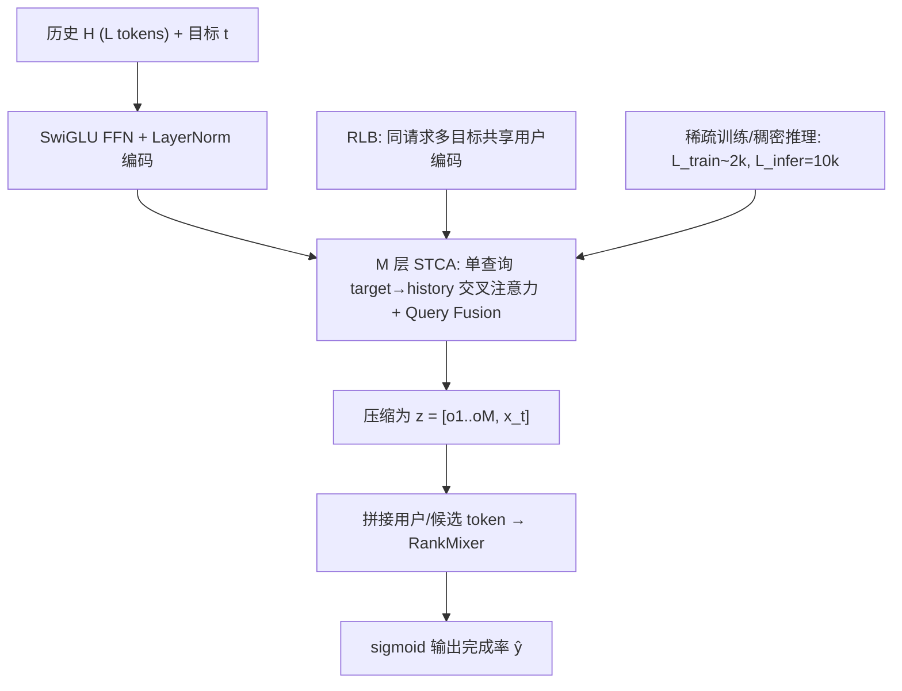
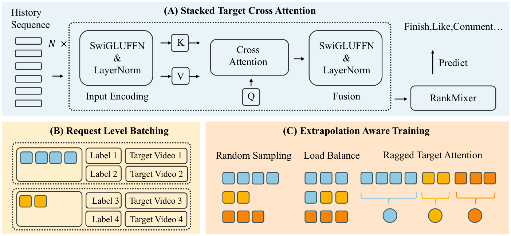

# Make It Long, Keep It Fast: End-to-End 10K Long User Behavior Sequence Modeling for Billion-Scale Douyin Recommendation (又长又快：抖音十亿级推荐中端到端万级长用户行为序列建模)

- **会议/期刊**: WWW 2026
- **作者与机构**: Lin Guan, Jia-Qi Yang, Zhishan Zhao, Beichuan Zhang 等（字节跳动 / 抖音）
- **推荐链路定位**: 精排（Ranking，端到端长序列编码器）
- **研究方向**: 序列与会话推荐 / 工业级架构与系统
- **论文原文**: [https://arxiv.org/abs/2511.06077v3](https://arxiv.org/abs/2511.06077v3)
- **开源代码**: 暂未开源

## TL;DR (1分钟核心速览)

短视频推荐需利用数千级历史行为，但主流两阶段范式（检索截断 + 精排）破坏端到端梯度且丢弃交互。本文提出 STCA——以目标为唯一 Query 对全历史做堆叠交叉注意力，将每层复杂度从 $O(L^2)$ 降至 $O(L)$；再用请求级批处理 RLB 复用用户侧编码（带宽降 77–84%、吞吐 2.2×），并以"稀疏训练、稠密推理"外推至 10K。抖音离线 AUC 提升 +0.49%（Finish），全流量 A/B 中 Finish +3.35%、停留时长 +0.93%。

## Background & Motivation (背景与核心矛盾)

- **主流范式**: 工业界普遍采用两阶段——先用 SIM/TWIN 类检索从万级历史中截取与目标相关的数百条，再送入 DIN/Transformer 精排；序列模块容量与长度受算力硬约束。
- **前人局限**: (1) 检索/截断切断了端到端梯度，预选阶段即丢失信息；(2) 历史自注意力对 $L$ 呈二次复杂度，且分布式训练中长历史的存储、CPU→GPU 传输与重复编码使系统成为 I/O 与带宽瓶颈而非 FLOP 瓶颈。
- **核心洞察 (Key Insight)**: 排序任务中真正重要的信号是**目标与历史之间的直接交互**，历史项之间的二阶关系信息量相对次要；因此可牺牲 history self-attention，换取线性复杂度下的超长上下文。同时作者观察到：当架构与系统真正支持端到端长序列时，模型质量随序列长度与序列模块容量**单调可预测地提升**（图 1），呈现类 LLM 的 scaling law。
- **本文切入点**: 用"单查询交叉注意力 + 用户中心批处理 + 长度外推训练"三件套，在固定延迟预算内把端到端序列建模推到 10K。

<figure class="paper-figure" markdown="span">
  <figcaption>图1：随序列长度和模型容量扩展。随着用户序列长度增加（500→10k tokens）和序列模块容量增加（Simple：6M，Medium：23M，Complex：133M 参数），序列模块（STCA）的 Finish AUC 提升（百分点）。</figcaption>
</figure>

## Method (核心方法设计)

### 1. 整体框架 (Overall Architecture)

输入为用户历史 $\mathcal{H}=\{(v_i,a_i)\}_{i=1}^{L}$（视频、行为类型、位置、时间差融合为 token 嵌入）与候选目标 $t$。历史与目标先经维度保持的 SwiGLU FFN + LayerNorm 编码；随后 $M$ 层 STCA 以目标为唯一 Query 逐层与全历史做交叉注意力，并通过 query fusion 将低层摘要回注高层；最终将各层摘要与目标嵌入压缩为 target-aware token $z$，与用户侧、候选侧辅助 token 拼接后送入 RankMixer 输出完成率 $\hat{y}$。训练侧 RLB 将同一请求的多个目标聚为一个 micro-batch 共享用户编码；外推训练在短窗口上采样、推理时服务 10K 历史。

<figure class="paper-figure" markdown="span">
  <figcaption>图2：我们的长历史排序栈概览。(A) 堆叠目标交叉注意力：从目标到完整历史的单查询交叉注意力，配合逐层融合，实现历史长度的线性扩展和端到端优化。(B) 请求级批处理：每个请求只计算一次用户/历史编码，并在多个目标间复用，以减少带宽和计算。(C) 外推感知训练：训练时采样较短历史，推理时服务较长历史（稀疏训练，稠密推理）。</figcaption>
</figure>

### 2. 关键设计拆解 (Key Designs)

1. **STCA：单查询目标-历史交叉注意力（把二次复杂度打成线性）**：痛点在于 Transformer 对 $[t;\mathcal{H}]$ 做自注意力需 $O(L^2)$。本文令目标为唯一 Query，第 $i$ 层第 $j$ 头：
$$\alpha^{(i,j)}=\mathrm{softmax}\!\left(\frac{q^{(i)}W_Q^{(i,j)}\,(\tilde{X}^{(i)}W_K^{(i,j)})^\top}{\sqrt{d_h}}\right)\in\mathbb{R}^{1\times L},\quad o^{(i,j)}=\alpha^{(i,j)}(\tilde{X}^{(i)}W_V^{(i,j)})$$
每层代价降为 $O(Ldh)$。更关键的是单 Query 允许**重排计算**：先算 $1\times L$ 的 $\alpha$，再与 $X$ 相乘后投影，即 $\mathrm{Attn}(q,X)=(\alpha X)W_V$，从而**无需物化 $L\times d_h$ 的 $XW_K$、$XW_V$ 中间张量**，显存与长度相关 FLOPs 进一步下降。物理直觉：把算力全部押注在"目标↔历史"相关性上，而非信息量较低的历史内部关系。

2. **Query Fusion 堆叠（用目标条件化融合捕获高阶依赖）**：单层交叉注意力只能抽取一阶相关性。第 $i+1$ 层将此前所有层摘要与目标嵌入拼接后压缩回 $d$ 维作为新 Query：
$$q^{(i+1)}=\mathrm{LN}\Big(\mathrm{SwiGLUFFN}^{(i+1)}\big([o^{(1)}\|\cdots\|o^{(i)}\|x_t]\,W_C^{(i+1)}\big)\Big)$$
使高层 Query 携带"已被目标筛选过的历史摘要"，实现逐层递进的目标条件化推理；消融显示该机制单独贡献 +0.06% AUC。

3. **RLB 与长度外推训练（系统与训练侧的两把钥匙）**：RLB 将同一用户/请求的 $m$ 个目标聚合为 $\mathcal{B}_u$，用户路径 $\Phi_{\text{user}}(\mathcal{H})$ 只算一次复用 $m$ 次，损失为 $\mathcal{L}_u=\frac{1}{m}\sum_k \mathcal{L}_{\text{BCE}}(\hat{y}(u,t_k),y_k)$——由期望线性性可知它是经验风险的**无偏估计**，只改计算布局不改目标。外推训练用 U 形 Beta 分布采样训练长度 $L_{\text{train}}\in[L^{\min},L^{\max}]$，保持平均长度 $\bar{L}\approx 2k$（序列稀疏度 $\mathrm{SS}=\bar{L}/L^{\max}\approx 20\%$），并**只保留时间上最近的 $L_{\text{train}}$ 条**（时间后缀选择），配合批级负载均衡与 ragged attention kernel 消除 padding 浪费。总损失即标准 BCE，无额外负采样（精排为 pointwise CTR 式二分类）。

## Experimental Setup & Evaluation Protocol (实验设置与评估协议)

- **数据集与预处理**: 抖音线上离线日志，三个排序目标——Finish（完播）、Skip（快速划走）、Head（点击进创作者主页）；序列 token 为 (video, action-type, position, time-delta) 融合嵌入。

| 数据集 | 序列规模 | 目标数 | 特征说明 | 备注 |
| :--- | :---: | :---: | :--- | :--- |
| Douyin 离线日志 | 训练均值 ~2k tokens，推理至 10k | 3（Finish/Skip/Head） | 用户/上下文、内容、创作者多模态特征 | 所有模型共享相同非序列特征、优化器与数据划分 |

- **数据划分与防穿越 (Splitting Strategy)**: 工业日志按时间顺序划分训练/评估（时间戳切分），评估集为后续时段曝光样本。
- **排名评测协议 (Ranking Protocol)**: 报告 **AUC**（越高越好）与 **NLL**（越低越好，衡量校准），非全库 Full-Ranking 的召回指标；所有结果以生产基线（RankMixer + 单层 Target Attention + TWIN(10k)）为 0 点报告相对 % 变化。
- **对比基线与超参设置**: 基线为 DIN、Transformer（自注意力）、HSTU，且**均额外加持 TWIN(10k) 检索块**（本文方法反而移除 TWIN），构成对基线有利的保守设定；在**近似匹配算力**下比较（对二次复杂度基线缩减深度/宽度）。STCA 默认 4 层、$d=256$、$h=8$、SwiGLU 扩展比 $r=4$，RLB 取 $m=8$。

## Key Experimental Results (实验关键数据)

### 1. 主实验对比 (Main Results)

| 模型 | Finish ΔAUC↑ | Finish ΔNLL↓ | Skip ΔAUC↑ | Skip ΔNLL↓ | Head ΔAUC↑ | Head ΔNLL↓ |
| :--- | :---: | :---: | :---: | :---: | :---: | :---: |
| Baseline (RankMixer+TA+TWIN) | 0.00 | 0.00 | 0.00 | 0.00 | 0.00 | 0.00 |
| DIN (+TWIN) | +0.19 | −0.17 | +0.23 | −0.18 | +0.19 | −0.21 |
| Transformer (+TWIN) | +0.25 | −0.46 | +0.27 | −0.36 | +0.38 | −0.27 |
| HSTU (+TWIN) | +0.31 | −0.86 | +0.52 | −0.62 | +0.36 | −0.43 |
| **Ours (STCA+RLB+Ext, 无 TWIN)** | **+0.49** | **−1.16** | **+0.71** | **−1.14** | **+0.39** | **−1.41** |

在线 A/B（一个月，全流量，替换 TWIN(10k)）：

| 场景 | 30日活跃 | 停留时长 | Finish | 评论 | 点赞 |
| :--- | :---: | :---: | :---: | :---: | :---: |
| 抖音 全体 | +0.116% | +0.927% | **+3.345%** | +1.568% | +1.828% |
| 抖音 Lite 全体 | +0.128% | +0.847% | **+4.228%** | +2.617% | +2.383% |
| 抖音 低活用户 | +0.366% | +2.007% | +5.499% | +2.685% | +2.437% |

### 2. 消融实验 (Ablation Study)

4 层 STCA @ 512 tokens，相对 RankMixer-only 的 Finish AUC 提升：

| 组件变更 | ΔAUC | 说明 |
| :--- | :---: | :--- |
| 稀疏 ID 嵌入 128→320 | +0.08% | 视频 ID 嵌入加宽，小初始化 + 低 LR 防不稳 |
| 序列侧 FFN + 深度 2L→4L | **+0.18%** | 单次最大增益 |
| FFN → SwiGLU | +0.11% | 隐层加宽 ×2 |
| 注意力头 8→16 | +0.05% | 目标条件化选择性增强 |
| Query Fusion | +0.06% | 低层摘要回注高层 |
| Time-delta 侧信息 | +0.08% | 请求时间 − 物品时间戳，近因先验 |

外推训练关键消融：

| 设置 | 指标 | 结果 |
| :--- | :--- | :---: |
| $L^{\max}_{\text{train}}$=2k / 4k / 10k | Finish AUC lift | +0.03% / +0.09% / +0.21% |
| $\bar{L}_{\text{train}}$=1.0k / 2.0k / 2.5k | AUC lift（SS） | +0.09%(10%) / +0.21%(20%) / +0.22%(25%) |
| Beta 形状 $\alpha$=0.02 / 0.5 / 10 | AUC lift | +0.21% / +0.11% / +0.08% |
| 子序列选择：时间后缀 vs 随机 | AUC lift | +0.21% vs 0（无增益） |

### 3. 关键实验发现 (Key Findings)

1. **线性 vs 二次的算力前沿差距随 $L$ 急剧放大**：$L$ 从 500→10k，STCA 序列侧 FLOPs 仅 1.06→21.06 GFLOPs（19.9×），Transformer 则 2.08→236.26 GFLOPs（113.6×）；在 NLL≈0.396 的同等质量下，STCA 用 10k 长度仅需 21.06 GFLOPs，而 Transformer 需 8k 长度 + 156.24 GFLOPs（约 7.4× 更高），证明"牺牲 history self-attention"在短视频排序中几乎无损。
2. **外推训练以 1/3 算力拿到约 80% 的收益**：$\bar{L}_{\text{train}}=2k$、$L^{\max}_{\text{train}}=10k$、$L_{\text{infer}}=10k$（外推比 $\rho=5$）时离线 AUC +0.23%，而全 10k 训练为 +0.30%；SS 仅 20%，远优于 HSTU 随机长度训练的 57.6%。同时 $L^{\max}_{\text{train}}$ 必须逼近推理长度（2k→10k 使增益从 +0.03% 升至 +0.21%），说明"暴露校准过的长尾"是外推成立的前提。
3. **系统杠杆决定可部署性，且增益集中在低活用户**：$L=2k$ 时 RLB 降低端到端带宽 84%（$L=512$ 为 77%）、PS CPU 减半、训练吞吐 2.2×（叠加 kernel 优化达 5.1×）、最大可训练长度扩展约 8×；线上低活用户 Finish 提升 +5.50%，显著高于高活用户的 +3.80%，说明长历史端到端建模对近期行为稀疏/噪声大的用户补偿最强。代价是移除 TWIN 后 GPU 成本 +33%、CPU −16%，净成本约 +17%。

## Highlights, Limitations & Rating (亮点、对比与审稿评价)

- **与代表作对比 (vs. Prior Work)**: 与 SIM/TWIN 类两阶段检索相比，本文不做截断/检索，保留全历史端到端梯度；与 DIN 相比，从单层 target attention 升级为多层堆叠 + query fusion，获得高阶目标条件化推理；与 HSTU 相比，同样追求长序列 scaling，但用单查询交叉注意力替代自注意力，SS 从 57.6% 降至 20%，算力前沿更优。
- **可迁移亮点**: (1) "单 Query 重排计算避免物化 KV"是任何 target-conditioned 长序列编码器都可直接借用的 kernel 级技巧；(2) 请求级批处理的无偏性论证（期望线性性）为所有"一用户多目标"的工业训练管线提供了零损加速范式；(3) U 形 Beta 长度采样 + 时间后缀选择构成一套低成本的长度外推课程。
- **审稿级局限批判**: (1) 离线评估仅报告 AUC/NLL，缺少 Full-Ranking 召回类指标与冷启动/新用户分桶，长序列对无历史用户无收益；(2) 外推比 $\rho=5$ 与 Beta 形状 $\alpha$ 属经验超参，论文未给出跨业务的自适应选择准则，且净推理成本 +17% 的收益-成本边界依赖具体流量结构。
- **四维评分**: 创新性 ⭐⭐⭐⭐ | 实验扎实度 ⭐⭐⭐⭐⭐ | 方法清晰度 ⭐⭐⭐⭐⭐ | 落地价值 ⭐⭐⭐⭐⭐

