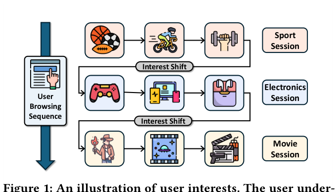
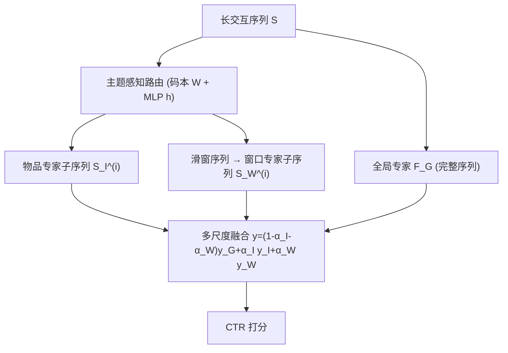
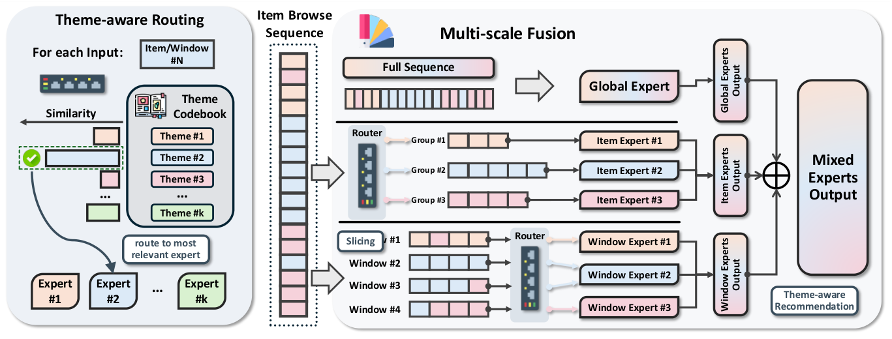

# Mixture of Sequence: Theme-Aware Mixture-of-Experts for Long-Sequence Recommendation (序列混合：面向长序列推荐的主题感知混合专家)

- **会议/期刊**: WWW 2026
- **作者与机构**: Xiao Lin, Zhicheng Tang, Weilin Cong, Kai Wang, Yajuan Wang, Zhining Liu, Wen-Yen Chen, Shuo Chang, Rong Jin, Huayu Li, Hanghang Tong 等（UIUC & Meta）
- **推荐链路定位**: 精排（CTR 预估）
- **研究方向**: 序列与会话推荐 / CTR 预估与特征交叉
- **论文原文**: [https://arxiv.org/abs/2604.20858v1](https://arxiv.org/abs/2604.20858v1)
- **开源代码**: [https://github.com/xiaolin-cs/MoS](https://github.com/xiaolin-cs/MoS)

## TL;DR (1分钟核心速览)

长序列推荐的核心痛点是用户兴趣在会话间剧烈跳变（session hopping），导致大量无关甚至误导性交互污染表征。本文提出模型无关的 MoE 框架 MoS：用主题码本路由器把长序列拆成多条主题一致子序列，再以全局/物品/窗口三类专家做多尺度融合。在 MicroVideo、KuaiVideo、EBNeRD-Small 三个数据集、四种骨干（Mamba4Rec/TransAct/TWIN/SDIM）上，无负采样全库排序下 AUC 平均提升 0.68%、GAUC 提升 0.72%，且 FLOPs 低于所有 MoE 对照。

## Background & Motivation (背景与核心矛盾)

- **主流范式**: 长序列 CTR 建模以 Transformer（TransAct/TWIN）、Mamba（Mamba4Rec）、哈希采样（SDIM）为主，靠注意力或选择性拷贝捕捉长程依赖。
- **前人局限**: ①这些机制本质是连续函数逼近器，难以拟合兴趣的**突变不连续信号**，注意力无法把跳变前的所有无关会话权重压到零；②MoE 类方法（GShard/DSelect-k/Expert Choice）的常规 MLP 路由器把物品近似均匀分派到各专家，专家缺乏主题分化。
- **核心洞察 (Key Insight)**: 作者用余弦自相似矩阵做案例分析，形式化出 **Session Hopping** 现象——会话内兴趣稳定（Stability）、会话间突变（Discontinuity）、非相邻会话兴趣重现（Reappearance）。重现性意味着长序列本身蕴含可复用的预测线索，关键在于**按主题而非按时间**重组序列。
- **本文切入点**: 把"子序列抽取"与 MoE 天然对齐——每个专家只看一条主题一致子序列，从而在结构上物理隔离误导信号。

<figure class="paper-figure" markdown="span">
  <figcaption>图1：用户兴趣示意图。该用户经历两次兴趣转移，形成三个明显不同的会话。在每个会话内，浏览历史反映了用户一致的兴趣。</figcaption>
</figure>

## Method (核心方法设计)

### 1. 整体框架 (Overall Architecture)

MoS 是即插即用的 MoE 外壳：输入用户长序列后，主题感知路由器依据码本把物品（或滑窗）分派到 top-k 专家，形成多条主题子序列；同时保留一条不经路由的全局专家处理完整序列。三类专家（全局 1 个、物品 n 个、窗口 n 个）输出按可学习权重加权融合得到最终 CTR 打分。训练采用三阶段渐进范式：骨干预热 → 主题专家预热 → 联合微调，以缓解 MoE 优化难度。

<figure class="paper-figure" markdown="span">
  <figcaption>图3：MoS的流程。左图展示了主题感知路由，它根据码本中的主题向量将输入分配给专家。右图展示了多尺度融合，它通过从完整序列中提取不同粒度的子序列来建模用户行为。</figcaption>
</figure>

### 2. 关键设计拆解 (Key Designs)

1. **主题感知路由 (Theme-aware Routing)**：痛点是用 MLP 路由器分派过于均匀、专家无分化。MoS 维护码本 $\boldsymbol{W}\in\mathbb{R}^{n\times D}$，第$i$行即第$i$ 个专家的主题向量，打分网络为余弦相似度：
$$\mathbf{H}(\boldsymbol{x})=\left(\frac{\|\boldsymbol{h}(\boldsymbol{x})\|_2}{\sqrt{\mathrm{diag}(\boldsymbol{W}\boldsymbol{W}^T)}}\right)^{-1}\boldsymbol{W}\boldsymbol{h}(\boldsymbol{x})$$
再经 KeepTopK+softmax 得稀疏门控。由于打分只依赖方向而非模长，内部高相似的子序列会被稳定路由到同一专家（Proposition 1），从几何上保证主题凝聚性。

2. **码本 EMA 更新与 k-means 初始化**：若码本与 MLP 联合梯度优化，二者会因线性性坍缩成单一 MLP，码本失去意义。故借鉴 VQ-VAE 用指数滑动平均更新码本行：
$$\boldsymbol{W}_i^{(t)}=\gamma\boldsymbol{W}_i^{(t-1)}+(1-\gamma)\frac{\sum_{\boldsymbol{x}\in\mathcal{B}}\mathbb{I}(G(\boldsymbol{x})[i]>0)\boldsymbol{h}(\boldsymbol{x})}{\sum_{\boldsymbol{x}\in\mathcal{B}}\mathbb{I}(G(\boldsymbol{x})[i]>0)}$$
使每个码字自适应追踪其主题下物品嵌入的质心；并以预训练嵌入上的 k-means 质心初始化，避免码字塌缩、保证主题多样性。

3. **多尺度融合与训练目标**：子序列抽取破坏时间连续性，故引入三类专家互补——全局专家 $F_G$退化为原骨干（$\boldsymbol{y}_G=F(\mathbf{X}(\mathcal{S}))$）捕捉全局漂移兴趣；物品专家按主题聚合$\boldsymbol{y}_I=\sum_i G_I(\boldsymbol{x}_{v_t})[i]F_I^{(i)}(\mathbf{X}(\mathcal{S}_I^{(i)}))$；窗口专家在步长$s$、窗长$L$的滑窗序列上做同样路由，兼顾语义与短期时序。最终$\boldsymbol{y}=(1-\alpha_I-\alpha_W)\boldsymbol{y}_G+\alpha_I\boldsymbol{y}_I+\alpha_W\boldsymbol{y}_W$。损失沿用骨干的 CTR 交叉熵（无额外对比/负采样项），三阶段训练中$\alpha$从$(0,0)$到$(0.5,0.5)$再到可调值。复杂度上，MoS 额外开销为$O\!\left(\frac{k_1^2N^2}{n_1}+\frac{k_2^2N^2}{s^2n_2}\right)$，约为共享专家式 MoE 的 53%。

## Experimental Setup & Evaluation Protocol (实验设置与评估协议)

- **数据集与预处理**: 三个真实数据集，覆盖短视频、在线视频与新闻场景：

| 数据集 | 场景 | 特征说明 |
| :--- | :---: | :--- |
| MicroVideo | 短视频娱乐 | 多模态图像嵌入 |
| KuaiVideo | 快手在线视频 | 用户–视频交互 |
| EBNeRD-Small | 数字出版新闻 | 个性化新闻推荐 |

- **数据划分与防穿越 (Splitting Strategy)**: 遵循 BARS Benchmark 默认设置（按时间顺序构造历史序列与下一物品标签，具体切分细节见附录 C.1）。
- **排名评测协议 (Ranking Protocol)**: 明确采用**无负采样全库排序**（ranking over the entire item set without negative sampling），指标为 AUC 与 GAUC；效率指标为 FLOPs。
- **对比基线与超参设置**: 路由维度对比 GShard、DSelect-k、Expert Choice Routing 及无 MoE 的 Vanilla 骨干；融合维度对比 MIRRN、AttenMixer、MiasRec。骨干为 Mamba4Rec/TransAct/TWIN/SDIM；Adam 优化器，学习率 $\{1\text{e-}4,5\text{e-}4,1\text{e-}3\}$，码本维度$\{16,32,64\}$，$\gamma=0.999$，窗长 8、步长 4，专家数 5、top-$k\in\{1,2\}$，$\alpha_I=\alpha_W=0.25$，A100 GPU。

## Key Experimental Results (实验关键数据)

### 1. 主实验对比 (Main Results)

MoS 在四种骨干上均取得最优平均排名（AUC 排名 1/1/1/1），下表摘取代表性数值（括号为相对 Vanilla 增益）：

| 骨干 | 方法 | MicroVideo AUC | MicroVideo GAUC | KuaiVideo AUC | KuaiVideo GAUC | EBNeRD AUC | EBNeRD GAUC |
| :--- | :--- | :---: | :---: | :---: | :---: | :---: | :---: |
| Mamba4Rec | Vanilla | 66.55 | 69.16 | 66.27 | 66.26 | 63.08 | 62.68 |
| Mamba4Rec | DSelect-k | 68.40 | 68.94 | 66.48 | 66.22 | 63.59 | 62.50 |
| Mamba4Rec | GShard | 66.05 | 68.15 | 65.89 | 65.74 | 63.26 | 63.79 |
| Mamba4Rec | **MoS** | **69.46**(+2.91) | **70.01**(+0.85) | **66.67**(+0.40) | **66.67**(+0.41) | **64.07**(+0.99) | **64.54**(+1.86) |
| TransAct | Vanilla | 70.58 | 69.90 | 67.67 | 65.92 | 70.89 | 70.25 |
| TransAct | **MoS** | **71.34**(+0.76) | **70.51**(+0.61) | **67.90**(+0.23) | **68.10**(+2.18) | **71.06**(+0.17) | **70.71**(+0.46) |
| TWIN | Vanilla | 70.34 | 69.67 | 69.36 | 66.60 | 69.85 | 69.54 |
| TWIN | **MoS** | **71.11**(+0.77) | **70.26**(+0.59) | **69.62**(+0.26) | **66.89**(+0.29) | **70.30**(+0.45) | **69.81**(+0.27) |
| SDIM | Vanilla | 70.50 | 69.62 | 68.56 | 66.61 | 69.63 | 69.03 |
| SDIM | **MoS** | **71.36**(+0.86) | **70.23**(+0.61) | **69.38**(+0.82) | **66.75**(+0.14) | 69.49(-0.14) | **69.40**(+0.37) |

与融合类基线对比，MoS 最优变体在三个数据集上分别领先最强基线 2.39/1.62、1.68/2.60、1.87/1.70（AUC/GAUC）。

### 2. 消融实验 (Ablation Study)

以 $\alpha_I,\alpha_W$在$\{0,0.2,\dots,1\}$上扫描（$\alpha_I+\alpha_W\le1$）替代传统 w/o 表格：

| 配置 | 含义 | MicroVideo AUC | MicroVideo GAUC |
| :--- | :--- | :---: | :---: |
| 仅全局专家 ($\alpha_I=\alpha_W=0$) | 退化为骨干 | 70.58 | 69.90 |
| 两两融合（三角边） | 全局+物品 或 全局+窗口 | 介于两者之间 | 介于两者之间 |
| 全融合（三角内部） | 三类专家联合 | **70.94–71.20** | **70.20–70.27** |

### 3. 关键实验发现 (Key Findings)

1. **全融合严格优于单专家与两两融合**：三角内部区域 AUC 稳定在 70.94–71.20，说明全局、物品、窗口三类专家捕捉的是互补行为模式，而非冗余信息；且性能对 $\alpha$ 不敏感，工程调参成本低。
2. **路由一致性是性能来源的直接证据**：追踪最热门物品的分派频率，MoS 始终将其路由到固定专家（如 expert #2），而 GShard/DSelect-k/Expert Choice 近似均匀分派——专家分化不足正是这些 MoE 基线在推荐数据上增益微弱甚至负增益（如 Mamba4Rec+GShard 的 AUC 下降 0.50）的根因。
3. **长序列与专家数均呈正向扩展**：序列长度从 100 增至 400 时四种骨干 AUC/GAUC 单调上升，验证"拆成主题子序列"确实缓解了长序列噪声；专家数超过 4 后增益饱和，暗示潜在主题数有限，过多专家会把有效信息切碎并抬高算力。

## Highlights & Limitations (亮点、对比与审稿批判)

- **与代表作对比 (vs. Prior Work)**: 相比 TransAct/TWIN 等靠注意力软性降权，MoS 用稀疏路由**硬隔离**跳变前会话，从结构上杜绝误导信号；相比 GShard/DSelect-k 等通用 MoE 路由器，MoS 的码本余弦路由带来可证明的主题凝聚性（Proposition 1）与可观测的专家专业化；相比 MIRRN/AttenMixer 的多尺度融合，MoS 的尺度划分与主题路由正交耦合，且 FLOPs 更低。
- **可迁移亮点**: ①"码本 + EMA + k-means 初始化"的主题路由可直接迁移到多兴趣召回与跨域序列建模；②三阶段渐进训练（骨干预热→专家预热→联合微调）是 MoE 推荐模型稳定收敛的通用配方。
- **审稿级局限批判**: ①窗口大小 8、步长 4、专家数 5 等关键超参在三个数据集上固定，缺少跨域敏感性分析，新闻场景（EBNeRD）上 SDIM 甚至出现 AUC 负增益，泛化边界不清；②主题数受限于码本大小，无法处理会话内多主题交织的细粒度兴趣，且 EMA 码本更新与三阶段训练带来额外工程复杂度，线上增量更新成本未评估。

## Rating (四维评分)

- **方法创新性 (Novelty)**: ⭐⭐⭐⭐ （Session Hopping 现象刻画精准，码本余弦路由有 Proposition 1 的几何支撑，但 MoE+多尺度融合的组合本身不算全新范式）
- **评估协议与实验扎实度 (Protocol & Experiments)**: ⭐⭐⭐⭐ （三数据集×四骨干×无负采样全库排序较扎实，含效率与路由行为分析，但缺显著性检验与跨域超参敏感性）
- **写作与数学规范度 (Clarity & Rigor)**: ⭐⭐⭐⭐ （现象—动机—方法的逻辑链清晰，公式简洁，复杂度分析给出 53% 的量化对比）
- **工业落地与复现价值 (Industrial & Practical Value)**: ⭐⭐⭐⭐⭐ （模型无关即插即用、代码开源、FLOPs 低于同类 MoE，直接适配现有长序列精排系统）
