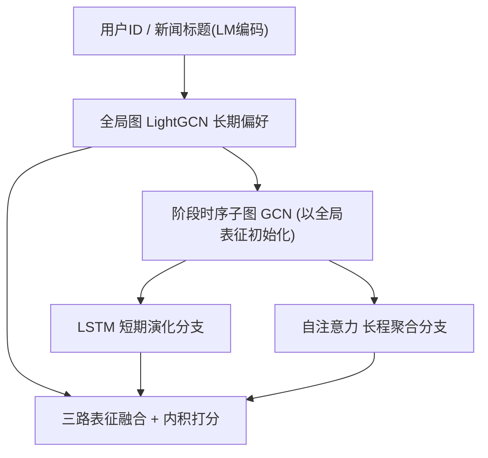
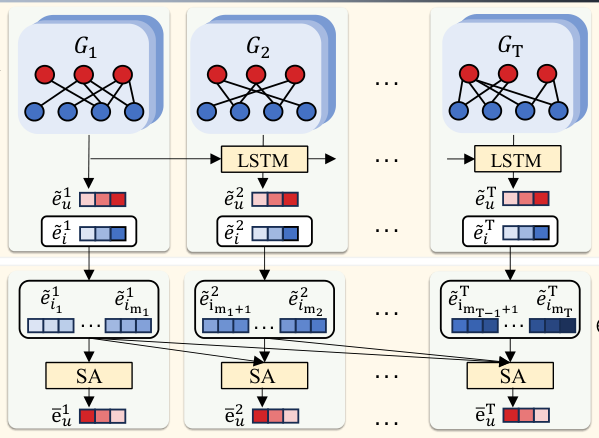

# Modeling Stage-wise Evolution of User Interests for News Recommendation (新闻推荐中用户兴趣的阶段式演化建模)

- **会议/期刊**: WWW 2026 (The ACM Web Conference 2026)
- **作者与机构**: Zhiyong Cheng, Yike Jin, Zhijie Zhang, Huilin Chen, Zhangling Duan, Meng Wang（合肥工业大学、合肥综合性国家科学中心人工智能研究院）
- **推荐链路定位**: 召回（用户-新闻匹配打分）
- **研究方向**: 序列与会话推荐 / 图神经网络推荐
- **论文原文**: [https://arxiv.org/abs/2603.10471v1](https://arxiv.org/abs/2603.10471v1)
- **开源代码**: [https://github.com/yikeJin/SEIN](https://github.com/yikeJin/SEIN)

## TL;DR (1分钟核心速览)

新闻推荐中用户兴趣既受稳定阅读习惯驱动，又被突发事件快速改变，而现有方法要么依赖单一静态交互图（只能抓长期协同信号、推荐过时内容），要么只做短期序列建模（丢失高阶协同结构）。本文提出 SEIN 统一框架：全局偏好模块用 LightGCN 在全图上学习稳定协同表征并作为初始化，局部偏好模块把用户历史切成阶段式时序子图，用 LSTM 分支刻画逐阶段演化、自注意力分支聚合长程跨阶段依赖，再以对比一致性 + 平滑正则约束二者对齐。在 Adressa-large 与 MIND-large 上，AUC 分别达 0.7993 / 0.5804，相对最强基线 CROWN 提升约 22.0% / 5.5%。

## Background & Motivation (背景与核心矛盾)

- **主流范式**: 新闻推荐已从 NPA/NRMS/NAML 的注意力语义建模，演进到 LightGCN/CNE-SUE 的图协同建模，以及 LSTUR/HieRec/TCCM 的时序建模。
- **前人局限**: ① 静态全局图方法（LightGCN、CNE-SUE）把用户偏好视为不变，无法捕捉兴趣漂移，易推过时新闻；② 纯短期序列方法（LSTUR、HieRec）过度响应近期行为，丢失稳定高阶协同信号，表征偏向短期兴趣。
- **核心洞察 (Key Insight)**: 用户-新闻交互天然具有**阶段式时序结构**——同一时间窗内的点击反映连贯的局部兴趣，跨窗转移则刻画兴趣如何演化；因此长期稳定性与短期动态性应当**联合建模而非二选一**。
- **本文切入点**: 用全局图提供稳定先验与高质量初始化，用阶段式时序子图 + 双分支（LSTM 演化 / 自注意力长程聚合）刻画局部动态，并以正则项桥接两者。

## Method (核心方法设计)

### 1. 整体框架 (Overall Architecture)

模型输入为用户 ID 与新闻标题（预训练语言模型编码后经 MLP 投影到 $d$维）。全局偏好模块在完整用户-新闻二部图上跑 LightGCN，得到长期协同表征$\boldsymbol{e}^g_u,\boldsymbol{e}^g_i$；局部偏好模块按时间窗把每个用户的历史切成$T$个时序子图$\mathcal{G}^t$，以全局表征为初始化在各子图上做 GCN，再分别送入 LSTM 分支（逐阶段演化）与自注意力分支（跨阶段长程聚合）；最终三路表征相加融合后做内积打分，训练时叠加 BCE 主损失、对比一致性正则与一阶平滑正则。

<figure class="paper-figure" markdown="span">
  <figcaption>图1：我们模型的整体框架。它集成了一个用于稳定协同偏好的全局偏好建模模块，以及一个通过短期演化分支和长程聚合分支捕捉时间动态的局部偏好建模模块。</figcaption>
</figure>

### 2. 关键设计拆解 (Key Designs)

1. **阶段式时序子图 + 全局初始化（Stage-wise Temporal Subgraphs）**：静态图无法表达兴趣漂移，而直接切序列又会让稀疏子图学不出好表征。作者把时间轴离散为 $T$个区间，每个区间构造子图$\mathcal{G}^t=(\mathcal{U}\cup\mathcal{I},\mathcal{E}^t)$，并**以全局 LightGCN 表征作为子图 GCN 的初始嵌入**：$\boldsymbol{e}^t_u,\boldsymbol{e}^t_i=\mathrm{GCN}^{(t)}(\mathcal{G}^t;\boldsymbol{e}^g_u,\boldsymbol{e}^g_i)$。直觉是：子图交互远稀疏于全图，全局先验相当于给每个阶段提供了"行为底座"，既防止阶段信号被异质噪声污染，又加速收敛。

2. **LSTM 演化 + 自注意力长程聚合双分支**：LSTM 只建模相邻阶段转移，会遗漏早期交互对当前兴趣的长程影响。为此，LSTM 分支按 $\tilde{\boldsymbol{e}}^t_u=\mathrm{LSTM}(\boldsymbol{e}^t_u,\boldsymbol{e}^{t-1}_u)$串联阶段表征；自注意力分支则对每个阶段$t$构造**累积前缀序列**$\boldsymbol{S}^t_u=[\tilde{\boldsymbol{e}}^t_1+\boldsymbol{p}_1,\dots,\tilde{\boldsymbol{e}}^t_{m_t}+\boldsymbol{p}_{m_t}]$（$\boldsymbol{p}_j$为可学习位置编码），堆叠$L_a$层带残差的自注意力后求和得$\boldsymbol{e}^t_u$。前者保证对近期突发的敏感性，后者提供跨阶段全局时序视角，二者互补。

3. **训练目标、负采样与推理效率**：总损失为
$$\mathcal{L}=\sum_{t=1}^{T}\lambda_t\mathcal{L}^t+\lambda_{cl}\mathcal{L}_{cl}+\lambda_{sl}\mathcal{L}_{sl}+\beta\|\Theta\|_2^2$$
其中 $\mathcal{L}^t$为各阶段 BCE，$\mathcal{L}_{cl}$用 InfoNCE 拉近阶段表征$\tilde{\boldsymbol{e}}^t_u$与其全局表征$\boldsymbol{e}^g_u$、推远其他用户（温度$\tau=0.1$），$\mathcal{L}_{sl}=\|\tilde{\boldsymbol{e}}^t_u-\tilde{\boldsymbol{e}}^{t-1}_u\|_2^2$约束兴趣渐变而非突变。负采样为**每正样本随机采 4 个负例**；推理时只需一次前向得到融合表征$\hat{\boldsymbol{e}}^t_u=\tilde{\boldsymbol{e}}^t_u+\boldsymbol{e}^t_u+\boldsymbol{e}^g_u$ 后内积打分，无额外检索开销。

## Experimental Setup & Evaluation Protocol (实验设置与评估协议)

- **数据集与预处理**:

| 数据集 | #Users | #Items | #Interactions | 时间跨度 | 特征/场景说明 |
| :--- | :---: | :---: | :---: | :---: | :--- |
| Adressa-large | 3,614,911 | 81,018 | 35,244,078 | 3 个月 | 挪威新闻平台，含完整时间戳 |
| MIND-large | 1,000,000 | 161,013 | 24,155,470 | 6 周 | 微软新闻日志，周 1–4 仅有序无精确时间戳 |

- **数据划分与防穿越 (Splitting Strategy)**: Adressa 采用**全局时间戳切分**（最后一周测试、倒数第二周验证、其余训练）；MIND 剔除无标签的第 6 周，周 1–4 均分为四个伪周期用于训练/验证，**第 5 周作测试集**。
- **排名评测协议 (Ranking Protocol)**: 报告 AUC、MRR、nDCG@5、nDCG@10，取验证 AUC 最大时的测试结果，5 次独立运行取均值；训练采用 1:4 随机负采样。
- **对比基线与超参设置**: 基线含 NPA、NRMS、NAML（注意力语义类）、LightGCN、CNE-SUE（图协同类）、TCCM、CROWN（时序/因果类）。嵌入维度 $d=64$，Adam 学习率$5\times10^{-6}$，batch 1024，dropout 0.2，$\lambda_t=1e{-1}$、$\lambda_{cl}=\lambda_{sl}=1e{-2}$；Adressa 时间窗 2 周、MIND 1 周。

## Key Experimental Results (实验关键数据)

### 1. 主实验对比 (Main Results)

| Dataset | Metric | NPA | NRMS | NAML | LightGCN | CNE-SUE | TCCM | CROWN | **Ours** | Improv.% (vs CROWN) |
| :--- | :--- | :---: | :---: | :---: | :---: | :---: | :---: | :---: | :---: | :---: |
| Adressa | AUC | 0.5312 | 0.5091 | 0.5046 | 0.4996 | 0.5207 | 0.5419 | 0.6553 | **0.7993** | +22.0% |
| Adressa | MRR | 0.2521 | 0.2512 | 0.2602 | 0.4056 | 0.2471 | 0.3424 | 0.3915 | **0.5223** | +33.4% |
| Adressa | NDCG@5 | 0.2263 | 0.2206 | 0.2341 | 0.2812 | 0.2209 | 0.2380 | 0.4156 | **0.4495** | +8.2% |
| Adressa | NDCG@10 | 0.3103 | 0.3018 | 0.3002 | 0.3379 | 0.3046 | 0.3219 | 0.5283 | **0.5327** | +0.8% |
| MIND | AUC | 0.5008 | 0.5429 | 0.5479 | 0.5029 | 0.5266 | 0.5468 | 0.5501 | **0.5804** | +5.5% |
| MIND | MRR | 0.2947 | 0.3227 | 0.3173 | 0.2491 | 0.2366 | 0.3570 | 0.3431 | **0.4368** | +22.4% |
| MIND | NDCG@5 | 0.3843 | 0.3566 | 0.3489 | 0.2289 | 0.2458 | 0.3178 | 0.4156 | **0.4429** | +6.6% |
| MIND | NDCG@10 | 0.4176 | 0.4218 | 0.4134 | 0.2908 | 0.3077 | 0.4068 | 0.4691 | **0.5171** | +10.2% |

### 2. 消融实验 (Ablation Study)

| Variant (Adressa) | AUC | MRR | N@5 | N@10 |
| :--- | :---: | :---: | :---: | :---: |
| w/o LPM（去局部模块） | 0.4880 | 0.1885 | 0.1049 | 0.1416 |
| w/o STE（去 LSTM 演化） | 0.5109 | 0.2112 | 0.2570 | 0.2713 |
| w/o LRA（去长程聚合） | 0.4851 | 0.2573 | 0.3120 | 0.3322 |
| w/o GPM（去全局模块） | 0.4996 | 0.4056 | 0.2812 | 0.3379 |
| **Ours** | **0.7993** | **0.5223** | **0.4495** | **0.5327** |

### 3. 关键实验发现 (Key Findings)

1. **局部时序建模是性能主引擎**：去掉整个 LPM 后 AUC 从 0.7993 暴跌至 0.4880（甚至低于随机水平附近），说明仅靠静态全局图在新闻场景几乎失效，阶段式动态建模贡献了绝大部分增益。
2. **双分支分工明确且不可替代**：去 STE 时 MRR 掉至 0.2112（近期敏感指标受损最重），去 LRA 时 AUC 仅 0.4851（长程上下文缺失导致整体判别力崩塌），验证了"近期适应 + 长程依赖"互补的必要性。
3. **全局模块的价值不止于协同信号，更在于初始化**：w/o GPM 的 AUC 仅 0.4996，远低于完整模型，说明全局表征作为稀疏时序子图的高质量先验对收敛与表征质量至关重要；此外表 4 显示 LPM 使高交互用户新文章的 Top-10 平均排名从 1.59 提升到 0.60，中/低交互用户新文章占比从 16.4% 升至 18.7%，兼顾了时效性与相关性。

## Highlights & Limitations (亮点、对比与审稿批判)

- **与代表作对比 (vs. Prior Work)**: 相比 LightGCN/CNE-SUE 的单一静态图，本文引入阶段式时序子图并保留全局先验；相比 LSTUR/HieRec 的纯序列建模，本文用全局图提供稳定协同底座；相比 TCCM 的全局去偏与 CROWN 的因果解耦，本文聚焦细粒度阶段演化，且不依赖显式内容类别特征。
- **可迁移亮点**: ① "全局图预训练表征 → 稀疏时序子图初始化"的两阶段范式可迁移到任何交互稀疏的时序推荐场景；② 对比一致性 + 一阶平滑正则的组合是约束"动态表征不偏离长期语义"的轻量通用技巧。
- **审稿级局限批判**: ① MIND 数据集缺乏精确时间戳，只能用伪周期划分，时序建模的有效性在该数据集上验证不充分；② 每个用户需构建 $T$个子图并跑$T$ 次 GCN + LSTM + 多层自注意力，训练开销随阶段数线性增长，论文未报告训练/推理时延与显存对比；③ 时间窗大小（Adressa 最优 2 周）为数据集相关超参，跨域迁移需重新调优。

## Rating (四维评分)

- **方法创新性 (Novelty)**: ⭐⭐⭐ （全局-局部双视角 + 阶段子图双分支组合较自然，但各组件（LightGCN/LSTM/自注意力）均为成熟模块的工程化整合，理论新颖度中等）
- **评估协议与实验扎实度 (Protocol & Experiments)**: ⭐⭐⭐⭐ （两个大规模真实数据集、7 个强基线、5 次运行取均值，消融与超参敏感性完整；但 MIND 伪周期划分削弱了时序验证力度）
- **写作与数学规范度 (Clarity & Rigor)**: ⭐⭐⭐⭐ （公式与符号定义清晰、三路融合与损失设计交代完整，复杂度分析略缺）
- **工业落地与复现价值 (Industrial & Practical Value)**: ⭐⭐⭐⭐ （代码已开源，框架模块化易复现；但多子图多次 GCN 的训练开销在超大规模工业场景需额外优化）

