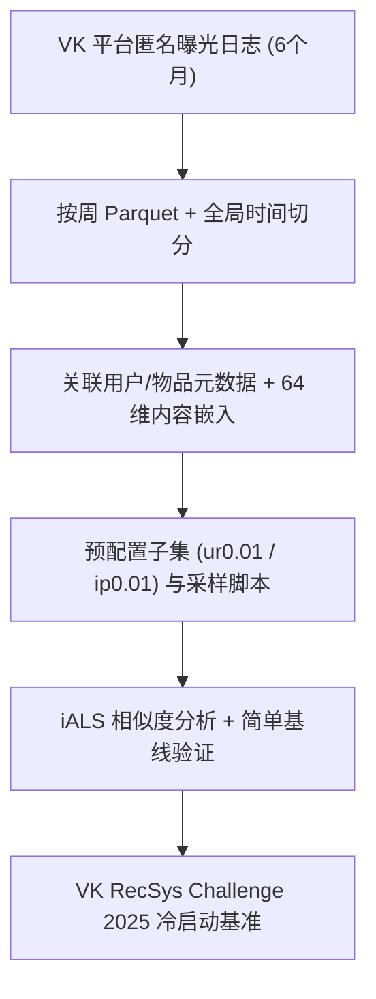

# VK-LSVD: A Large-Scale Industrial Dataset for Short-Video Recommendation (VK 大规模短视频推荐数据集)

- **会议/期刊**: WWW 2026 (The ACM Web Conference)
- **作者与机构**: Aleksandr Poslavsky, Alexander D'yakonov, Andrey Zimovnov (VK AI); Yuriy Dorn (MSU AI Center & IAI)
- **推荐链路定位**: 召回 / 序列建模 / 冷启动基准
- **研究方向**: 序列与会话推荐 / 冷启动与长尾推荐
- **论文原文**: [https://arxiv.org/abs/2602.04567v2](https://arxiv.org/abs/2602.04567v2)
- **开源代码**: 暂未开源（数据集已发布于 [HuggingFace deepvk/VK-LSVD](https://huggingface.co/datasets/deepvk/VK-LSVD)，Apache 2.0）

## TL;DR (1分钟核心速览)

短视频推荐长期缺乏**真实平台动态、长周期、多反馈信号**的开放数据：现有公开集要么用户规模仅数万（KuaiRand/KuaiRec/RecFlow），要么仅数周观测、反馈单一（MicroLens 只有评论）。本文发布 VK-LSVD——来自 VK 平台的 **407 亿次曝光、1000 万用户、1963 万视频、6 个月连续日志**，含 64 维内容嵌入、7 类隐式/显式/病毒式反馈与上下文元数据，并采用**严格全局时间切分 (GTS)**。作者用 iALS 相似度分析与简单基线验证数据质量，并以 VK RecSys Challenge 2025（近 800 人参赛、NDCG@100 评估）确立冷启动基准。

## Background & Motivation (背景与核心矛盾)

- **主流范式**: 短视频推荐以隐式反馈（观看时长、跳过）为主信号，需在会话级高频交互中建模兴趣快速漂移，并融合多模态内容。
- **前人局限**: ① 现有短视频数据集高度集中于快手生态（KuaiRand、KuaiRec、KuaiSAR、RecFlow、清华集），平台多样性缺失；② 规模与时长不可兼得——MicroLens 虽达 10 亿交互但仅含评论反馈、无全局时间线且为网页爬取；RecFlow 仅 4.2 万用户、37 天；Tenrec/NineRec 缺原始内容或观看时长。
- **核心洞察 (Key Insight)**: 短视频中"每一次曝光都是信号"——完整观看与快速跳过同样携带用户偏好信息；而长周期 + 全局时间切分才能真实刻画兴趣演化与流行度漂移。
- **本文切入点**: 以单一平台 6 个月全量匿名日志 + 丰富反馈 + 内容嵌入 + 严格 GTS，构建可支撑序列建模、冷启动与长尾研究的工业级基准。

## Method (核心方法设计)

### 1. 整体框架 (Overall Architecture)

本文为数据集论文，其"方法"即数据构建与验证流水线：从 VK 短视频服务采集匿名曝光日志 → 按周切分为 Parquet 文件并保持文件内/文件间时间有序 → 关联用户元数据、物品元数据与 64 维内容嵌入 → 施加全局时间切分（前 25 周训练 / 1 周验证 / 1 周测试）→ 提供预配置子集与采样脚本 → 用 iALS 表征相似度分析与四类简单基线完成技术验证，并以竞赛任务（为新视频排序用户）检验实用性。

### 2. 关键设计拆解 (Key Designs)

1. **全局时间切分与唯一交互记录 (Global Temporal Split)**：多数公开集采用随机划分或 Leave-One-Out，导致未来信息泄漏、无法评估流行度漂移。VK-LSVD 强制训练/验证/测试为**连续时间段**（25 周 / 1 周 / 1 周），且每个 user-item 对仅保留首次交互参数，观看时长为跨次累计（可超过视频时长，反映重看行为）。这一设计使"时间外推"评估成为默认协议，直接暴露模型对兴趣漂移的适应能力。
2. **多维反馈与内容嵌入 (Rich Feedback + 64-D Embedding)**：仅用点击/观看时长无法区分"被动曝光"与"主动偏好"。数据集提供 like/dislike/share/bookmark/click_on_author/open_comments 六类显式与深层反馈（点赞 11.7 亿、点踩仅 1186 万，极端不平衡本身即研究素材），并对每个物品给出经截断 SVD 压缩、按重要性排序的 64 维内容嵌入，支持灵活降维与多模态/内容冷启动实验。
3. **可扩展子集与冷启动竞赛任务**：40B 交互对学术算力不友好，作者提供 `ur0.01`（1% 随机用户）、`ip0.01`（1% 热门物品）等预配置子集及自定义采样脚本。竞赛任务刻意反转常规设定——**为新物品排序用户**（每视频预测 Top-100 相关用户，NDCG@100，每用户最多 100 次推荐），将冷启动从"新用户"扩展到"新物品侧"，构成非标准但贴近工业投放的基准。

## Experimental Setup & Evaluation Protocol (实验设置与评估协议)

- **数据集与预处理**: 完整数据无缺失值，交互表按周存储；用户元数据覆盖 1000 万用户（年龄 18–70、性别、80 个地理取值），物品元数据覆盖 1963 万视频（作者、时长）。

| 数据集 | #Users | #Items | #Interactions | 稀疏度/密度 | 特征/场景说明 |
| :--- | :---: | :---: | :---: | :---: | :--- |
| VK-LSVD (Ours) | 10 M | 19.6 M | 40.77 B | 0.0208% | 6 个月、7 类反馈、64-D 嵌入、上下文元数据 |
| Tsinghua U (Kuaishou) | 10 K | 153.6 K | 1 M | — | 6 个月，含原始视频 |
| RecFlow (Kuaishou) | 42 K | 82 M+9 M | 38 M+1.9 B | — | 37 天，含未曝光物品 |
| NineRec | 2 M | 144 K | 24.5 M | — | 10 个月，跨域多模态 |
| MicroLens | 34.5 M | 1.14 M | 1 B | — | 1 年，仅评论反馈、网页爬取 |
| KuaiRand | 27 K | 32 M | 322.3 M | — | 2+2 周，无偏评估 |
| KuaiRec | 7.2 K | 10.7 K | 12.5 M | 99.6% | 2 个月，近满矩阵 |
| Tenrec | 5 M | 3.75 M | 142.3 M | — | 3 个月，双平台跨域 |

- **数据划分与防穿越 (Splitting Strategy)**: **全局时间戳切分 (GTS)**——训练 25 周、验证 1 周、测试 1 周，连续时间段；基线实验同时报告 Random Split 作为对照，以量化时间切分带来的难度上升。
- **排名评测协议 (Ranking Protocol)**: 基线验证采用 ROC AUC、NDCG@20 与 Coverage；竞赛采用 **NDCG@100**（每视频 Top-100 用户排序）。基线实验未明确全库 vs 采样排序，属评估细节的薄弱处。
- **对比基线与超参设置**: 四类简单基线——Random（高覆盖无预测力）、Global Popularity、Conversion-based（优化 CTR）、iALS（以观看 >10s 为正信号）。iALS 表征用于相似度分析：用户按人口属性分组、物品按作者/时长/k-means 内容簇分组，每组采样 10,000 对计算余弦相似度。

## Key Experimental Results (实验关键数据)

### 1. 主实验对比 (Main Results)

原文 Table 4 在 `ur0.01_ir0.01` 子集上的简单基线基准（核心指标）：

| 模型 | Coverage (GTS) | ROC AUC (GTS) | NDCG@20 (GTS) | ROC AUC (Random) | NDCG@20 (Random) |
| :--- | :---: | :---: | :---: | :---: | :---: |
| Random | 0.96449 | 0.50003 | 0.00006 | 0.50216 | 0.00003 |
| Global Popularity | 0.00010 | 0.57383 | 0.00244 | 0.58999 | 0.02183 |
| Conversion-based | 0.00010 | 0.60341 | 0.00000 | **0.68107** | 0.00000 |
| **iALS** | 0.00501 | **0.58126** | **0.02623** | 0.61649 | **0.06554** |

### 2. 消融实验 (Ablation Study)

本文无模型消融，其"消融"等价于**切分协议对照**与**表征相似度验证**：

| 分析维度 | 关键数值 | 说明 |
| :--- | :---: | :--- |
| iALS NDCG@20：GTS vs Random | 0.02623 vs 0.06554 | 时间切分使难度提升约 2.5× |
| iALS ROC AUC：GTS vs Random | 0.58126 vs 0.61649 | 同上，验证 GTS 更贴近线上 |
| 物品相似度：同作者 | 0.58 | 作者是物品相似度主导因素 |
| 物品相似度：全元数据相同 | 0.66 | 内容关系被数据充分捕获 |
| 用户相似度：同性别/年龄/地理 | 显著高于随机 | 人口属性强影响用户表征 |

### 3. 关键实验发现 (Key Findings)

1. **时间切分是"照妖镜"**：iALS 在 GTS 下 NDCG@20 从 0.06554 跌至 0.02623（−60%），说明随机划分严重高估模型能力，VK-LSVD 的 GTS 协议能筛出真正抗漂移的序列模型。
2. **CTR 优化 ≠ 排序优化**：Conversion-based 模型 ROC AUC 最高（0.68107）但 NDCG@20 恒为 0，暴露"点击率校准"与"列表排序"目标错位，为多目标/重排研究提供天然反例。
3. **隐式行为足以还原内容结构**：仅用 iALS 隐向量即得同作者物品相似度 0.58、全元数据相同 0.66，证明数据中内容信号与行为信号高度自洽，支撑纯行为冷启动与内容增强两条技术路线。

## Highlights & Limitations (亮点、对比与审稿批判)

- **与代表作对比 (vs. Prior Work)**: 相比 KuaiRec（7.2K 用户、近满矩阵、2 个月）与 RecFlow（42K 用户、37 天），VK-LSVD 在用户规模上提升 2–3 个数量级且观测期达 6 个月；相比 MicroLens（10 亿交互但仅评论反馈、无全局时间线），其反馈维度与时间协议显著更贴近工业；相比 T-ECD（1350 亿但为合成电商数据），其真实短视频日志不可替代。
- **可迁移亮点**: ① "为新物品排序用户"的逆向冷启动任务设定，可直接迁移至创作者侧冷启投放；② 预配置子集 + 采样脚本的发布范式，值得所有超大规模数据集效仿以降低复现门槛。
- **审稿级局限批判**: ① 基线实验仅四个极简模型，未给出 SASRec/BERT4Rec 等序列 SOTA 的参考数值，基准"锚点"不足；② 基线评估未明确全库排序还是采样排序，且竞赛结果（2026 年 1 月）在论文中缺席，冷启动基准的有效性尚待外部验证；③ 人口属性可能引入算法偏见，作者仅作提示而未提供公平性度量。

## Rating (四维评分)

- **方法创新性 (Novelty)**: ⭐⭐⭐ （数据集贡献为主，GTS 协议与逆向冷启动任务设定具工程新意，但无算法层面创新）
- **评估协议与实验扎实度 (Protocol & Experiments)**: ⭐⭐⭐ （GTS 与 Random 双协议对照、iALS 相似度验证较扎实，但基线过简、缺序列 SOTA 锚点与竞赛结果）
- **写作与数学规范度 (Clarity & Rigor)**: ⭐⭐⭐⭐ （Schema、统计表与伦理说明清晰完整，无复杂公式故无符号歧义，但基线评估细节略含糊）
- **工业落地与复现价值 (Industrial & Practical Value)**: ⭐⭐⭐⭐⭐ （407 亿真实交互 + Apache 2.0 + 子集脚本 + 活跃竞赛，是短视频序列推荐与冷启动研究的高价值公共基础设施）

