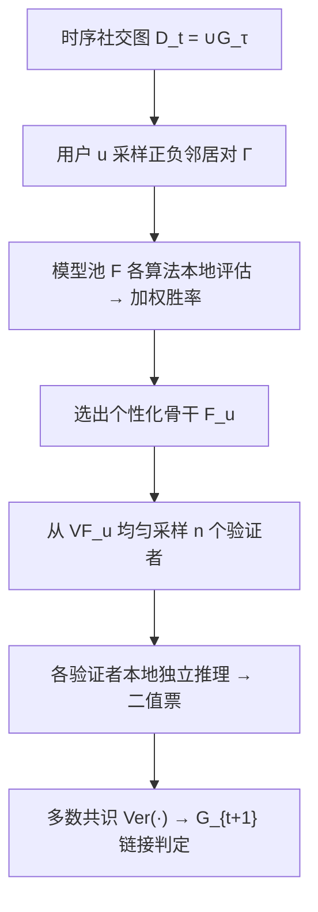
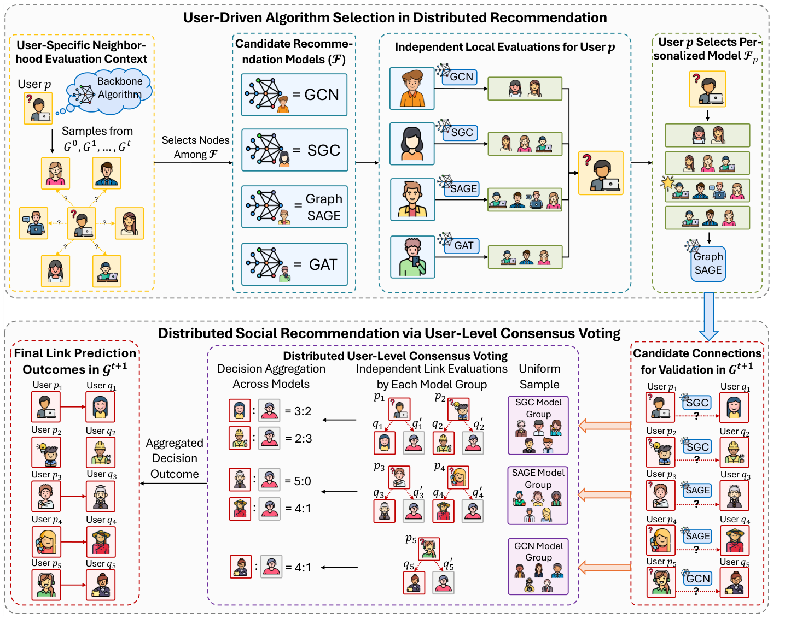

# From Aggregation to Selection: User-Validated Distributed Social Recommendation (从聚合到选择：用户验证的分布式社交推荐)

- **会议/期刊**: WWW 2026 (HCRS Workshop)
- **作者与机构**: Jingyuan Huang, Dan Luo, Zihe Ye, Weixin Chen, Minghao Guo, Yongfeng Zhang (Rutgers University / Lehigh University / HKBU)
- **推荐链路定位**: 召回（好友链接预测）
- **研究方向**: 社交与群组推荐 / 去偏公平与工业架构
- **论文原文**: [arXiv:2505.21388v4](https://arxiv.org/abs/2505.21388v4)
- **开源代码**: [agiresearch/DeSocial](https://github.com/agiresearch/DeSocial)

## TL;DR (1分钟核心速览)

现有分布式社交推荐把多个客户端模型的打分用固定规则**聚合**，聚合模块成为隐式单点信任，用户无法参与验证；且集中式 Hit@K/NDCG 无法度量"用户确认的推荐是否正确"。本文提出 DeSocial：每个用户基于**本地社交邻域**从模型池（MLP/GCN/GAT/GraphSAGE/SGC）中自选个性化骨干，再由 n 个验证者用户**独立本地推理 + 多数共识投票**给出最终链接判定，并提出共识式指标 Acc@K。在 UCI/Memo-Tx/Enron/GDELT 四个真实社交网络上，Acc@2 较最强单骨干平均提升 4.51%，较集成/联邦基线亦全面领先。

## Background & Motivation (背景与核心矛盾)

- **主流范式**: 社交推荐（好友建议）本质是时序图上的链接预测；分布式范式让多个用户各自持模型、联合影响推荐结果，以贴合"以用户为中心"的局部社交结构。
- **前人局限一（聚合即单点）**: GEN、E2GNN、FedGraphNN 等靠参数融合、软投票或梯度聚合产出最终列表，聚合函数成为隐式单点信任，用户无法把"我是否认可这条连接"注入决策环。
- **前人局限二（评测失配）**: Hit@K/MRR/NDCG 假设所有评估者共享同一打分函数与全局排序；而用户验证场景下验证者模型异构、只给二值局部信号，标准指标无法回答"用户批准的推荐是否真的正确"。
- **核心洞察 (Key Insight)**: 社交图天然分布式存储、无全局端到端优化、验证者无共享参数、且需在方差下达成共识——这四点决定了"聚合"不如"选择+共识"。
- **本文切入点**: 把决策权从聚合函数交还给用户：先按本地邻域**选**模型，再让同模型组的验证者**投票**，用 Acc@K 直接度量共识正确性。

## Method (核心方法设计)

### 1. 整体框架 (Overall Architecture)

DeSocial 分两段闭环：①**用户驱动算法选择**——对每个在 $G_{t+1}$ 中有候选连接的用户 $u$，在其历史邻域上采样正负邻居对 $\Gamma$，由模型池中各算法的持有者分别打分并回报加权胜率，$u$ 据此选出个性化骨干 $F_u$；②**用户级共识投票**——对候选连接 $(p,q)$，从使用 $F_p$ 的用户集合中均匀采样 $n$ 个验证者组成委员会，各验证者把 $D_t$ 拷入本地内存、用各自模型独立推理并给出二值票，多数票即最终判定。全程无全局优化、无参数共享，仅靠用户级共识收敛。

<figure class="paper-figure" markdown="span">
  <figcaption>图1：DeSocial示意图，包含分布式社交推荐中的用户驱动算法选择与用户级共识投票。每个用户基于其局部邻域评估候选推荐模型池，执行用户驱动算法选择，并选出个性化模型F𝑝。给定G𝑡+1中的候选连接，验证者使用各自选定的模型独立进行局部推理，不共享参数。最终链接预测通过分布式用户级共识投票获得，其中验证者的二元判断被聚合。</figcaption>
</figure>

### 2. 关键设计拆解 (Key Designs)

1. **用户驱动算法选择（把"聚合"换成"选择"）**：痛点是无全局优化时无法端到端训练统一模型。用户 $u$ 在邻域对集 $\Gamma=\{(v_p,v_n)\mid v_p\in\cup_\tau N^\tau(u),\,v_n\notin\cup_\tau N^\tau(u)\}$ 上，按各算法区分正负对的能力加权投票选骨干：

$$F_u=\arg\max_{f\in\mathcal{F}}\sum_{(v_p,v_n)\in\Gamma}\mathbb{I}\big[P(u,v_p)>P(u,v_n)\big]\cdot\Pi_{u,v_p},\quad \Pi_{u,v_p}=\exp\big(\alpha(t-t_e)\big)$$

其中 $\Pi$ 按连接出现时刻 $t_e$ 指数加权，越近期的连接权重越大。直觉：让每个用户只用自己的局部证据挑"最懂我社交圈"的归纳偏置，避免异构局部视图被一个聚合器抹平。

2. **用户级共识投票（方差下的鲁棒判定）**：单验证者易受局部噪声与模型方差影响。委员会 $\Phi_{p,t+1}\sim\text{UniformSample}(V_{F_p},n)$ 中每个 $\phi$ 用自身模型对 $(p,q)$ 与一组负样本 $q'$ 比较，投出

$$\text{Vote}(\phi,p,q,t)=\mathbb{I}\Big[P(p,q)>\max_{q'\in\text{Neg}(\phi,p,q,t)}P(p,q')\Big]$$

最终 $\text{Ver}(\Phi_{p,t+1},p,q,t)=\text{Majority}(\text{Vote})$，即过半票为正向。直觉：只要单模型优于随机猜测，多数投票就能压掉个体方差；但若骨干弱于随机，投票会放大错误——这正是"必须先选好模型"的原因。

3. **训练目标、负采样与推理效率**：各验证者独立最小化 $\mathcal{L}(\hat{G}_{t+1},G_{t+1};\Theta_u)$，仅被选为验证者的用户参与更新（对齐 DeSocial 实际执行模式，避免集中式模拟的全图更新开销）。负样本采用 [57] 的随机采样策略；请求与投票分别按 $B_{req}$、$B_{vote}$ 分批以降低分布式通信与推理开销。

## Experimental Setup & Evaluation Protocol (实验设置与评估协议)

- **数据集与预处理**: 四个真实社交网络，按时间戳均匀切为 40 个时间片（每片边数近似相等、保持时序）：

| 数据集 | 类型 | 时间片 | 说明 |
| :--- | :---: | :---: | :--- |
| UCI | 社交消息网络 | 40 | 小规模、结构稀疏 |
| Memo-Tx | 比特币交易信任网 | 40 | 中等规模、信任边 |
| Enron | 邮件通信网 | 40 | 企业邮件社交 |
| GDELT | 全球事件共现网 | 40 | 大规模、稠密 |

- **数据划分与防穿越 (Splitting Strategy)**: **滚动 Leave-One-Out（时序切片级）**——$t$ 时刻用 $\cup_{\tau=0}^{t-1}G_\tau$ 训练、$G_t$ 验证、$G_{t+1}$ 测试，非按用户/边剔除。
- **排名评测协议 (Ranking Protocol)**: 提出 **Acc@K**（$K\in\{2,3,5\}$），即 1 条用户批准正连接 + $K-1$ 条随机负连接中，正连接获得最高共识分的概率；负样本按 [57] 随机策略采样，属**采样排序**而非全库排序。
- **对比基线与超参设置**: 单骨干 MLP/GCN/GAT/GraphSAGE/SGC；分布式基线 GEN、E2GNN（集成）、FedGraphNN（联邦），均支持上述五骨干。报告五次验证者设置运行的均值±标准差。

## Key Experimental Results (实验关键数据)

### 1. 主实验对比 (Main Results)

| 方法 | UCI Acc@2 | UCI Acc@3 | Memo-Tx Acc@2 | Memo-Tx Acc@3 | Enron Acc@2 | Enron Acc@3 | GDELT Acc@2 | GDELT Acc@3 |
| :--- | :---: | :---: | :---: | :---: | :---: | :---: | :---: | :---: |
| MLP | 66.38 | 52.52 | 73.61 | 66.57 | 81.48 | 75.20 | 91.28 | 87.60 |
| GCN | 63.90 | 51.90 | 69.62 | 61.23 | 79.92 | 74.41 | 82.94 | 74.08 |
| GAT | 61.15 | 48.24 | 72.51 | 65.88 | 85.52 | 80.30 | 88.29 | 81.34 |
| GraphSAGE | 69.00 | 55.78 | 82.85 | 75.47 | 90.27 | 86.16 | 93.16 | 89.59 |
| SGC | 72.77 | 62.77 | 80.37 | 74.78 | 88.24 | 84.50 | **95.59** | **92.46** |
| GEN | 66.19 | 52.42 | 81.92 | 74.41 | 90.04 | 85.77 | 92.87 | 83.94 |
| E2GNN | 74.98 | 63.00 | 83.83 | 76.83 | 86.44 | 80.65 | 94.95 | 91.34 |
| FedGraphNN | 70.47 | 60.08 | 82.72 | 75.32 | 88.87 | 84.39 | 95.50 | 92.33 |
| **DeSocial** | **77.63** | **66.01** | **87.25** | **79.65** | **92.11** | **88.39** | **98.13** | **96.09** |
| Improv.% (vs 最强基线) | +3.53% | +4.78% | +4.08% | +3.67% | +2.04% | +2.59% | +2.66% | +3.93% |

### 2. 消融实验 (Ablation Study)

| 变体 | UCI Acc@2 | UCI Acc@3 | Memo-Tx Acc@2 | Memo-Tx Acc@3 | Enron Acc@2 | Enron Acc@3 |
| :--- | :---: | :---: | :---: | :---: | :---: | :---: |
| Single Backbone (SGC/GraphSAGE) | 72.77 | 62.77 | 82.85 | 75.47 | 90.27 | 86.16 |
| **DeSocial (完整)** | **77.63** | **66.01** | **87.25** | **79.65** | **92.11** | **88.39** |
| w/o Personalized（固定单算法） | 76.28 | 65.64 | 85.88 | 79.20 | 92.18 | 88.19 |
| Random Select（随机选算法） | 75.05 | 61.10 | 84.81 | 78.40 | 90.83 | 87.11 |
| Simple Select（按度/聚类系数选） | 73.33 | 56.66 | 86.44 | 78.13 | 90.67 | 87.06 |
| w/o Consensus（单验证者） | 73.35 | 63.16 | 83.96 | 77.28 | 90.08 | 86.36 |

### 3. 关键实验发现 (Key Findings)

1. **"选择"优于"聚合"是核心增益来源**：DeSocial 较最强单骨干平均 +4.51%，且全面超过 E2GNN（UCI 74.98→77.63）与 FedGraphNN（GDELT 95.50→98.13）；说明即便模型池里已有强模型，参数/打分聚合仍无法替代用户级选择+共识。
2. **个性化选择与共识缺一不可，且选择质量敏感**：去掉共识（单验证者）UCI 掉 4.28 个点（77.63→73.35），说明多数投票是抗方差主力；而 Random/Simple Select 分别掉至 75.05/73.33，证明"选对模型"比"多模型"更关键——随机或启发式选择会显著削弱共识收益。
3. **"少即是多"与活跃度分层效应**：验证者选择树显示盲目加入更多算法类型可能反而降分，有效验证依赖归纳偏置互补而非数量堆叠；图 2 中 Q1（最不活跃）用户靠活跃验证者的集体评估获得改善，但 UCI 与 GDELT-GCN 上 Q4 因邻域冗余产生冲突信号、全一致率反低于 Q3；图 3 表明委员会规模 $n$ 增大后增益收敛，实用规模无需很大。

## Highlights, Limitations & Rating (亮点、对比与审稿评价)

- **与代表作对比 (vs. Prior Work)**: 与 E2GNN/GEN 的本质区别是**决策级选择**而非参数融合/软投票；与 FedGraphNN 的区别是验证者拥有全局图感知、独立推理后共识，而非在局部视图上交换梯度再按固定规则聚合；与单骨干 GNN 的区别是把"一个全局模型"换成"每人一个模型 + 委员会"。
- **可迁移亮点**: ① Acc@K 共识指标可直接迁移到任何"多评估者二值判定"的推荐场景（如众包标注、去中心化审核）；② 用本地邻域胜率做模型选择，是一种免全局训练的轻量个性化路由技巧。
- **审稿级局限批判**: ① 模型池固定为五个轻量 GNN，未验证更大/演化模型池与验证者可靠性异质（恶意验证者）下的鲁棒性；② 评测仅在采样 Acc@K 上做，缺少全库排序与真实在线 A/B，且集中式模拟中仅更新验证者集合，可能低估分布式真实通信开销。
- **四维评分**: 创新性 ⭐⭐⭐⭐ | 实验扎实度 ⭐⭐⭐ | 方法清晰度 ⭐⭐⭐⭐ | 落地价值 ⭐⭐⭐

