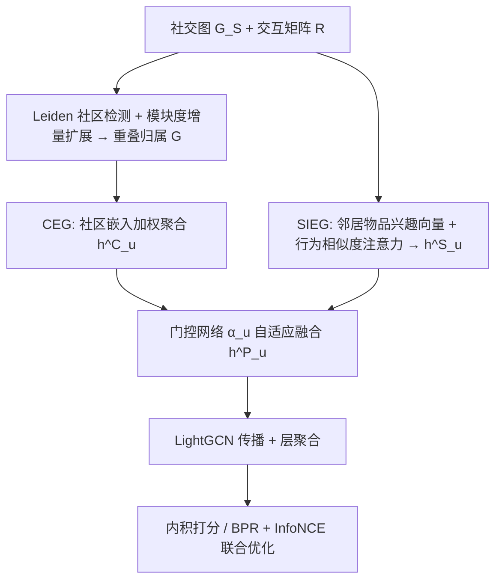
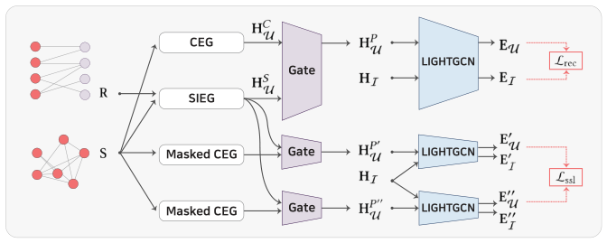

# PULSE: Socially-Aware User Representation Modeling Toward Parameter-Efficient Graph Collaborative Filtering (面向参数高效图协同过滤的社交感知用户表征建模)

- **会议/期刊**: WWW 2026
- **作者与机构**: Doyun Choi, Cheonwoo Lee, Biniyam Aschalew Tolera, Taewook Ham, Chanyoung Park, Jaemin Yoo (KAIST)
- **推荐链路定位**: 召回 (GCF 表征学习)
- **研究方向**: 社交与群组推荐 / 自监督对比学习与交互去噪
- **论文原文**: [https://arxiv.org/abs/2601.14720v2](https://arxiv.org/abs/2601.14720v2)
- **开源代码**: [https://github.com/cdy9777/PULSE](https://github.com/cdy9777/PULSE)

## TL;DR (1分钟核心速览)

图协同过滤 (GCF) 与图社交推荐为每个用户分配独立可学习嵌入，参数量随用户数线性膨胀，且社交去噪模块进一步加剧存储开销。PULSE 彻底取消显式用户嵌入，改由「重叠社区归属」与「社交邻居交互物品」两类社交信号经门控自适应融合生成用户表征，再送入 LightGCN 传播，并辅以社区掩码对比正则抑制噪声。在 Douban-Book/Yelp/Epinions 三数据集、全库排序协议下，NDCG@20 相对最强基线提升 9.0%/8.1%/8.5%，总参数较 LightGCN 减少 28%–45%。

## Background & Motivation (背景与核心矛盾)

- **主流范式**: 图社交推荐在 GCF 的用户-物品二部图上叠加社交图，用 GNN 传播多跳协同信号，代表作为 DiffNet、MHCN、GBSR、RecDiff 等。
- **前人局限**: 其一，用户嵌入参数量随 $|\mathcal{U}|$ 线性增长，大规模用户集下存储与训练成本成为瓶颈；其二，交互极度稀疏时独立用户嵌入难以充分训练，过拟合严重，而社交去噪类方法 (GBSR/DSL/SGIL) 反而引入额外参数，雪上加霜。
- **核心洞察 (Key Insight)**: 社交网络本身已蕴含两类高信息量、低维度的用户侧信号——用户所属的**重叠社区结构**（社会同质性）与**社交邻居交互过的物品**（社会影响），二者足以"拼装"出用户表征，无需为每个用户单独存一个向量。
- **本文切入点**: 以"社区嵌入 + 社交物品聚合 + 门控融合"替代显式用户嵌入表，把用户建模的参数从 $O(|\mathcal{U}|)$降到$O(|\mathcal{C}|)$（$|\mathcal{C}| \ll |\mathcal{U}|$）。

## Method (核心方法设计)

### 1. 整体框架 (Overall Architecture)

PULSE 将用户表征生成与图传播解耦：先由 CEG 模块基于用户-社区二部图聚合社区嵌入得到 $\mathbf{h}^C_u$，由 SIEG 模块沿社交图聚合邻居的"物品兴趣向量"得到$\mathbf{h}^S_u$，两者经用户自适应门控加权为$\mathbf{h}^P_u$；该矩阵与可学习物品嵌入拼接作为 LightGCN 的初始层输入，在用户-物品二部图上做$L$ 层归一化传播与层聚合，最终以内积打分，训练目标为 BPR 推荐损失 + 社区掩码 InfoNCE 自监督损失 + L2 正则。

<figure class="paper-figure" markdown="span">
  <figcaption>图2：PULSE的整体框架。CEG为每个用户融入社区信息，SIEG整合来自社交邻居的物品信息。这些不同的信号通过门控网络为每个用户自适应融合。所得用户嵌入与物品嵌入一同传入LightGCN，并使用推荐损失和额外的自监督损失进行优化。各组件更详细的图示见图3和图4。</figcaption>
</figure>

### 2. 关键设计拆解 (Key Designs)

1. **CEG：重叠社区感知的用户嵌入生成**：痛点是非重叠划分无法刻画用户同时属于朋友/家人/同事等多语义群体。做法是先用 Leiden 算法得到初始划分，再迭代地把用户加入某邻居社区——只要该加入使社区模块度增量超过固定阈值，从而得到重叠归属矩阵 $\mathbf{G}\in\{0,1\}^{m\times|\mathcal{C}|}$；随后按$\mathbf{h}^C_u=\sum_{c\in\mathcal{N}_G(u)}\alpha^C_{uc}\mathbf{h}_c$聚合可学习社区嵌入（$\alpha^C_{uc}=|\mathcal{N}_G(u)|^{-1}$）。直觉：社区数远小于用户数，且同社区用户共享参数，天然缓解稀疏用户的欠训练。

2. **SIEG：社交邻居物品感知的用户嵌入生成**：痛点是仅靠自身交互无法刻画冷启动用户，而社交边的影响力并不均等。先对每个用户做度归一化物品聚合得 $\mathbf{h}^I_u=\sum_{i\in\mathcal{N}_R(u)}\frac{\text{detach}(\mathbf{h}_i)}{\sqrt{d_R(u)d_R(i)}}$（`detach` 阻断梯度，保证物品嵌入只由 GCF 学习、不被社交信号污染）；再沿社交图聚合$\mathbf{h}^S_u=\sum_{v\in\mathcal{N}_S(u)}\frac{\alpha^S_{uv}\mathbf{h}^I_v}{\sqrt{d_S(u)d_S(v)}}$，其中注意力融合余弦相似度与 RBF 核：
$\alpha^S_{uv}=\frac{1}{2}\big(1+\text{sim}(\mathbf{h}^I_u,\mathbf{h}^I_v)\big)\exp\!\big(-\frac{1}{2\sigma^2}\|\mathbf{h}^I_u-\mathbf{h}^I_v\|_2^2\big)$。
直觉：同时约束角度对齐与模长一致，行为不相似的"伪好友"权重被压低，度归一化防止高连接度节点主导。

3. **门控融合、自监督正则与训练目标**：融合权重 $\alpha_u=\sigma_1(\sigma_2([\mathbf{h}^C_u;\mathbf{h}^S_u]\mathbf{W}_1)\mathbf{W}_2)$逐用户自适应调配两类信号。由于 CEG 的社区归属无真值标签且感受野大，易引入无关社区导致过平滑，故对$\mathbf{G}$随机掩码生成两个视图，施加 InfoNCE：$\mathcal{L}_{ssl}=-\sum_{u}\log\frac{\exp(\text{sim}(\mathbf{e}'_u,\mathbf{e}''_u)/\tau)}{\sum_{v\in\mathcal{U}}\exp(\text{sim}(\mathbf{e}'_u,\mathbf{e}''_v)/\tau)}$。总损失$\mathcal{L}=\mathcal{L}_{rec}+\lambda_1\mathcal{L}_{ssl}+\lambda_2\|\theta\|_2^2$，$\mathcal{L}_{rec}$ 为标准 BPR，负采样为均匀随机负样本；推理仅需一次前向传播，复杂度对交互数与社交边数线性。

## Experimental Setup & Evaluation Protocol (实验设置与评估协议)

- **数据集与预处理**: 沿用 GBSR 的三数据集设定，未额外做 k-core 过滤：

| 数据集 | #Users | #Items | #Interactions | 交互密度 | 社交边数 / 密度 |
| :--- | :---: | :---: | :---: | :---: | :--- |
| Douban-Book | 13,024 | 22,347 | 598,420 | 0.206% | 169,150 / 0.100% |
| Yelp | 19,539 | 22,228 | 450,884 | 0.104% | 727,384 / 0.191% |
| Epinions | 18,202 | 47,449 | 338,400 | 0.039% | 595,259 / 0.180% |

- **数据划分与防穿越 (Splitting Strategy)**: 训练/验证/测试按 **6:2:2 比例划分**；冷启动实验额外随机抽 500 用户并从训练集中移除其全部交互，仅在推理阶段评估。
- **排名评测协议 (Ranking Protocol)**: **Full-Ranking 全库排序**——将训练集中该用户所有未交互物品作为候选，指标为 Recall@{10,20,40} 与 NDCG@{10,20,40}。
- **对比基线与超参设置**: 13 个基线，含 7 个 GCF（LightGCN、SGL、SimGCL、LightGCL、GFormer、AutoCF、MixSGCL）与 6 个图社交推荐（MHCN、DSL、GDMSR、GBSR、RecDiff、SGIL）；Xavier 初始化、Adam、学习率 $10^{-3}$、batch size 4096、最多 500 epoch、以 NDCG@20 早停 (patience=15)；所有模型均经网格搜索调参。

## Key Experimental Results (实验关键数据)

### 1. 主实验对比 (Main Results)

| 方法 | Douban R@20 | Douban N@20 | Yelp R@20 | Yelp N@20 | Epinions R@20 | Epinions N@20 |
| :--- | :---: | :---: | :---: | :---: | :---: | :---: |
| LightGCN | .1311 | .1058 | .1012 | .0568 | .0619 | .0352 |
| SimGCL | .1321 | .1107 | .1092 | .0625 | .0653 | .0366 |
| AutoCF | .1389 | .1220 | .1097 | .0643 | .0601 | .0337 |
| MixSGCL | .1399 | .1155 | .1124 | .0653 | .0640 | .0369 |
| MHCN | .1412 | .1165 | .1052 | .0615 | .0649 | .0373 |
| GBSR | .1352 | .1167 | .1094 | .0618 | .0671 | .0388 |
| SGIL | .1350 | .1146 | .0977 | .0576 | .0633 | .0355 |
| **PULSE** | **.1562** | **.1330** | **.1214** | **.0706** | **.0727** | **.0421** |
| **Improv.%** | +10.6% | **+9.0%** | +8.0% | **+8.1%** | +8.3% | **+8.5%** |

冷启动 500 用户子集上，PULSE 在 Douban-Book 取得 R@20 = .0617 / N@20 = .0542，远超 LightGCN (.0307/.0274) 与 GBSR (.0279/.0265)；Yelp 上 N@20 = .0507 亦优于 GBSR 的 .0477。

### 2. 消融实验 (Ablation Study)

| 变体 | Douban N@20 | Yelp N@20 | 说明 |
| :--- | :---: | :---: | :--- |
| PULSE (full) | **.1330** | **.0706** | 完整模型 |
| w/o CEG | 显著下降 | 显著下降 | 移除社区信号，仅剩社交物品信号 |
| w/o SIEG | 显著下降 | 显著下降 | 移除社交邻居物品信号 |
| w/o 门控 (等权融合) | 下降 | 下降 | 固定 $\alpha_u=0.5$，丧失用户级自适应 |
| w/o $\mathcal{L}_{ssl}$ | 下降 | 下降 | 社区噪声与过平滑未被抑制 |

（原文消融置于附录 D，此处仅保留方向性结论，具体数值以原文为准。）

### 3. 关键实验发现 (Key Findings)

1. **稀疏场景收益最大**：Epinions 交互密度仅 0.039% 而社交密度 0.180%，PULSE 在此取得 N@20 +8.5% 的最大相对提升，说明当交互信号匮乏时，社区与社交物品信号对用户表征的补位作用最强。
2. **参数与效率双赢**：总参数较 LightGCN 减少约 36%(Douban-Book)/45%(Yelp)/28%(Epinions)；Douban-Book 上每 epoch 仅 4.1s、峰值显存 282MB，远低于 AutoCF (40.2s/3455MB) 与 GFormer (43.5s/5012MB)，收敛耗时 349s 亦优于 GBSR 的 608s。
3. **对社交噪声与低活用户鲁棒**：随机替换 5%–20% 社交边后 PULSE 始终领先 GBSR/DSL/MHCN；在交互度最低四分位组（Douban-Book <8 次、Yelp <4 次交互）仍全面优于所有基线，验证社区级信号对噪声边不敏感、行为相似度注意力可屏蔽伪好友。

## Highlights & Limitations (亮点、对比与审稿批判)

- **与代表作对比 (vs. Prior Work)**: 与 LightGCN 的本质差异在于取消用户嵌入表、以社交信号"生成"而非"学习"用户向量；与 MHCN 相比，后者用超图卷积刻画高阶社交圈但参数量更大，PULSE 用轻量 Leiden 社区检测 + 共享社区嵌入达到更优精度；与 GBSR/RecDiff 等去噪路线相比，PULSE 不额外引入去噪参数，而是让噪声在社区聚合与相似度注意力中被结构性稀释。
- **可迁移亮点**: ①"用低基数共享码本（社区/簇）替代高基数个体嵌入"的参数压缩范式可迁移至物品侧冷启动与大规模 ID 特征；②`detach` 阻断跨信号梯度污染的做法，在多源表征融合中值得复用。
- **审稿级局限批判**: ①社区检测为离线两阶段启发式，社交图动态演化时需重跑 Leiden，增量更新成本未讨论；②物品嵌入仍为 $O(|\mathcal{I}|)$ 可学习参数，作者亦在结论中承认未解决；③主实验为单次运行、未报告方差与显著性检验，且 DSL/GDMSR/RecDiff 标注为"设置不同"，横向比较的公平性存疑。

## Rating (四维评分)

- **方法创新性 (Novelty)**: ⭐⭐⭐⭐ （首次系统性地以社交信号生成替代显式用户嵌入，思路干净，但各组件均为已有技术的组合式创新）
- **评估协议与实验扎实度 (Protocol & Experiments)**: ⭐⭐⭐⭐ （三数据集 + Full-Ranking + 13 基线 + 冷启动/噪声/分桶多维分析齐全，扣分于单次运行与部分基线设置不一致）
- **写作与数学规范度 (Clarity & Rigor)**: ⭐⭐⭐⭐ （公式与模块职责清晰、复杂度分析完整，但消融与超参分析置于附录，正文自洽性略打折）
- **工业落地与复现价值 (Industrial & Practical Value)**: ⭐⭐⭐⭐⭐ （代码开源、显存与训练时间均最优、参数减半，对大规模用户集的存储成本极具吸引力）

